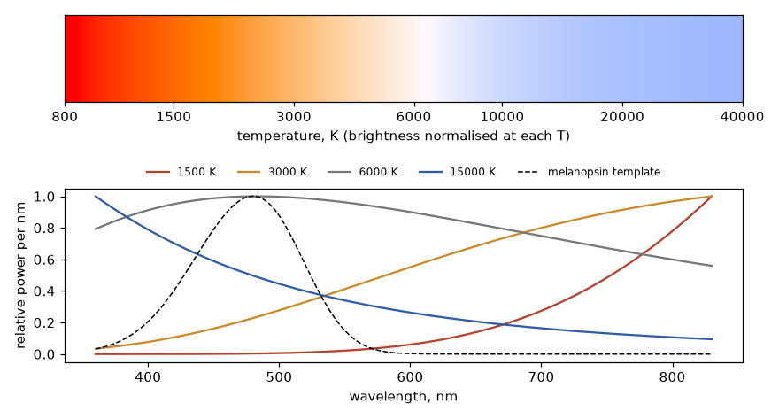

# Chemistry, gases, heat, radiation and entropy

These 21 questions come from one curious student working out how heat, molecules and light behave. Many of the
instincts are good and the fixes are usually small: a sign, a square root, a missing compressor. Three ideas run
through the whole section:

- **Energy accounting is exact.** Breaking bonds costs energy, and net heat flow is the difference of two large gross flows.
- **Most "never happens" claims are statistics, not laws.** T07 and T16 show this by counting states, and T17 says how unlikely the reverse is.
- **A short rule of thumb can hide a mechanism.** "Three carbons", "hotter is bluer" and "heavier is slower" each break somewhere useful.

Everything marked Code runs from the repo root, for example `python 03-chemistry-thermo-radiation/code/verify_t01_nox.py`.
Output blocks are copied from real runs and trimmed to the relevant lines. Sources are linked where used. Where I could
only confirm a value through a search summary or secondary page, or not at all, the text says so.

---

### T01: Does making NO₂ from N₂ and O₂ need energy for bond formation, and is it endothermic even though it "burns"?

**Status:** Derived + Code + Established

**Short answer:** The reaction is endothermic, by +66.2 kJ per mole of N₂, but not for the reason stated: bond *breaking* costs energy, and bond *forming* releases it. The triple bond is the big cost, as you said. N₂ also doesn't really burn, since burning means a self-sustaining exothermic reaction. In hot air, a flame's heat drives N₂ + O₂ → 2NO, and NO₂ forms from NO later as the gas cools.

**Starting from:** Conservation of energy (Hess's law), $\Delta G = \Delta H - T\Delta S$, ideal-gas equilibrium, and measured NIST-JANAF data for [NO](https://webbook.nist.gov/cgi/cbook.cgi?ID=C10102439&Mask=1), [NO₂](https://webbook.nist.gov/cgi/cbook.cgi?ID=C10102440&Mask=1), [N₂](https://webbook.nist.gov/cgi/cbook.cgi?ID=C7727379&Mask=1), [O₂](https://webbook.nist.gov/cgi/cbook.cgi?ID=C7782447&Mask=1), and atomic [N](https://webbook.nist.gov/cgi/cbook.cgi?ID=C17778880&Mask=1) and [O](https://webbook.nist.gov/cgi/cbook.cgi?ID=C17778802&Mask=1).

**Derivation:**

1. *The sign.* Atoms in a bond sit lower in energy than separated atoms, which is why they stay bonded. So separating them takes energy in and joining them gives energy out. No bond formation "needs" energy in this accounting, though a reaction may need energy to get started (activation energy).
2. *From formation enthalpies.* $\Delta_f H^\circ(\mathrm{NO_2}) = 33.10$ kJ/mol, so $\Delta H^\circ = 2(33.10) = +66.2$ kJ for N₂ + 2O₂ → 2NO₂. It splits into two steps: N₂ + O₂ → 2NO (+180.6 kJ), then 2NO + O₂ → 2NO₂ (−114.4 kJ).
3. *From bond energies.* From the atomic enthalpies, $D(\mathrm{N_2}) = 945.4$, $D(\mathrm{O_2}) = 498.4$ and the NO₂ atomisation energy is 937.9 kJ/mol. Then broken − formed $= 945.4 + 2(498.4) - 2(937.9) = +66.2$ kJ. This agreement is an identity, because these bond energies are built from the same data.
4. *The gap with a textbook table.* With [mean bond energies](https://gchem.cm.utexas.edu/pdf/helpsheets/bondenergies.pdf) (N≡N 945, O=O 498, N=O 607, N–O 201), treating NO₂ as O=N=O gives −487 kJ, the wrong sign. Treating it as O=N–O gives +325 kJ. Neither works because NO₂ has neither bond: its two N–O links are equivalent, intermediate in length and strength, and its odd electron is delocalised. Mean tables average over other molecules. The two sequential bond strengths differ greatly too: 306.4 kJ/mol for the first, 631.6 kJ/mol for the second, averaging 469.0.
5. *Why high temperature?* For N₂ + O₂ → 2NO, $\Delta H \approx +181$ kJ and $\Delta S = +24.8$ J/K. The equilibrium constant $K = e^{-\Delta G/RT}$ rises steeply with $T$ because the reaction is endothermic. Equilibrium NO in air is a mole fraction of about $3\times10^{-16}$ at 298 K and 0.8% at 2000 K.
6. *Direct NO₂ is never favoured.* N₂ + 2O₂ → 2NO₂ turns three gas molecules into two, so $\Delta S = -121.9$ J/K as well as $\Delta H > 0$. $\Delta G^\circ$ is positive at all temperatures and grows on heating. Heating does not favour NO₂ directly: above about 770 K, 2NO + O₂ → 2NO₂ has a positive $\Delta G^\circ$, so hot gas holds far more NO than NO₂. In the table below, NO₂/NO is $5\times10^{-3}$ at 1500 K. NO₂ accumulates when the NO made in the hot zone cools with its reverse reaction frozen.
7. *Where the triple bond shows up.* Kinetically, the bottleneck is O + N₂ → NO + N, endothermic by +313.8 kJ/mol, so its activation temperature must be at least 37 740 K. The [published fit](https://archive.nptel.ac.in/content/storage2/courses/112104033/lecture4/4_3.htm), $k = 1.8\times10^{14} e^{-38370/T}$ cm³ mol⁻¹ s⁻¹, sits just above this floor. The result is that the time scale falls from about 19 hours at 1500 K to 25 ms at 2500 K. This matches the [engineering statement](https://ansyshelp.ansys.com/public/Views/Secured/corp/v242/en/flu_th/flu_th_nox_thermal.html) that thermal NOx matters only above about 1800 K.
8. *Not burning.* At 2000 K, reaching equilibrium absorbs 728 J per mole of air, cooling it about 22 K. The reaction takes heat from the flame instead of supplying any. Remove the fuel and it stops. That also answers the question's puzzle: "in the presence of oxygen and very hot" doesn't make a reaction exothermic.

**Check:** [`code/verify_t01_nox.py`](code/verify_t01_nox.py) finds composition twice, from $K(T)$ with a root finder and by directly minimising total Gibbs energy with no $K$ anywhere. It also checks Gibbs-Helmholtz numerically.

```
treating NO2 as O=N=O  : -487 kJ (wrong sign)
treating NO2 as O=N-O  : +325 kJ (wrong size)
thermochemical value   : +66.2 kJ
   T/K   dH(net)  dG(net)   dG(N2+O2->2NO)  dG(2NO+O2->2NO2)
  298.1     66.2    102.5        173.2            -70.7
 1000.0     64.0    191.6        155.6             36.0
 2000.0     66.2    318.2        130.1            188.1
 3000.0     66.0    444.1        104.9            339.2
[PASS] net dG for N2 + 2 O2 -> 2 NO2 is positive at every T from 298 to 5000 K -- minimum 102.5 kJ
   T/K    x(NO)       x(NO2)      x(NO2)/x(NO)
  298.1  2.743e-16  1.954e-10    7.125e+05
 1000.0  3.527e-05  1.854e-06    5.257e-02
 1500.0  1.324e-03  6.732e-06    5.085e-03
 2000.0  8.044e-03  1.277e-05    1.588e-03
 3000.0  4.625e-02  2.226e-05    4.814e-04
[PASS] K route and direct Gibbs minimisation agree at 2000 K -- x_NO 8.0438e-03 / 8.0438e-03, x_NO2 1.2770e-05 / 1.2770e-05
  1500  1.324e-03    6.843e+04 s
  2500  2.330e-02    2.546e-02 s
```

**Limits:** Above about 2500 K, dissociation of O₂ and N₂ matters and is left out of the composition, so the 3000 K row is only indicative. The O atom level in the kinetics uses 298 K $\Delta H$ and $\Delta S$, and the time is an initial-rate estimate. Fuel-derived and prompt NO are ignored. The JANAF entries date from the 1960s, and small revisions wouldn't change any conclusion. The actual oxidation of NO to NO₂ in cool air also runs through ozone and radicals, which is general knowledge I did not verify or compute here.

---

### T02: If we replace H with C, "the same electronegative atom", is the inductive effect negligible?

**Status:** Code + Established + Open

**Short answer:** Carbon is not the same as hydrogen: Pauling values are about 2.55 and 2.20 (general knowledge). Replacing the H of formic acid with CH₃ changes pKa by about 1.0, which isn't negligible, but extending that alkyl group further does almost nothing. *Why* the first step is so large is under active debate: recent calculations indicate alkyl groups withdraw slightly relative to H, opposite to the standard textbook "+I" label.

**Starting from:** Measured aqueous pKa at 25 °C ([Engineering ToolBox table](https://engineeringtoolbox.com/paraffinic-benzoic-hydroxy-dioic-acids-structure-pka-carboxylic-dissociation-constant-alcohol-phenol-d_1948.html); [acrylic](https://en.wikipedia.org/wiki/Acrylic_acid) and [propiolic](https://en.wikipedia.org/wiki/Propiolic_acid) from their Wikipedia entries, which cite primary tables). $\Delta\mathrm{p}K_a$ is a free-energy difference divided by $2.303RT$.

**Derivation:**

1. *Alkyl for H.* Formic → acetic is +1.02, acetic → propanoic is +0.11, and C₃–C₆ acids differ by 0.05, about the scatter between tables. This table lists pivalic acid at 4.78 where I recall about 5.0 elsewhere (unverified), so don't over-read differences near 0.1.
2. *Hybridisation.* A carbon is not one fixed electronegativity. More s character holds electrons closer, so the attached carbon's pull rises sp³ < sp² < sp: propanoic 4.87, acrylic 4.25, propiolic 1.89. The vinyl and ethynyl acids also have conjugation with C=O, so this series isn't a pure inductive measurement.
3. *What is contested.* The classic explanation is that alkyl groups donate. Direct calculations by [Johnson, Gregory, Hughes and Elliott's group](https://pubs.rsc.org/en/content/articlelanding/2024/ob/d4ob01572j) find alkyl groups inductively withdrawing relative to H, with [no significant difference among four alkyl groups](https://pubs.rsc.org/en/Content/ArticleLanding/2025/RA/D5RA03716F), and the [RSC's education pages](https://edu.rsc.org/staffroom/exam-board-issues-unprecedented-statement-about-the-inductive-effect/4021182.article) note this is unsettled for school-level use and that the modelling conditions may not transfer to reactions in solution. I read abstracts and summaries, not full texts. A published [response letter](https://orca.cardiff.ac.uk/190250/) shows the debate is live.
4. *Medium matters.* In the gas phase alcohol acidity runs t-BuOH > i-PrOH > EtOH > MeOH, the reverse of the solution order, attributed to [polarisability in the gas phase and solvation in water](https://chem.libretexts.org/Bookshelves/Organic_Chemistry/Supplemental_Modules_(Organic_Chemistry)/Alcohols/Properties_of_Alcohols/Acidities_of_Alcohols) (Brauman and Blair). So a pKa shift in water doesn't by itself reveal an intrinsic electron push. This missing piece is what a distance-only picture leaves out.

**Check:** [`code/verify_t02_t05_inductive.py`](code/verify_t02_t05_inductive.py) tests the data pattern.

```
  H->CH3 on the carboxyl: dpKa = +1.02
  CH3->C2H5:              dpKa = +0.11
  spread of C3-C6 acids:  0.05
[PASS] first alkyl matters, later ones do not (factor over 5)
    4.87 -> 4.25 -> 1.89
[PASS] acidity rises with s character
```

**Limits:** This code compares data; it can't decide the mechanism. The acids' pKa values come from compilations of varying age, with typical scatter of a few hundredths.

---

### T03: Is the effect seen only on a continuous chain, or on branches too?

**Status:** Code + Established

**Short answer:** Branches too. Nothing about a substituent's effect knows what we call the "main chain". What matters is how far away the substituent is, and how many routes or dipoles act. Multiple substituents on branches add, with diminishing returns.

**Starting from:** The pKa data in T02; empirical additivity as a hypothesis to test.

**Derivation:**

1. *Same distance, different skeleton.* Cl next to the carboxyl gives shifts of 1.89, 2.04 and 1.96 in acetic, propanoic and butanoic acids. One carbon farther gives 0.89 and 0.77. The extra carbon elsewhere matters little.
2. *Several branches.* Replacing H with Cl on the α-carbon gives 1.89, 3.41 and 4.10. Simple addition predicts 1.89, 3.78, 5.67. So the second Cl adds about 80% as much, and the third about 36% as much as the first. Interaction among chlorines and solvation cause the shortfall; an additive model is only a first approximation.
3. *Cages.* [Roberts and Moreland (1953)](https://authors.library.caltech.edu/records/0t4ah-6fv61) measured 4-substituted bicyclo[2.2.2]octane-1-carboxylic acids in 50% ethanol, where three saturated routes join the substituent to the acid. They found effects comparable to meta and para benzene substituents, though resonance through the cage is impossible, and an electrostatic cavity model gave qualitative agreement. A multi-path count from the fit in T04 gives a Cl-equivalent shift of about 0.37 from three routes of 0.12, but the numeric data weren't accessible for comparison here. A cage has its substituent's dipole also facing the acid directly through space, so it doesn't separate "paths adding" from "field acting".

**Check:** [`code/verify_t02_t05_inductive.py`](code/verify_t02_t05_inductive.py), section T03.

```
  Cl on C2: acetic 1.89, propanoic 2.04, butanoic 1.96
  Cl on C3: propanoic 0.89, butanoic (Cl-bearing carbon also carries CH3) 0.77
[PASS] Cl shift at fixed distance depends weakly on the rest of the skeleton (spread < 0.2)
    1 Cl: dpKa = 1.89, additive prediction 1.89, ratio 1.00
    2 Cl: dpKa = 3.41, additive prediction 3.78, ratio 0.90
    3 Cl: dpKa = 4.10, additive prediction 5.67, ratio 0.72
```

**Limits:** Few data points, and I could not confirm the cage pK values. The dichloro and trichloro pKa values vary by up to 0.09 between tables (a [secondary summary](https://alliancechemical.com/blogs/news/inductive-effect-textbooks-wrong-acetic-acid-2026) lists 1.26 and 0.64).

---

### T04: If we add carbons above and below a carbon, does the effect reach only those four or stretch to outer chains?

**Status:** Code + Established + Open

**Short answer:** It isn't limited to three carbons or those four. The measured acidity shift falls by a steady factor of about 0.39 per carbon, so it never strictly stops. It passes below ordinary measuring and table scatter (around 0.05 pKa) by about the fifth carbon. "Three carbons" is where it stops being chemically interesting. Carbons above and below at the same distance share the same effect, in the sense described in step 3.

**Starting from:** [pKa of 2-, 3- and 4-chlorobutanoic acids](https://openstax.org/books/organic-chemistry/pages/20-4-substituent-effects-on-acidity) (2.86, 4.05, 4.52) and butanoic acid (4.82); a model $\Delta\mathrm{p}K_a(n) = A f^{\,n-1}$ with $n$ the number of carbons from the carboxyl.

**Derivation:**

1. *The decay.* Shifts are 1.96, 0.77 and 0.30. The two ratios are 0.393 and 0.390, nearly equal, so a geometric decay describes these points. Allowing $\pm0.02$ pKa errors, $f = 0.390 \pm 0.019$.
2. *No cut-off.* Extrapolating, $n = 4$ gives 0.118 (Ka up 31%), $n = 5$ gives 0.046, and $n = 6$ gives 0.018. This is an extrapolation from three points, not a measurement.
3. *Is the effect passed along the bonds at all?* Here your picture needs care. An acidity shift compares the acid with its charged anion. A simple through-space model, the C–Cl dipole acting on the carboxylate charge averaged equally over staggered chain shapes, with one fitted dielectric constant, gives 1.93, 0.81 and 0.35. That nearly matches the data. So the decay doesn't prove a relay through bonds. Calculations in [Elliott et al. (2026), J. Chem. Educ.](https://doi.org/10.1021/acs.jchemed.6c00141) reportedly find charge shifts in neutral molecules limited to about one bond, with the longer-range acidity trend arising in the charged carboxylate and its solvent. I could only read [press](https://sciencedaily.com/releases/2026/09/260913082157.htm) and a [secondary summary](https://alliancechemical.com/blogs/news/inductive-effect-textbooks-wrong-acetic-acid-2026) of this, and [a published reply](https://orca.cardiff.ac.uk/190250/) exists. So the mechanism counts as Open here, while the data are not in doubt.

**Check:** [`code/verify_t02_t05_inductive.py`](code/verify_t02_t05_inductive.py). Three treatments of chain shape were tried and all are shown, because the choice decided the fit. I chose equal weights after seeing the misfits, so this shows electrostatics is *sufficient* and does not prove it correct. The model also has a surprisingly small $\varepsilon$, a known feature of treating a molecule's low-polarity interior and nearby water as one number.

```
  successive ratios: 0.393, 0.390
  f with pKa errors of +/-0.02: 0.390 +/- 0.019
    n = 4: dpKa = 0.118  Ka ratio = 1.31
    n = 5: dpKa = 0.046  Ka ratio = 1.11
  boltzmann: eps =  4.60, shifts n=1..5 = 1.70, 0.91, 0.65, 0.64, 1.63, worst error at n=1..3 = 0.35
  anti     : eps =  4.95, shifts n=1..5 = 1.58, 1.19, 0.52, 0.42, 0.25, worst error at n=1..3 = 0.42
  equal    : eps =  4.05, shifts n=1..5 = 1.93, 0.81, 0.35, 0.09, 0.01, worst error at n=1..3 = 0.05
  data     :               shifts n=1..3 = 1.96, 0.77, 0.30
```

**Limits:** Three aqueous points can't separate mechanisms. The Boltzmann variant's rising values at long range are a model artefact: it lets folded shapes bring Cl close to the charge with no steric or solvation penalty.

---

### T05: Double bonds are shorter, so can they stretch the effect to four carbons?

**Status:** Code + Established + Open

**Short answer:** Partly, but mostly not for the reason you gave. A C=C link does seem to transmit better than CH₂CH₂, so the direction of your guess is right. In a simple model, shortening the bond by 0.2 Å gives only a factor of 1.08, while a whole extra carbon of reach would need 2.6. The bigger contributions are likely the rigid geometry and the more polarisable π electrons. Resonance is a separate effect that really can reach far along a conjugated chain.

**Starting from:** The electrostatic model from T04 with geometry changed, and published transmission comparisons in reaction series.

**Derivation:**

1. *Testing the idea directly.* Take Cl–CH₂–CH₂–CH₂–COOH, and change only the C2–C3 length from 1.53 to 1.33 Å. The computed shift goes 0.348 → 0.375 (factor 1.08). Distance can't do much because 0.2 Å is small against a typical 4.5 Å separation.
2. *Geometry.* The real alkene, Cl–CH₂–CH=CH–COOH (E), has no folded shapes. Its mean Cl-to-charge distance is actually *longer* (5.46 vs 4.45 Å), yet the shift rises to 0.457 in this model, because its dipole stays aligned while the saturated chain's shapes partly cancel. Shorter bonds and a greater reach aren't the same thing.
3. *Experiment.* Literature on Hammett reaction constants ranks side-chain transmission as [OCH₂ > SCH₂ > CH=CH > SeCH₂ > CH₂CH₂](https://doi.org/10.1139/v60-338). [Chapman, Newman, Shorter and Wall (1976)](https://pubs.rsc.org/en/Content/ArticleLanding/1976/P2/P29760000847) report $\rho(\text{cinnamic}) = 0.39\,\rho(\text{benzoic})$, and the phenylacetic relation $\rho = 0.60(\rho_{\text{benzoic}} - 0.25)$, or 0.45 at $\rho_{\text{benzoic}} = 1$. So in that system CH=CH (two carbons) passes about as much as one CH₂. Those are reactions with diazodiphenylmethane in alcohols, seen through search abstracts rather than full papers. I found no measured pKa for 4-chlorocrotonic acid (only a [predicted value](https://www.chemicalbook.com/ChemicalProductProperty_EN_CB44650214.htm), not used).
4. *What else changes.* An sp² carbon is itself more electronegative than sp³, and π electrons polarise easily, neither of which is in my point-charge model. How these divide up is not settled here.
5. *Do not call resonance induction.* In para-substituted benzoic acids ([OpenStax Table 20.4](https://openstax.org/books/organic-chemistry/pages/20-4-substituent-effects-on-acidity)), p-OCH₃ and p-OH raise the pKa even though oxygen is more electronegative than carbon, since oxygen donates π electrons through the ring. p-NO₂, by contrast, gives 0.78. For Cl, meta (0.36) beats para (0.20), but there distance and para resonance donation point the same way, so that pair can't separate them. Conjugation can carry an effect through many bonds with little fall-off, but that is resonance.

**Check:** [`code/verify_t02_t05_inductive.py`](code/verify_t02_t05_inductive.py), sections T05 and Resonance.

```
  Cl-CH2-CH2-CH2-COOH, all staggered conformers           : dpKa = 0.348
  same, C2-C3 shortened from 1.53 to 1.33 A, nothing else  : dpKa = 0.375
  Cl-CH2-CH=CH-COOH (E): shorter, planar, no folding       : dpKa = 0.457
  saturated: Cl to charge centre min/mean/max = 2.68 / 4.45 / 5.84 A
  E-alkene : Cl to charge centre min/mean/max = 5.29 / 5.46 / 5.80 A
[PASS] bond shortening alone cannot supply a whole extra carbon of reach (needs factor 1/f = 2.6) -- factor 1.08 vs 2.56
    p-NO2   3.41  dpKa = +0.78
    p-OCH3  4.46  dpKa = -0.27
[PASS] p-OCH3 and p-OH weaken the acid despite electronegative O (resonance donation beats induction)
```

**Limits:** The model has no π polarisability and no conformer energetics, and borrows its $\varepsilon$ from saturated acids. The C–Cl dipole (1.87 D) is general knowledge, taken from CH₃Cl. No direct aqueous pair for this comparison was confirmed.

---

### T06: Graham's law as people escaping a fire through a door

**Status:** Derived + Code

**Short answer:** You're right that lighter molecules escape faster, and that it's about how fast they move. Two things change. The rate goes as $1/\sqrt{M}$, not $1/M$, and molecular size doesn't enter when the hole is small compared with the mean free path. No one has to squeeze or queue. Molecules simply arrive at the hole at random, and lighter ones arrive more often.

**Starting from:** An ideal gas in equilibrium with a Maxwell velocity distribution, $\tfrac12 m \langle v_x^2\rangle = \tfrac12 kT$, and a hole small enough that the gas near it stays undisturbed.

**Derivation:**

1. *Count arrivals.* Molecules with $v_x > 0$ within a distance $v_x\,dt$ of area $A$ reach it in time $dt$. The rate is
$$\Phi = nA\int_0^\infty v_x\,f(v_x)\,dv_x = nA\sqrt{\frac{kT}{2\pi m}} = \tfrac14 n\bar v A,\qquad \bar v = \sqrt{\frac{8kT}{\pi m}}.$$
2. *Graham's law.* At fixed $n$, $T$ and $A$, $\Phi \propto 1/\sqrt{m}$, so rate$_1$/rate$_2 = \sqrt{M_2/M_1}$. Helium against O₂: $\sqrt{32/4} = 2.83$, not 8.
3. *Where the square root comes from.* All species at the same temperature carry the same average kinetic energy. So a four-times-heavier molecule isn't four times slower, only twice. Heavier "people" here aren't weaker. They have equal energy.
4. *Size.* No diameter appears above. Even a sphere that must clear the rim by $d/2$ changes the rate only by $(1 - d/2a)^2$: for a 0.3 nm molecule at a 1 µm hole, that's $3\times10^{-4}$. Your "fit through the door" idea is right only when hole and molecule are comparable, which is a different regime (sieving).
5. *A fairer analogy.* A very wide, dark room with one small doorway where people wander at random, never queueing, each carrying the same energy. A crowd rushing a door, in contrast, is collision-controlled. That is the wide-hole regime in step 6.
6. *When the law fails.* If the hole is wider than the mean free path, molecules push each other through as a flow and the light species drags the heavy one along. Simulated separation falls from about 4 to 1.5 for masses 1 and 16.
7. *Bonus.* Escapers carry mean energy $2kT$ instead of $\tfrac32 kT$, because fast molecules arrive more often. The gas left behind cools. T07's evaporation has the same logic.

**Check:** [`code/verify_t06_effusion.py`](code/verify_t06_effusion.py) traces particles wall to wall with no use of the rate formula. It found something I had not built in: with perfect mirror walls and no collisions, the rate falls below the formula, because orbits able to reach the hole get used up. So the law needs something to keep the gas mixed. Diffuse walls supply that here, and collisions do in a real gas.

```
  mass   escapes   rate      kinetic theory n vbar A/4   ratio
      1     3776    4.720        4.700             1.004
      4     1820    2.275        2.350             0.968
     16      909    1.136        1.175             0.967
     32      659    0.824        0.831             0.991
  fitted exponent of rate against mass = -0.5063 +/- 0.0100 (Poisson)
[PASS] exponent excludes the -1 of 'rate inversely proportional to mass'
  rate / (n vbar A / 4) by mass: 0.83, 0.89, 0.86, 0.94, 1.00, 0.96
[PASS] escapers carry 2 kT, not 1.5 kT -- 1.976 kT
  d = 0.001 and 0.05, hole radius 0.05: escapes 1856 and 467, ratio 3.974 +/- 0.206, geometry alone 3.920
  no collisions (Kn infinite): escapes 1879 / 458, separation 4.10 +/- 0.21 (sqrt law 4.00, 1/M law 16.00)
  hard spheres: N = 10000, d = 0.033, volume fraction 0.19, mean free path 0.021, hole diameter 0.40, Kn = 0.052
    escapes 524 / 342, separation 1.53 +/- 0.11
```

**Limits:** Initial velocities are drawn from Maxwell's distribution, so the code tests the flux law and not that distribution. Rim clearance is a geometric input, so part C isn't independent evidence. The hard-sphere run is dense (volume fraction 0.19) with a hole large against the box, and its 1.53 is illustrative of the trend, not a prediction. Particles are re-inserted after escape to hold the gas steady, unlike a real leaking vessel. Real molecules aren't hard spheres, and a very narrow channel behaves differently from a thin-wall hole.

---

### T07: Hot baths, oily hands and a cooling bottle, with numbers

**Status:** Derived + Code + Established

**Short answer:** The student's mental picture is good, and the bottle's entropy does fall. The fix is in how that is stated: entropy isn't passed from bottle to world like a parcel. The room's gain must exceed the bottle's loss, which is provable, and for this bottle the world gains a net +13.4 J/K. The bath is mainly about the rare high-energy tail rather than faster gas. And bubbles on oily hands need surfactant.

**Starting from:** Kinetic theory, Boltzmann factors, $dS = \delta Q/T$ for a body at uniform $T$, $S = k\ln\Omega$, and [NIST water data](https://webbook.nist.gov/chemistry/fluid/) (IAPWS-95).

**Derivation:**

1. *Beaten-up molecules.* Air at 300 K and 1 atm: mean speed 468 m/s, mean free path 67 nm, about $7\times10^9$ collisions per molecule per second, and about $2.9\times10^{23}$ wall hits per cm² per second (using a textbook kinetic diameter of 0.37 nm).
2. *The bath.* From 20 to 40 °C, vapour speed rises only 3.4%, as $\sqrt T$. But vapour pressure rises by 3.16 times, as measured by NIST (2.3393 and 7.3849 kPa). Escaping needs an energy near 17.5 $kT$ per molecule, so only the tail leaves, and the tail's size is exponentially sensitive: $e^{L/R\,(1/T_1 - 1/T_2)} = 3.15$, using the latent heat alone. Those leaving take the top energies, so the rest cools. Evaporating 1 g cools 1 kg of water about 0.57 K.
3. *Oily hands.* Intermolecular forces are the right idea. Water molecules attract each other more than they do oil, so oil stays separate. Soap molecules have a water-liking head and an oil-liking tail, and gather at surfaces and around oil droplets. Surface tension drops from 72.8 mN/m to about 38 mN/m with SDS at its critical micelle concentration near 8 mM (literature-typical values; [a study like this](https://www.nepjol.info/index.php/cognition/article/view/55401) measures them, though I confirmed the numbers only through a search summary). Lower tension alone doesn't make a film last. What stabilises it is film elasticity (Gibbs–Marangoni): a thinning spot has less surfactant, higher tension, and pulls liquid back. This last point is general knowledge, not verified here. Oil itself tends to destabilise foams, so greasy hands often foam poorly until enough soap is used.
4. *The bottle's sign.* A body of heat capacity $C$ cools from $T_i$ to $T_r$ in a large room at $T_r$:
$$\Delta S_\text{bottle} = C\ln\frac{T_r}{T_i},\qquad \Delta S_\text{room} = \frac{C(T_i - T_r)}{T_r},$$
$$\Delta S_\text{total} = C\left[\frac{T_i}{T_r} - 1 - \ln\frac{T_i}{T_r}\right] \ge 0,$$
since $\ln x \le x - 1$ with equality only at $x = 1$. So whatever the starting temperature, hot or cold, the total rises. If the bottle were colder than the room, its own entropy would *rise* as it warmed, so "decreases in the bottle" isn't universal. 0.50 kg of water from 60 to 25 °C gives −232.31, +245.70 and a total of +13.38 J/K. The bottle's entropy drop and the world's net gain are different numbers.
5. *Why, microscopically.* Counting microstates of two Einstein solids shows the equal-temperature split has $10^{200}$ times more ways, even at just 4400 oscillators. Random quantum exchange, with no entropy in its rules, finds it. That's what "increase in entropy" means.

**Check:** [`code/verify_t07_entropy.py`](code/verify_t07_entropy.py) does exact counting, random exchange, a stepped dQ/T integral and a random sweep of temperatures.

```
  speed gain 20 -> 40 C: 3.4 percent
  Boltzmann-factor prediction of vapour pressure ratio: 3.15; NIST: 3.16
  barrier 3.0 kT: fraction leaving 0.0142, KE of those left 1.4507 kT vs start 1.4999 kT
  dS/k: bottle -436.9, room +896.4, total +459.5
  equilibrium is e^460 = 10^200 times more probable than the start
  random exchange: bottle quanta over time [2000, 551, 564, 556, 587], final 529; exact maximum 544
  dS bottle -232.31 J/K, dS room +245.70 J/K, dS total +13.38 J/K
  Newton cooling stepped numerically: dS bottle -232.31, room +245.70, total +13.39 J/K
[PASS] total entropy change >= 0 for 200000 random start and room temperatures, hot or cold
```

**Limits:** Constant heat capacity, a room large enough not to warm, and uniform bottle temperature. The Einstein solids are models for equal-spaced quanta, not water. The vapour-pressure estimate uses a mean latent heat and ignores vapour non-ideality. A real bath's cooling also depends on air currents and humidity.

---

### T08: A fridge's liquid draws heat from an apple, boils to "steam", and is condensed

**Status:** Derived + Code + Established

**Short answer:** You have the core idea right: a very low-boiling liquid is colder than the food, takes heat from it and boils. Three corrections: it's vapour rather than steam (steam means water); the heat goes through the cabinet's air to the evaporator rather than directly from the apple; and the essential missing piece is the **compressor**, because cold vapour can't dump heat into a warmer room. Work is required, by the second law. The expansion valve then closes the loop.

**Starting from:** First and second laws per kg of refrigerant, steady flow, and [NIST fluid data](https://webbook.nist.gov/chemistry/fluid/) for R-134a ([Tillner-Roth and Baehr 1994](https://doi.org/10.1063/1.555958)) and isobutane R-600a.

**Derivation:**

1. *Cycle.* (1→2) Compressor raises vapour pressure and temperature. (2→3) Condenser: vapour condenses, releasing heat to the room. (3→4) Expansion valve: pressure drops, some liquid flashes and the mix becomes cold. (4→1) Evaporator: liquid boils, taking heat from the cabinet. Each step has a steady-flow energy balance, so $q_L = h_1 - h_3$, $w = h_2 - h_1$ and $q_H = h_2 - h_3$.
2. *Why compress.* R-134a at 0.10 MPa boils at −26.4 °C: your "very low boiling point". At 0.20 MPa it is at −10.1 °C, still colder than a 25 °C room, so it can't lose heat to that room. It condenses against 25 °C air only above about 0.67 MPa. Pressure sets boiling point, and that's what the compressor exploits.
3. *Second law.* Moving $Q$ from cold $T_L$ to hot $T_H$ with no work gives $\Delta S = Q/T_H - Q/T_L < 0$, which is forbidden. With work $W$, heat out is $Q + W$, and $\Delta S \ge 0$ needs $W \ge Q(T_H/T_L - 1)$, so
$$\mathrm{COP} = \frac{Q}{W} \le \frac{T_L}{T_H - T_L}.$$
4. *Numbers.* For evaporation at −10 °C and condensing at 39.4 °C, R-134a gives Carnot 5.32, ideal cycle 4.09 and 2.86 with a compressor of assumed isentropic efficiency 0.70. Between the actual 4 °C cabinet and 25 °C room, the limit would be 13.2. The gap comes from finite temperature differences in heat exchangers, valve throttling and compressor losses.
5. *The apple.* A 0.20 kg apple (taking $c \approx 3550$ J/kg/K, as 85% water) cooled from 30 to 4 °C gives up 18.5 kJ. That boils about 135 g of circulating refrigerant, takes 6.4 kJ of compressor work, and puts 24.9 kJ into the room. A fridge warms its room overall.

**Check:** [`code/verify_t08_fridge.py`](code/verify_t08_fridge.py) uses tabulated enthalpies and entropies only. Before using them it tests the copied data against the exact relation $h_v - h_l = T(s_v - s_l)$. An earlier ideal-vapour Clausius–Clapeyron check I wrote failed at 5%, which turned out to be real vapour non-ideality, not a bad table, so both are now reported.

```
  worst mismatch over 12 R-134a rows: 0.010 percent
  R-134a fridge: evaporate -10.1 C, condense 39.4 C
    q_L = 137.1 kJ/kg, w(isentropic) = 33.5 kJ/kg, T after compression 45.6 C
    flash fraction after expansion valve x4 = 0.334, entropy gain in valve 0.0246 kJ/kg/K
    COP Carnot 5.32, COP ideal cycle 4.09, COP with eta = 0.7 compressor 2.86
  R-600a fridge: evaporate -12.1 C, condense 41.3 C
    COP Carnot 4.89, COP ideal cycle 3.74, COP with eta = 0.7 compressor 2.62
  Moving q_L = 137 kJ/kg from a 4 C cabinet to a 25 C room with no work: dS = -0.0348 kJ/kg/K
  smallest work that makes dS = 0: 10.4 kJ/kg (reversible machine between 4 C and 25 C), COP 13.2
  It only condenses against 25 C air if its saturation temperature exceeds 25 C: pressure above about 0.67 MPa
  heat to remove 18.5 kJ; refrigerant circulated 135 g; compressor work 6.4 kJ; heat dumped to the room 24.9 kJ
```

**Limits:** The 2.86 is a modelled COP with an assumed efficiency, not a measurement of a real appliance. Pressure drops, superheat and subcooling are ignored. For isobutane, compression from saturated vapour would end at 97.5% quality in this idealisation; real units superheat their suction gas. Entropy interpolation in the superheat table is linear.

---

### T09: Why not make red or warm bulbs, and would they help sleep?

**Status:** Derived + Code + Established

**Short answer:** We can and do: red and amber bulbs exist, because LEDs, sodium lamps and filters aren't limited to thermal glow. For hot bodies the real order is **red, orange, yellow-white, white, blue-white**, with no green or violet stage at any temperature. On sleep: dim, warm evening light is well supported for reducing melatonin suppression, but evidence that coloured bulbs improve sleep *quality* is weak and mixed, and I found no good trial of red room lighting specifically. The temperature argument doesn't apply to bulb colour, since colour doesn't change room heat in any meaningful way.

**Starting from:** Planck's law, the CIE 1931 colour matching functions through the [Wyman, Sloan and Shirley (2013)](https://jcgt.org/published/0002/02/01/) Gaussian fit, a melanopsin curve from the [Govardovskii et al. (2000)](https://doi.org/10.1017/s0952523800174036) template with peak 480 nm, and cited human studies.



**Derivation:**

1. *Why not rainbow order.* A thermal spectrum is one broad hump, so colour isn't set by where the peak is. As $T$ rises, the visible slice just tilts from red-heavy to blue-heavy. The ratio of blue to red response rises monotonically, so the path never turns back.
2. *Why no green.* At 5467 K the Planck peak sits at 530 nm, green, yet purity is only 0.09: nearly white. The hump is wider than the visible band, covering red and blue as well. The sRGB green channel never exceeds both others at any temperature (largest ratio 0.946).
3. *Why no violet.* As $T\to\infty$, the visible part tends to Rayleigh–Jeans, $\lambda^{-4}$, whose colour is a limit at $(x, y) = (0.240, 0.234)$: dominant wavelength near 473 nm, a pale blue. So heating further never gets past that blue-white. "Violet stars" don't exist as blackbodies. The student's order, with blue before white, is corrected too: white (near 6000–6500 K) comes before blue-white.
4. *Red thermal lamps fail on efficiency.* A blackbody at 1000 K gives 0.00015 lm/W and at 2700 K gives 12 lm/W. So a red-hot filament is almost entirely infrared. Red lights are made another way: an LED emits near one wavelength because of its band gap, a sodium lamp from one atomic line, and a filter on a 2700 K bulb just removes the rest (keeping about 27% of its lumens in this model).
5. *Light and sleep.* Melanopsin cells drive circadian timing with peak sensitivity [near 480 nm](https://journals.plos.org/plosbiology/article?id=10.1371/journal.pbio.3001571). Per lumen, my template gives a 630 nm LED about 0.1% of the drive of 6500 K light, and a 2700 K bulb about 39%. Evidence by strength:
   - *Strong for the physiological marker.* Controlled human studies show evening light suppresses and delays melatonin. In [Chang et al. (2015)](https://pmc.ncbi.nlm.nih.gov/articles/PMC4313820), reading on a light-emitting device for about 4 h suppressed melatonin by over 55% and delayed its onset over 1.5 h, compared with a printed book. Sleep onset took about 10 minutes longer. That study had only 12 healthy young adults.
   - *Consensus guidance.* [Brown et al. (2022)](https://journals.plos.org/plosbiology/article?id=10.1371/journal.pbio.3001571) recommend at most 10 lux melanopic equivalent in the 3 hours before bed and at most 1 lux in the sleep environment, preferring white light depleted in short wavelengths. So **dimness counts as much as colour**: bright red light is not automatically fine, and the paper gives no specific red recommendation.
   - *Weak or mixed for sleep outcomes.* Blue-blocking glasses are the closest tested intervention. A [2025 meta-analysis of crossover trials](https://www.ncbi.nlm.nih.gov/pmc/articles/PMC12668929/) found at most small actigraphic improvements, a [2021 review](https://pubmed.ncbi.nlm.nih.gov/34030534/) saw support in people with sleep disorders or jet lag, and a Cochrane review is [reported](https://www.yahoo.com/news/blue-light-blocking-glasses-dont-010100352.html) as finding little benefit. Those are glasses rather than bulbs, and I read the Cochrane result through news coverage.
6. *Heat and sleep.* Your physiology is partly right. Core temperature falls toward sleep, and a [hot room impairs sleep](https://pmc.ncbi.nlm.nih.gov/articles/PMC3427038/). But the heat leaves through warm skin. Kräuchi et al. (1999, Nature 401, 36–37, described in that review) tie fast sleep onset to warmed hands and feet relative to the torso, so colder isn't simply better. Later work on external foot warming appears mixed, which I saw only in search summaries. And a 5 W lamp warms a room by about 0.05 K (assuming 107 W/K of loss), whichever colour it is. The two channels are separate: colour acts on the eye, and power acts on the room. A sleeping person, at about 80 W, adds 16 times more heat.

**Check:** [`code/verify_t09_blackbody_colour.py`](code/verify_t09_blackbody_colour.py) runs Planck through the fit to chromaticity. Anchors: equal-energy white, and Planck at 2856 K against CIE Illuminant A, whose chromaticity (0.44758, 0.40745) is from general knowledge.

```
  Planck at 2856 K: xy = (0.4464, 0.4085); CIE Illuminant A (0.44758, 0.40745)
   T/K    x      y     dominant nm  purity  hue deg   linear R:G:B      peak nm
   1000 0.642 0.355       604      1.00       2    1.00: 0.03:-0.02      2898
   1900 0.535 0.414       590      0.86      15    1.00: 0.24:-0.00      1525
   2700 0.459 0.412       585      0.64      22    1.00: 0.42: 0.10      1073
   4500 0.360 0.364       581      0.23      28    1.00: 0.73: 0.50       644
   6500 0.313 0.324       440      0.02     308    1.00: 0.94: 0.99       446
  10000 0.281 0.288       474      0.16     227    0.61: 0.70: 1.00       290
  30000 0.250 0.249       473      0.31     227    0.36: 0.50: 1.00        97
  T -> infinity (Rayleigh-Jeans) xy = (0.240, 0.234), dominant 473 nm
  samples in the green sector: 0 of 500
  samples in the violet sector: 6 of 500, at T = 6445 to 6922 K, highest purity there 0.036
  bodies with purity above 0.05: hue 0-28 deg (red-orange) or 227-240 deg (blue)
  T whose Planck peak is at 530 nm (green) = 5467 K: purity 0.09, xy = (0.333, 0.342)
   1000 K:   0.00015 lumens per watt radiated
   2700 K:      12.4 lumens per watt radiated
  red LED 630 nm (FWHM 20)             (0.707,0.293)     663    1.00     0.0010
  incandescent 2700 K                  (0.459,0.412)     585    0.64     0.3889
  5 W LED             : room warms by 0.05 K at steady state (6.7 + 100 W/K loss)
```

**Limits:** The Gaussian fit strays from true CIE data in the far tails, so dominant wavelength is searched only over 430–680 nm and is poorly resolved above about 620 nm (hence "663" for a 630 nm LED). The 6500 K line's hue and dominant wavelength are meaningless at near-zero purity: the locus passes white on the magenta side, and those six "violet sector" samples are visually white. Perceived colour also depends on adaptation and brightness; a dim 1000 K body looks deep red, and real stars aren't perfect blackbodies. The melanopsin curve ignores lens filtering and age, and cones also contribute, so the ratios are approximate and aren't the CIE S 026 calculation. Room loss is an assumed round figure. I'm not giving medical advice: chronic sleep trouble deserves proper care.

---

## Radiation coming back: what is law and what is odds

T10 to T17 share one framework. These distinctions matter more than any number:

| Claim | Kind |
|---|---|
| Energy is conserved; a convex body in vacuum never intercepts its own rays | Strict, within tested physics and ray optics |
| Absorptivity = emissivity at each wavelength, direction, polarisation | Strict in equilibrium for reciprocal materials; magneto-optic exceptions exist |
| Microscopic rates of absorption and emission are linked (detailed balance) | Strict consequence of microscopic physics plus equilibrium |
| Net heat flows hot to cold; entropy rises; emitted light does not reassemble | Overwhelming probability, not a strict law |
| Recurrence happens | Theorem, *only* for isolated bounded systems |

### T10: Does an object later reabsorb the radiation it emitted?

**Status:** Derived + Code

**Short answer:** A convex object in empty space never does. A concave one does directly: half of what the inner surface of a hemispherical cup emits lands back on the cup. In a room, walls and air send energy back as well, though these are different photons. Photons of the same mode are identical, so "the same radiation" only has meaning as energy going back and forth.

**Starting from:** Straight-line rays in vacuum; Lambert's cosine law for a diffuse surface; view factor reciprocity $A_i F_{ij} = A_j F_{ji}$; geometric optics.

**Derivation:**

1. *Convex.* A ray leaving a sphere with $\hat n\cdot\hat d \ge 0$ meets the sphere again only at $t = -2\,\vec p\cdot\hat d \le 0$, in the past. So self-absorption is exactly zero.
2. *Cup.* All radiation leaving the inner surface hits either the cup or its opening. The opening is flat, so it sends nothing to itself and all of its view is the cup, giving $A_\text{open}\cdot 1 = A_\text{cup} F_{\text{cup}\to\text{open}}$, and thus $F_\text{self} = 1 - \pi R^2/2\pi R^2 = \tfrac12$.
3. *Cavity effect.* Each return gives another chance to absorb, so the opening's effective emissivity is $\varepsilon/[1 - (1-\varepsilon)F]$. Self-absorption reduces net loss relative to the surface's area, which is why holes look black and why a cavity approaches a blackbody.

**Check:** [`code/verify_t10_t17_radiation.py`](code/verify_t10_t17_radiation.py), part A, traces rays.

```
  convex sphere: fraction of rays that return to the body = 0.000000
  hemispherical cup, inner surface: self view factor by rays = 0.4998; reciprocity gives 1 - A_open/A_cup = 0.5
  grey cup surface emissivity 0.05: opening looks like emissivity 0.0962; multiple-reflection formula eps/(1-(1-eps)F) = 0.0952
  grey cup surface emissivity 0.90: opening looks like emissivity 0.9472; multiple-reflection formula eps/(1-(1-eps)F) = 0.9474
```

**Limits:** Diffuse grey surfaces and ray optics. When features approach the wavelength (about 10 µm for body heat), diffraction and near fields matter, and those aren't modelled.

---

### T11: Does radiation need to be "recognised" by the object to be reabsorbed?

**Status:** Derived + Code + Established

**Short answer:** No. Light has no memory of where it came from, and an object doesn't check. Absorption depends only on the light's wavelength, direction and polarisation, and on what the material can do at that moment. There's a true kernel in the idea, though: matter absorbs best at frequencies it can also emit, because the same transitions do both.

**Starting from:** The second law for bodies in one enclosure, and the universal Planck intensity $I_\lambda(T)$ in a cavity.

**Derivation:** In a sealed cavity at $T$, a small surface receives $I_\lambda(T)$ from each direction and absorbs a fraction $a(\lambda,\Omega)$. It emits $e(\lambda,\Omega) I_\lambda(T)$. If these differ at any wavelength and direction, a filter or mirror could let that imbalance drive net heat between bodies at one temperature, with nothing else changing, against the second law. So $e = a$ at every $\lambda$ and direction. This is **Kirchhoff's law**, the reason why a good absorber is a good emitter. It refers to the kind of light, never to its source. A sodium vapour strongly reabsorbs its own 589 nm line because the frequency matches its transition, and would absorb 589 nm from any other source equally. Atomic details are given by detailed balance in T15.

**Check:** [`code/verify_t10_t17_radiation.py`](code/verify_t10_t17_radiation.py), part B: photons bounce between two plates at the same temperature. Plate 1's emission and absorption probabilities are set freely.

```
  eps1 = 0.2, a1 = 0.2: net power out of plate 1 = +0.0013 E
  eps1 = 0.9, a1 = 0.9: net power out of plate 1 = -0.0003 E
  eps1 = 0.8, a1 = 0.4: net power out of plate 1 = +0.3144 E
  eps1 = 0.3, a1 = 0.7: net power out of plate 1 = -0.2722 E
```

Only $\varepsilon = a$ gives zero flow at equal temperature.

**Limits:** Kirchhoff in this form needs reciprocal materials. [Zhu and Fan (2014)](https://link.aps.org/accepted/10.1103/PhysRevB.90.220301) designed magneto-optic emitters that break the direction-by-direction equality, and [Shayegan et al. (2023)](https://www.nature.com/articles/s41566-023-01261-6.pdf) observed this. The second law survives, since the balance then holds between different directions. This code encodes photon bookkeeping and can't derive a real material's $a$.

---

### T12: Does the direction of electromagnetic radiation matter in reality?

**Status:** Derived + Code

**Short answer:** Yes. It determines what gets hit, how much reflects and how strongly a surface emits. Water at 10 µm has emissivity 0.99 straight on and just 0.12 at 89°. Light also carries momentum in its direction of travel.

**Starting from:** Maxwell's equations at an interface (the Fresnel equations), plus Kirchhoff's law in T11, and water's optical constants at 10 µm. $k = 0.0508$ follows from the [tabulated absorption coefficient](https://users.physics.ox.ac.uk/~pierrehumbert/PrinciplesPlanetaryClimate/Data/WorkbookDatasets/Chapter4Data/AbsorptionData/WaterAbsorptionOrig.txt) of 638 cm⁻¹ ([Hale and Querry 1973](https://doi.org/10.1364/ao.12.000555)), and $n = 1.218$ is from memory of that dataset, unverified.

**Derivation:**

1. *Geometry.* The power an area receives scales with $\cos\theta$, and a beam only delivers where it points. That is why T10's view factors exist.
2. *Reflection.* Fresnel coefficients for $s$ and $p$ polarisation depend on angle, and as $\theta \to 90°$ every flat interface reflects completely (see T21). Emissivity follows through Kirchhoff, angle by angle.
3. *Momentum.* A photon of energy $E$ carries momentum $E/c$ along its direction, so absorbing or reflecting light pushes in a definite direction.
4. *Interference and antennas.* Waves have phase, so patterns of emission can be highly directional. A single oscillating dipole gives $\sin^2\theta$ and nothing along its axis.

**Check:** [`code/verify_t10_t17_radiation.py`](code/verify_t10_t17_radiation.py), part D.

```
   angle   emissivity s   emissivity p   mean
       0       0.9898         0.9898   0.9898
      60       0.9279         0.9946   0.9612
      85       0.3871         0.5216   0.4544
      89       0.0936         0.1368   0.1152
   hemispherical emissivity 0.9511, normal 0.9898
```

**Limits:** A smooth water surface, not skin. Directional effects are hidden in thermal radiation from rough, many-emitter sources, so these often look diffuse overall. Thermal emission from uncorrelated sources has no preferred direction beyond geometry and Fresnel factors.

---

### T13: If radiation leaves an object, why doesn't it come back?

**Status:** Derived + Code + Conceptual

**Short answer:** Nothing turns it around. In empty space light travels in straight lines, so it comes back only if something reflects or re-emits it. Often something does: in a room you get a similar amount of energy back from the walls. An exact return of the same wave would need a precisely converging wave, which is allowed by the equations but astronomically unlikely (T17).

**Starting from:** Maxwell's equations are time-reversal symmetric, and photons have no self-interaction in vacuum at these energies; initial conditions are ordinary (no prepared converging wave).

**Derivation:**

1. *Outward geometry.* An emission's flux falls as $1/r^2$, spreading over more directions and locations, and the fraction heading to a body of area $A$ at distance $r$ is about $A/(4\pi r^2)$.
2. *Reversal is allowed, not arranged.* The time-reverse of an expanding wave is a wave converging onto the emitter, a valid solution. To get that, every wall atom would need to emit with exactly the right phase. Nothing arranges that. Phase-space counting in T17 quantifies it.
3. *What really happens in a room.* Walls absorb about 90% of 10 µm radiation and re-emit thermally, with no memory of the phase. Return as *energy* is common, while return as *the same state* is not. This is why a body at room temperature feels no net loss: T18 shows gross 668 W, nearly cancelled by what comes back.

**Check:** [`code/verify_t10_t17_radiation.py`](code/verify_t10_t17_radiation.py), part G, uses mode counting for the scale. For one photon in an ideal mirror box, return is easy.

```
   Single-photon case: a lossless mirror box returns a photon pulse every round trip, about
   20 ns for 3 m. Real wall reflectance near 0.1 at 10 um: survival after n bounces 0.1^n.
     n =  3: 1e-03
```

**Limits:** The wall reflectance of 0.1 is an illustrative round value consistent with emissivity near 0.9 for ordinary building materials (general knowledge). Why the universe's initial conditions supply expanding rather than converging waves is the deeper question in T16.

---

### T14: In air-filled space, why doesn't emitted heat return to the source?

**Status:** Code + Established + Estimate

**Short answer:** It often does. Air absorbs some infrared wavelengths and radiates in all directions, so some energy diffuses back. Whether it comes back depends on the body's size relative to the absorption length. The Earth, being huge, gets most back: about 333 W/m² of downward longwave. A person mostly doesn't, because much body heat is at wavelengths air passes easily, and warmed air simply rises and carries heat away.

**Starting from:** Radiative transfer in a grey, non-scattering gas that re-emits isotropically; conservation of photons (energy) in the random walk.

**Derivation:**

1. *Absorption is selective.* About 38% of a 34 °C body's emission lies in 8–14 µm, where clear air is relatively transparent (the atmospheric window), while H₂O and CO₂ bands absorb elsewhere. These are general facts about the atmosphere that I'm not computing here.
2. *Random walk.* A gas that absorbs and re-emits isotropically sends a photon on a random walk with step of one absorption length, $\ell$. For a plane source, the walk must eventually return unless it escapes a slab of optical depth $\tau$. The simulation returns $1 - 1/(1 + \tfrac34\tau)$, approximately, the classic two-stream result.
3. *Geometry matters.* In 3D, a walker starting at radius $a$ can wander away forever. The return chance for a small body of radius $a \ll \ell$ is small (0.1 $\ell$: 4%), while for $a \gg \ell$ it's high (10 $\ell$: 88%).
4. *Thermalisation.* The absorbed energy mostly goes to collisions rather than re-emission of that photon, so re-emission is really thermal emission by the local gas. So the simulation describes transfer of energy, with gas temperature assumed to adjust. It's why the return isn't "the same" radiation.
5. *Planetary scale.* For Earth, [Trenberth, Fasullo and Kiehl (2009)](https://dspace.library.uu.nl/bitstream/handle/1874/43692/EnergieBalans%255BMeteorologicaDec2009%255D.pdf?sequence=1) give back radiation of 333 W/m². Later estimates are [higher](https://doi.org/10.1007/s10712-011-9165-8), about 347. This is the greenhouse effect, so "emitted heat doesn't return" is false at that scale.

**Check:** [`code/verify_t10_t17_radiation.py`](code/verify_t10_t17_radiation.py), part E.

```
   optical depth   back to source   through    two-stream 1/(1 + 3 tau/4) for transmission
         0.1          0.0838     0.9162       0.9302
         1.0          0.4464     0.5536       0.5714
        20.0          0.9386     0.0614       0.0625
   body radius (mean free paths)   returned by 40 mfp   reached 40 mfp   still walking   corrected to infinity
          0.1                      0.037            0.963          0.0001              0.039
         10.0                      0.843            0.157          0.0000              0.882
   diffusion limit for a >> 1, by analogy with the slab: 0.75 a / (1 + 0.75 a) = 0.882 at a = 10
```

**Limits:** Grey, uniform, static gas and an absorbing source. Real air has line-by-line spectra, convection and a temperature gradient. Outdoors, sky temperature sets what returns. The numbers are shape results, not a calculation for a person in a real atmosphere.

---

### T15: Does absorption lead to emission but not vice versa, and why?

**Status:** Derived + Code + Established

**Short answer:** Neither direction is required. Emission needs an excited state, and that can come from collisions, chemistry or current as well as from absorption. Absorption often ends as heat with no photon emitted at all. The real asymmetry is smaller: an excited atom can emit into an empty field, but a ground-state atom can't absorb from one, since there's nothing to absorb.

**Starting from:** Energy conservation; thermal populations $N_2/N_1 = e^{-x}$ with $x = h\nu/kT$; Einstein's 1917 rate argument ([Phys. Z. 18, 121](https://bibbase.org/network/publication/einstein-zurquantentheoriederstrahlunggermanonthequantumtheoryofradiation-1917)).

**Derivation:**

1. *Emission without prior absorption.* A flame, an LED and a hot coal emit though their excitation came from chemistry, current or collisions. A body in vacuum radiates and cools, absorbing nothing.
2. *Absorption without emission.* Most light absorbed by skin or black paint turns to heat in collisions long before any re-emission.
3. *The rates.* For atoms coupled to a mode holding $n$ photons, absorption is $\propto N_1 n$ and emission is $\propto N_2(n+1)$. The $n$ part is stimulated emission, and "+1" is spontaneous emission. In equilibrium,
$$N_2(n + 1) = N_1 n \;\Rightarrow\; n = \frac{1}{e^{x} - 1},$$
which is Planck's law. Einstein reversed this logic: Planck's law *requires* stimulated emission and fixes the ratio of the coefficients, $A/B = 8\pi h\nu^3/c^3$.
4. *Your asymmetry, restated.* The "+1" is the only term with no absorption partner. At $n = 0$, emission continues and absorption stops. Both processes are otherwise the same transition, with the same matrix element.

**Check:** [`code/verify_t10_t17_radiation.py`](code/verify_t10_t17_radiation.py), part C, runs a stochastic simulation of photons entering and leaving one mode. No Planck formula is used: the Bose occupation appears. Remove stimulated emission and it gives Wien's form instead.

```
   h nu / kT   sim (with stimulated)  Bose 1/(e^x-1)   sim (spontaneous only)  Wien e^-x
     0.50            1.5525           1.5415               0.6042         0.6065
     1.00            0.5811           0.5820               0.3718         0.3679
     4.00            0.0187           0.0187               0.0184         0.0183
   T = 307 K, 10000 nm: x = 4.69, mean photons per mode 0.0093
```

**Limits:** Two levels, one mode, atoms held at fixed populations by an unmodelled bath. Quantum field theory is what justifies the $n+1$; the simulation takes it as given and tests the consequence. So this is a test of the equilibrium result, and it doesn't derive the rule.

---

### T16: Is this asymmetry due to entropy?

**Status:** Derived + Code + Conceptual + Open

**Short answer:** Mostly, for the *net* direction of heat and for why light doesn't reassemble. Not for individual events: microscopic rates are set by quantum mechanics, and spontaneous emission happens without "knowing" about entropy. Entropy doesn't push anything: it counts what's overwhelmingly likely. And that explanation needs a low-entropy starting point, whose origin is not explained by the second law itself.

**Starting from:** $S = k\ln\Omega$; photon gas energy $U = aT^4V$; time-reversible microscopic laws; a stated assumption of a low-entropy initial state.

**Derivation:**

1. *Radiation carries entropy.* With $dS = dU/T$ at fixed volume and $dU = 4aT^3V\,dT$, integrating gives $S = \tfrac43 aT^3 V = \tfrac43 U/T$. So thermal radiation of energy $Q$ carries $\tfrac43 Q/T$ where the body gave up only $Q/T$. Emission to empty space produces entropy $Q/3T$.
2. *Exchange.* Two bodies $T_1 > T_2$ have net flow $Q$ with $\Delta S = Q(1/T_2 - 1/T_1) > 0$. If they're equal, $\Delta S = 0$, and the gross flows just cancel.
3. *Reversibility and irreversibility coexist.* The Kac ring has signs on a ring moving one step per tick, flipped at fixed marks. The rule is exactly reversible, yet the coarse magnetisation decays toward zero, and the coarse entropy rises to $\ln 2$. Nothing in the rule favours the future: the asymmetry comes from starting ordered and looking only at coarse quantities. Reversing the map recovers the start exactly.
4. *What isn't explained.* Why emission spreads out in the direction we call the future, i.e. why retarded and not advanced waves, reduces to the universe's low-entropy past. That is widely argued, but it's a boundary-condition claim and isn't derivable from the local laws. Whether it fully explains the radiation arrow is debated.

**Check:** [`code/verify_t10_t17_radiation.py`](code/verify_t10_t17_radiation.py), part F.

```
   N = 5000, 501 marks (odd): magnetisation at t = 10, 50, 150, N, 2N: 0.086, -0.071, 0.001, -1.000, +1.000; first exact return t = 10000
     molecular-chaos prediction (1 - 2 mu)^t at t = 10, 50: 0.107, 0.000
     coarse-grained entropy per site at t = 1, 10, 150, first return: 0.326, 0.689, 0.693, 0.000 (max ln 2 = 0.693)
[PASS] reversing the map from t = 150 restores the start exactly
```

**Limits:** The Kac ring is a toy with no photons. It shows a logical possibility, and it can't establish that real radiation works this way. The cosmological step is Open. The chaos prediction at $t=50$ is near 0 while this ring gives $-0.07$. I read that as a sample fluctuation: nearby sites are correlated over about $1/2\mu = 5$ sites, giving a rough spread of $\sqrt{9/N} \approx 0.04$, so it's within about two spreads.

---

### T17: If repeated enough times, is there a chance emitted radiation returns exactly?

**Status:** Derived + Code + Estimate

**Short answer:** In an ideal sealed box, yes: recurrence is a theorem, though it only guarantees getting arbitrarily close, and the wait is absurd. One second of a person's emission would take around $10^{9\times10^{22}}$ of any time unit you like. In the real open universe, where photons can leave forever and walls aren't perfect, nothing guarantees it. The law isn't forbidding return. The odds are.

**Starting from:** Liouville's theorem (phase volume conserved) and a finite accessible volume (Poincaré); Kac's lemma for mean return time, $\langle\tau\rangle = 1/P(\text{state})$ ([Kac 1947](https://projecteuclid.org/journals/bulletin-of-the-american-mathematical-society/volume-53/issue-10/On-the-notion-of-recurrence-in-discrete-stochastic-processes/bams/1183511152.pdf)); mode counting; $S = \tfrac43 U/T$.

**Derivation:**

1. *Theorem.* A flow that preserves volume in a bounded phase space must bring almost every state back arbitrarily close, infinitely often. Exact return isn't promised for continuous classical systems (it's only near-return). A finite quantum system with discrete energies shows analogous near-revivals. Isolation and boundedness are essential.
2. *Small systems really recur.* A Kac ring returns exactly at $N$ steps for an even number of marks, and $2N$ for odd, because each site meets every mark once per lap. Ehrenfest's two-box urn returns to "all left" in a mean of $2^N$ moves.
3. *Scale.* Between 8 and 12 µm a 30 m³ room has $M = 8\pi\int\nu^2 d\nu\, V/c^3 \approx 3.45\times 10^{17}$ modes. One person emits about $5.9\times 10^{22}$ photons per second. If photons mix independently among modes, the chance they all return to original modes is about $M^{-N} = 10^{-1.04\times 10^{24}}$. By the entropy route, $S/k \approx 2.14\times 10^{23}$, so recurrence takes about $e^{S/k} = 10^{9.3\times 10^{22}}$. These two estimates count different things and agree only that the exponent itself is enormous. At this size the time unit doesn't matter: the age of the universe is only $10^{32}$ optical periods.
4. *Keep separate.* A single photon in a perfect mirror box returns every 20 ns. So "return" is easy for one simple thing, and impossible in practice only for many things at once, which is what "exactly" requires.

**Check:** [`code/verify_t10_t17_radiation.py`](code/verify_t10_t17_radiation.py), parts F and G.

```
   N = 5000, 500 marks (even): magnetisation at t = 10, 50, 150, N, 2N: 0.085, -0.076, 0.002, +1.000, +1.000; first exact return t = 5000
   N    measured mean return   2^N
    8           261.1          256
   12          4091.9         4096
   electromagnetic modes in a 30 m3 room between 8 and 12 um: 3.45e+17
   chance all of one second's photons do so at once: 10^(-1.04e+24)
   entropy of one second's emission: S/k = 2.14e+23; recurrence time ~ exp(S/k): 10^(9.29e+22) of any time unit
```

**Limits:** Both large numbers are order-of-magnitude estimates of an exponent. They assume independent mixing. Walls and the emitter themselves would need to return as well, making the real number far worse. In an expanding universe, whether recurrence applies at all is an open question, and it's not settled here.

---

### T18: How much radiation does a human emit per second?

**Status:** Derived + Code + Established

**Short answer:** About 670 J per second gross (roughly 6×10²² infrared photons per second), and net about 75–115 W in a 20–25 °C room, since the room radiates back most of that. Net is near your resting metabolic power, which is why you survive on food providing only about 2000 kcal/day rather than the nearly 14 000 kcal/day the gross figure would imply.

**Starting from:** Planck's law, and these inputs: mean skin 34 °C (assumption, typical uncovered), body area 1.8 m² (typical adult), effective radiating fraction 0.75, emissivity 0.98 ([Steketee 1973](https://doi.org/10.1088/0031-9155/18/5/307), the value confirmed through a secondary citation).

**Derivation:**

1. *Emission.* Integrating Planck gives $M = \sigma T^4 = 504.7$ W/m² at 307.15 K. Effective area is $1.8\times0.75 = 1.35$ m² since arms facing the torso see each other. Gross $= 1.35 \times 0.98 \times 504.7 = 668$ W.
2. *Net.* Surroundings at $T_r$ return $\varepsilon A\sigma T_r^4$, so $P_\text{net} = \varepsilon A\sigma(T_s^4 - T_r^4)$: 114 W at 20 °C, 75 W at 25 °C, zero at skin temperature, negative above it. Varying skin 32–35 °C, area and $f_\text{eff}$ gives 67 to 128 W at 22 °C.
3. *Independent support for $f_\text{eff}$.* Linearising gives $h_r = 4\varepsilon\sigma T^3 = 6.07$ W/m²/K per radiating area. [de Dear et al. (1997)](https://doi.org/10.1007/s004840050035) measured 4.5 W/m²/K per total body area on a thermal manikin, implying a fraction of 0.74. (My first version of this check compared the two on different area bases and failed; that was my error.)
4. *Where it is.* Peak near 9.4 µm, with essentially nothing visible: a fraction near $3\times10^{-22}$ is below 0.78 µm. Thermal cameras see this; eyes don't.

**Check:** [`code/verify_t18_t21_human.py`](code/verify_t18_t21_human.py), part A.

```
  Planck integral at 34 C = 504.7 W/m2; sigma T^4 = 504.7 W/m2
  peak per unit wavelength 9.43 um
  gross emission 668 W, 5.83e+22 photons/s, i.e. 13788 kcal/day if nothing came back
  room T    received W   net W
      20         554       114
      25         593        75
      34         668        -0
      40         721       -54
  net range 67 to 128 W
  so the measurement implies an effective fraction f_eff = 0.74, against the 0.75 assumed
```

**Limits:** Bare skin in a uniform-temperature room. Clothing lowers the outer temperature and reduces both figures. Real rooms have cold windows and warm radiators. Convection and evaporation also carry heat and aren't included here. Skin temperature varies a lot over the body.

---

### T19: In a crowd of millions, could collective heat kill us?

**Status:** Code + Estimate + Established

**Short answer:** In open air, no, not from body heat alone: a million tightly packed people warm the passing air by about 1 K. What counts is local density and ventilation, not head count. In a sealed or badly ventilated space, yes: humidity climbs until sweat can't cool you, and the model reaches a dangerous 40 °C core in 2–3 hours. Real crowd deaths are, however, usually from something else: compression that stops breathing.

**Starting from:** Energy and moisture balance; heat production 120 W per standing person (assumed); skin at 35 °C; dry heat coefficients of 3.4 (natural convection) + 4.5 W/m²/K ([de Dear 1997](https://doi.org/10.1007/s004840050035)); Lewis-relation evaporation limit; 70 kg body at 3470 J/kg/K (assumed); wet-bulb temperature as the thermodynamic limit for evaporative cooling.

**Derivation:**

1. *Scale.* At 4 people/m², flux is 480 W/m², about half of noon sun, regardless of whether there are ten thousand or ten million. An open patch of side $L$ under wind $u$ mixing into depth $H$ warms by $\Delta T = qL/(\rho c_p uH)$. So at fixed density, $\Delta T \propto \sqrt{N}$: 0.1 K for $10^4$, 1.0 K for $10^6$, 3.1 K for $10^7$, with $u = 2$ m/s and $H = 100$ m as assumptions.
2. *One body with no heat loss at all* warms at $120/(70\times3470)$ K/s $= 1.78$ K/h, and reaches 40 °C in 1.7 h. That bounds how fast this can go, and shows that heat kills over hours, not minutes.
3. *Enclosed.* Each person's share of air, moisture and heat follows ODEs (see script). All metabolic heat must leave in the exhaust air, and it nearly all goes as latent heat, so humidity builds. In steady state $\rho\dot V(c_p\Delta T + L\Delta w) = M$. When ventilation falls, wet-bulb climbs toward skin temperature and evaporation stops.
4. *Limits.* Net cooling needs skin warmer than wet-bulb. [Sherwood and Huber (2010)](https://pmc.ncbi.nlm.nih.gov/articles/PMC2906879) took 35 °C wet-bulb as a theoretical limit. Laboratory tests with [Vecellio et al. (2022)](https://pmc.ncbi.nlm.nih.gov/articles/PMC8799385) found core temperature begins to rise in young healthy adults at [about 30–31 °C in humid air and 25–28 °C in hot dry air](https://psu.edu/news/research/story/humans-cant-endure-temperatures-and-humidities-high-previously-thought), lower for older people. The model's 1 L/s/person case reaches 32.5 °C.
5. *What actually kills crowds.* Fruin's classic review says: "Virtually all crowd deaths are due to compressive asphyxia" ([Fruin 1993](https://gkstill.com/Support/crowd-flow/fruin/Fruin2.html)), not trampling. Bent steel railings show forces above 4500 N, and around 7 people/m² a crowd behaves almost like a fluid. Heat can be the main killer in hot crowds too, but as weather plus exertion: [Saudi authorities reported 1301 deaths](https://www.rnz.co.nz/news/top/520381/at-least-1301-people-died-during-hajj-saudi-arabia) at Hajj 2024, with long walks in direct sun in extreme temperatures, rather than from the crowd's own body heat. The official count may be incomplete.

**Check:** [`code/verify_t18_t21_human.py`](code/verify_t18_t21_human.py), parts C and D. The energy balance closes independently of the integrator, and an exact psychrometric wet-bulb solver cross-checks the [Stull (2011)](https://doi.org/10.1175/JAMC-D-11-0143.1) fit. The [NWS heat index](https://www.wpc.ncep.noaa.gov/html/heatindex_equation.shtml) is listed for comparison. Stull's constants came from an implementation page rather than the paper, but they pass that independent check.

```
  1e+06 people at 4.0/m2: 120.0 MW over 0.250 km2 = 480 W/m2; air warming passing over at 2 m/s, mixed 100 m deep: 1.0 K
  no heat loss at all: core warms 1.78 K per hour (120 W, 70 kg, 3470 J/kg/K); 37 to 40 C in 1.7 h
  ventilation    volume     air T   air RH   wet-bulb   core T at 6 h   time to 40 C    CO2 at 6 h
  10.00 L/s/p    5.0 m3    33.1      58%     26.2         37.0     not reached      0.09%
   2.50 L/s/p    3.0 m3    34.1      76%     30.3         39.9     not reached      0.24%
   1.00 L/s/p    3.0 m3    34.6      86%     32.5         43.0           3.2 h      0.54%
   0.00 L/s/p    3.0 m3    35.0     100%     35.0         46.9           2.1 h      3.64%
  energy check at 10 L/s: out in air 13.3 W sensible + 106.7 W latent = 120.0 W vs 120 W in
  T/C  RH%   Tw exact   Tw Stull   heat index C
   35   75     30.96     31.10        53.3
   40   75     35.62     35.83        77.0
```

**Limits:** Rough model. Core temperatures above 40 °C are outputs of a heat budget with no physiological collapse, so treat them as "lethal range reached" and no more. It ignores walls absorbing heat, which helps a sealed room, and individual differences, which are large. Half-exposed skin is a guess, and the outdoor model's 100 m mixing depth is assumed. CO₂ uses about 0.005 L/s per person ([Persily and de Jonge 2017](https://doi.org/10.1111/ina.12383) is the modern reference, but that value is from general knowledge). The heat index is outside its fitted range at the extreme entries. Packing limits breathing too, so these hazards interact. Asphyxia acting in minutes as against hours for heat is general knowledge, not derived here.

---

### T20: Do humans absorb radiation from others and re-emit it?

**Status:** Derived + Code + Established

**Short answer:** Yes on the absorption, not quite on the re-emission. Your skin absorbs about 98% of a neighbour's infrared in its outermost layer, and that energy immediately becomes ordinary heat. You then emit according to your own temperature, without any trace of that person's photons. At equal temperature, the exchange cancels, which is why a dense crowd can't cool itself by radiation.

**Starting from:** Emissivity 0.98 for skin, Kirchhoff's law, view factors, absorption coefficient of water at 10 µm as a proxy for skin, and simple cylinders as body shapes (radius 0.16 m, height 1.7 m).

**Derivation:**

1. *How much arrives.* Tracing rays, a person 1 m away catches 3.8% of what you emit, about 25 W of your 668 W, and sends about the same back. At equal skin temperatures the net is zero; a 1 K difference gives a net of about 6 W/m²/K times the small shared area.
2. *Where it goes.* Water's absorption coefficient at 10 µm is 638 cm⁻¹, so $1/\alpha = 15.7$ µm: stopped within the outermost skin layers (using water as a stand-in). Its energy moves into molecular motion in collisions.
3. *Re-emission.* Emission is thermal, with spectrum set by your skin's temperature and emissivity. There's no storing and forwarding. If you're warmed by 1 W, you emit a little more over all wavelengths, and also lose more by other routes.
4. *In a crowd.* A surrounded person's side surface mainly sees other warm bodies. At 6 people/m², 91% of the emission lands on neighbours and about 5% reaches the sky. That emission is nearly all returned, so radiation stops working as a cooling route. This is the reason T19's model cuts the exposed skin area, although its factor of one half is a guess, not taken from this result.

**Check:** [`code/verify_t18_t21_human.py`](code/verify_t18_t21_human.py), part B. The ray tracer is validated against the closed-form long-cylinder view factor.

```
    1.0 m: fraction of A's emission landing on B = 0.038, so B receives 25 W gross and returns about the same to A
  ray tracer on a nearly infinite cylinder at 1 m: 0.0513; closed form 0.0514
    0.5/m2, gap 1.09 m: to other people 0.263, to ground 0.369, to sky 0.369
    2.0/m2, gap 0.39 m: to other people 0.647, to ground 0.176, to sky 0.177
    6.0/m2, gap 0.09 m: to other people 0.907, to ground 0.046, to sky 0.047
  penetration depth 1/alpha = 15.7 um (radiation is absorbed in the outer skin)
```

**Limits:** Upright cylinders on a square grid, with no heads, arms or clothing, and absorbing surfaces with a single bounce. Real skin's layering isn't modelled. Stated 0.98 is averaged across the mid-infrared and doesn't apply to visible light.

---

### T21: Is that absorption or emission process ever 100%?

**Status:** Derived + Code + Established

**Short answer:** No real surface reaches 100% across all wavelengths and directions. Skin is about 98% in the mid-infrared, and far lower for visible light (you can see skin because it reflects). Energy accounting *is* 100%: absorbed + reflected + transmitted always equals incident. No law I know forbids near-perfect absorption at one wavelength and angle, but flat surfaces fail at grazing angles, and finite thickness limits broadband absorption.

**Starting from:** Fresnel reflection at a smooth interface; Kirchhoff's law; the analyticity-based Rozanov bound; measured skin emissivity; optical constants as in T12.

**Derivation:**

1. *Reflection is unavoidable at a boundary.* At normal incidence $R = [(n-1)^2 + k^2]/[(n+1)^2 + k^2]$, nonzero unless $n = 1$ and $k = 0$. But a medium with $k = 0$ doesn't absorb. With $n = 1.218$ and $k = 0.0508$, absorption is 0.990 at normal incidence and 0.951 averaged over a hemisphere.
2. *Grazing limit.* At $\theta\to90°$, $\cos\theta\to0$ in the Fresnel formulas and the reflection coefficient goes to magnitude 1, for any finite index other than 1. So a flat surface can't absorb perfectly in all directions: at 89.999°, absorption is 0.0001.
3. *Skin against the model.* Measured 0.98 ([Steketee 1973](https://doi.org/10.1088/0031-9155/18/5/307), via a secondary citation) exceeds the smooth-water hemispherical 0.951. Roughness and folds help, as the cavity formula from T10 shows, and skin isn't pure water. It's suggestive agreement, not a skin model.
4. *Cavities help but don't finish.* $\varepsilon/[1-(1-\varepsilon)F]$ reaches 1 only as $\varepsilon = 1$ or $F = 1$, and $F = 1$ means no opening for light to enter.
5. *Thickness limit.* For a non-magnetic absorber of thickness $d$ on a metal backing, [Rozanov (2000)](https://doi.org/10.1109/8.884491) showed $\int_0^\infty|\ln R(\lambda)|\,d\lambda \le 2\pi^2 d$. Holding $R \le R_0$ over a band $\Delta\lambda$ needs $d \ge |\ln R_0|\,\Delta\lambda/2\pi^2$, and this diverges as $R_0\to0$. So exact zero reflection across any finite band requires infinite thickness in that setting.
6. *Best achieved.* A carbon-nanotube coating from MIT absorbs [more than 99.995%](https://www.nbcnews.com/mach/science/new-blackest-black-material-absorbs-99-995-percent-light-ncna1056071) of incident visible light. Remarkable, and still not 100%. The result is reported in press coverage that I read in place of the paper.
7. *What "100%" could mean.* A body in steady state emits as much power as it absorbs, in total, so power balance can be exact. But that isn't the same radiation: sunlight (peak 502 nm) goes in and body heat (9.4 µm) comes out, with an entropy gain. Near-perfect absorption at one wavelength and angle is well known in designed structures (general knowledge), which is why I call perfect absorption ruled out in practice across a broad range, rather than forbidden outright.

**Check:** [`code/verify_t18_t21_human.py`](code/verify_t18_t21_human.py), part E. It recovers $k$ from the tabulated absorption coefficient and tests sensitivity to $n$, since that one value wasn't confirmed.

```
  k from the tabulated absorption coefficient: alpha lambda / 4 pi = 0.0508
  n     normal absorptivity   hemispherical absorptivity
  1.150       0.9946               0.9627
  1.218       0.9898               0.9511
  1.400       0.9718               0.9225
  at 89.999 degrees absorptivity 0.0001
    R0 = 1e-05 across 3-50 um: d >= 27.4 um
    R0 = 1e-100 across 3-50 um: d >= 548.3 um
    self view factor 0.90: effective absorptivity 0.99692
```

**Limits:** Rozanov's bound applies to the backed, non-magnetic case. The thickness it demands stays modest until $R_0$ is absurdly small (548 µm at $10^{-100}$), so it's a matter of principle, and hardly the practical limit; surface quality and materials are. The formula is my reconstruction of the standard form; I confirmed the paper and its thickness-bandwidth conclusion, not the equation line by line. Water stands in for skin. Near fields can exceed far-field limits, which I've left out.
