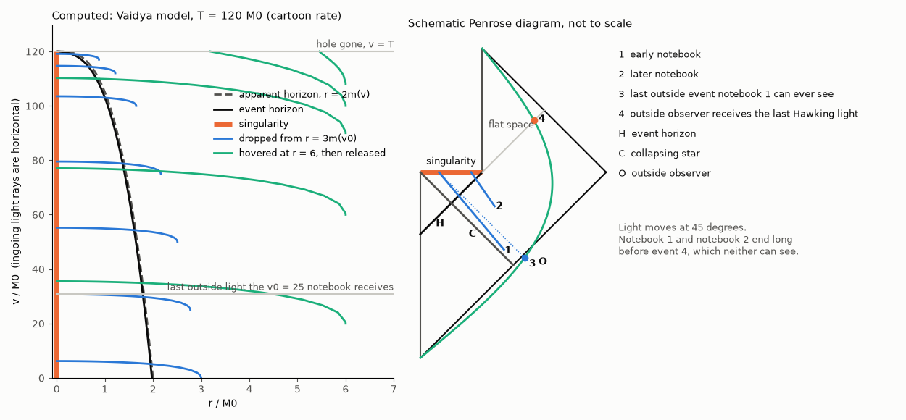

# Black holes, wormholes, entropy and information

Questions B01 to B48. Much of this section has a settled classical answer and an
unsettled quantum one, so each answer says which part is which. Nine core derivations
do the heavy lifting, and each question points back to the one it needs. The question
the student cared about most, the falling notebook, is [D8](#d8-the-notebook-what-can-a-falling-object-see)
and answers [B46](#b46-the-notebook-falling-toward-the-end-of-time) to
[B48](#b48-is-the-notebook-falling-into-another-universe).

Units: $G=c=1$ inside derivations unless a formula shows them, with $M$ then meaning
$GM/c^2$ as a length or $GM/c^3$ as a time. $f(r)=1-2M/r$. Solar mass, constants and the
year come from [`common/constants.py`](../common/constants.py).

Three results readers usually find surprising, all derived below:

- A notebook falling past the horizon of a non-rotating hole sees distant clocks run
  **slow**, at half rate at crossing. The huge speed-up belongs to someone hovering.
- Once curvature is written against the proper time left, the mass drops out:
  $K\to 64/(27c^4\tau^4)$ for every black hole. Near the singularity a stellar hole and
  a supermassive one are the same.
- A person is torn apart about 30 ms before the singularity, by the estimate used here,
  regardless of the mass. Mass only decides whether that moment is before or after the horizon.

## Core derivations

| ID | Derivation | Script | Used by |
|---|---|---|---|
| [D1](#d1-free-fall-and-the-proper-time-bound) | Free fall from any radius, and the bound $\pi GM/c^3$ | [`verify_geometry.py`](code/verify_geometry.py) | B02 to B08, B44, B46, B47 |
| [D2](#d2-curvature-tides-and-what-happens-near-r0) | Kretschmann scalar, tides, Kasner behaviour, depth and volume | [`verify_geometry.py`](code/verify_geometry.py) | B02 to B06, B08, B48 |
| [D3](#d3-causal-structure-why-nothing-gets-out) | No causal curve leaves the horizon; $v$ never decreases | [`verify_notebook.py`](code/verify_notebook.py) | B07 to B09, B40, B45 to B47 |
| [D4](#d4-orbits-disks-and-mergers) | ISCO, efficiency, capture, viscous disk, Eddington limit, mergers | [`verify_orbits_accretion.py`](code/verify_orbits_accretion.py) | B01, B10 to B13 |
| [D5](#d5-wormholes-flare-out-and-negative-energy) | Flare-out implies null energy violation; Casimir mode sum | [`verify_wormholes_casimir.py`](code/verify_wormholes_casimir.py) | B14 to B16, B20, B21 |
| [D6](#d6-antimatter-and-the-dark-sector) | Antimatter has positive energy; $w$ for dark matter and dark energy | [`verify_wormholes_casimir.py`](code/verify_wormholes_casimir.py) | B17 to B22, B34, B36 |
| [D7](#d7-hawking-temperature-and-evaporation) | Hawking temperature, mass-loss ODE, lifetimes, last moments | [`verify_evaporation.py`](code/verify_evaporation.py) | B33 to B41, B46 to B48 |
| [D8](#d8-the-notebook-what-can-a-falling-object-see) | Static versus falling clocks, signals received, evaporating interior | [`verify_notebook.py`](code/verify_notebook.py) | B44 to B48 |
| [D9](#d9-entropy) | Entropy definitions, black hole entropy, scaling, potentials, Page curve | [`verify_entropy.py`](code/verify_entropy.py), [`verify_evaporation.py`](code/verify_evaporation.py) | B24 to B37 |

The full output of every script is at the [end of this page](#full-script-output).
What the scripts can't show: they test GR and semiclassical formulas against independent
numerics, so agreement says the mathematics is right, not that nature obeys it in
regimes nobody has measured.

## D1: Free fall and the proper-time bound

**Starting from:** the Schwarzschild metric, the unique static, spherically symmetric
vacuum solution of Einstein's equations (Birkhoff's theorem, general knowledge),

$$ds^2=-f\,dt^2+\frac{dr^2}{f}+r^2d\Omega^2,$$

and the rule that free bodies follow geodesics.

Since the metric does not depend on $t$, $E=f\,dt/d\tau$ is conserved along a radial
geodesic. Normalising $u\cdot u=-1$ gives

$$\left(\frac{dr}{d\tau}\right)^2=E^2-f(r).$$

Released from rest at $r_0$, $E^2=f(r_0)$, and the solution is a cycloid with total fall time
$\tau=\frac{\pi}{2}r_0\sqrt{r_0/2M}$.

Inside $r<2M$, $f<0$, so the $dt^2$ term is positive and the $dr^2$ term negative: $r$ is
now the time coordinate. For **any** timelike path, not only geodesics,

$$d\tau^2=\frac{dr^2}{2M/r-1}-\left(\frac{2M}{r}-1\right)dt^2-r^2d\Omega^2\le\frac{dr^2}{2M/r-1}.$$

Integrating from $r=2M$ to $0$ gives the bound, which no rocket can beat:

$$\tau_{\max}=\int_0^{2M}\frac{dr}{\sqrt{2M/r-1}}=\pi M=\frac{\pi GM}{c^3}.$$

It is reached only by $E\to0$ with no motion in $t$ or angle. A body falling from far away
has $E=1$ and gets $\frac43M$. This agrees with
[Lewis and Kwan 2007](https://doi.org/10.1071/AS07012), who also point out that rockets can
extend your time up to a maximum.

```text
  E        tau(2M to 0)/M   (E=1 exact: 4/3; E->0 limit: pi)
   2.00        0.826436
   1.00        1.333333
   0.30        2.257664
   0.01        3.102059
   0.00        3.141593
```

The script also integrates the second-order geodesic equation through the horizon and
recovers the cycloid time, and tries random accelerated paths; none beats $\pi$.
Passing that sampling test isn't a proof. The inequality above is.

## D2: Curvature, tides and what happens near r=0

**Kretschmann scalar.** Coordinates can fake a singularity, as $r=2M$ does. A scalar
built from curvature can't. The script derives Christoffel symbols and the Riemann tensor from
the metric with sympy and obtains

$$K=R_{abcd}R^{abcd}=\frac{48G^2M^2}{c^4r^6}.$$

At the horizon $K=3/(4M^4)$, finite and smaller for bigger holes. At $r=0$ it diverges.

**Tides.** The same computation in the frame of a faller gives
$\ddot\xi_r=+\frac{2GM}{r^3}\xi_r$ and $\ddot\xi_\perp=-\frac{GM}{r^3}\xi_\perp$: stretched
along the fall, squeezed across it. At the horizon, for a body of length $L$,

$$\Delta a=\frac{c^6L}{4G^2M^2}\propto\frac{1}{M^2}.$$

With $L=2$ m and a lethal limit of 100 g (my assumed estimate, not a measured figure), the
lethal radius satisfies $r^3=2GML/\Delta a$. Then the fall law
$\tau=\frac23r^{3/2}/\sqrt{2GM}$ gives $\tau=\frac23\sqrt{L/\Delta a}\approx 30$ ms,
**with no $M$ in it**.

```text
  M/M_sun    r_s(km)    tide at horizon(m/s^2)   r_lethal/r_s   tau left at r_lethal(s)   at horizon
         1       2.95           2.061e+10             276         3.011e-02          already torn apart
        10       29.5           2.061e+08            59.5         3.011e-02          already torn apart
     1e+03   2.95e+03           2.061e+04            2.76         3.011e-02          already torn apart
     1e+04   2.95e+04           2.061e+02           0.595         3.011e-02          survives
  4.15e+06   1.23e+07           1.197e-03          0.0107         3.011e-02          survives
   6.5e+09   1.92e+10           4.878e-10        7.92e-05         3.011e-02          survives
  Horizon tide = c^6 L/(4 G^2 M^2): equals 100 g at M = 4.58e+03 M_sun, 1 g at M = 4.58e+04 M_sun
```

**Near r=0 the interior is a Kasner cosmology.** Inside, write $T=r$ as time:

$$ds^2=-\frac{dT^2}{2M/T-1}+\left(\frac{2M}{T}-1\right)dx^2+T^2d\Omega^2.$$

For $T\ll M$, with $\tau$ the proper time left, $T\propto\tau^{2/3}$ and the $x$ scale factor
goes as $\tau^{-1/3}$. So this is the Kasner solution
([Kasner 1921](https://doi.org/10.2307/2370192)) with exponents $(-\frac13,\frac23,\frac23)$:
one direction stretches without limit while two shrink to zero, and the volume goes as
$\tau\to0$. Generic singularities are expected to be more complicated
([Belinskii, Khalatnikov and Lifshitz 1970](https://doi.org/10.1080/00018737000101171)).

Substituting $r^3=\frac92M\tau^2$, which holds near $r=0$ for every $E$, into $K$ gives

$$K\to\frac{64}{27\,c^4\tau^4},$$

the same as the exact Kasner value computed by sympy. **The mass cancels.** So $K$ reaches
the Planck value $1/l_P^4$ about $1.24\,t_P$ before the end for any black hole.

```text
PASS  Kasner (-1/3,2/3,2/3) is an exact vacuum solution
PASS  Kasner K = 64/(27 tau^4)  [sympy: K = 64/(27*tau**4)]
PASS  Exact interior: sphere radius ~ tau^(2/3)  [fit 0.6667]
PASS  Exact interior: t-direction scale ~ tau^(-1/3) (stretches)  [fit -0.3333]
PASS  K -> 64/(27 c^4 tau^4) for every mass and energy
```

**Depth is not an invariant.** The familiar funnel picture embeds a $t=$ const slice in
flat 3D space, with depth $z=2\sqrt{2M(r-2M)}$. Painlevé-Gullstrand time slices the same
spacetime (the script confirms the same $K$) into exactly flat slices, $dr^2+r^2d\Omega^2$,
with zero depth. A funnel depth that depends on the slicing is a feature of the drawing, and it
stops at the horizon anyway.

**Interior volume.** Also slice dependent, but with a useful maximum.
[Christodoulou and Rovelli 2015](https://doi.org/10.1103/PhysRevD.91.064046) define the volume
by the maximal slice. Along a slice at constant $r$, the volume per unit $v$ is
$4\pi r^2\sqrt{2M/r-1}$, which peaks at $r=\frac32M$, so $V\approx3\sqrt3\pi M^2v$. It grows
with time, and for Sgr A* it comes to about $10^{16}$ times $\frac43\pi r_s^3$ today.

```text
  M/M_sun   area(m^2)    K(horizon)(m^-4)  tide/L at horizon(s^-2)  tau_max(s)  mean density(kg/m^3)
        10   1.096e+10       1.578e-17           1.030e+08   1.547e-04     1.843e+17
  4.15e+06   1.888e+21       5.318e-40           5.983e-04   6.422e+01     1.070e+06
   6.5e+09   4.631e+27       8.837e-53           2.439e-10   1.006e+05     4.362e-01
  Sgr A*: V(after v=13.8 Gyr) = 8.003e+46 m^3, while (4/3)pi r_s^3 = 7.711e+30 m^3, ratio 1.04e+16
```

Masses used: M87* $6.5\times10^9M_\odot$ is from [EHT 2019](https://doi.org/10.3847/2041-8213/ab1141). For Sgr A*, [EHT 2022](https://doi.org/10.3847/2041-8213/ac6674) quotes about $4\times10^6M_\odot$ from stellar orbits. The scripts use $4.15\times10^6$, a figure from general knowledge of the [GRAVITY 2019](https://doi.org/10.1051/0004-6361/201935656) orbit fit that I could confirm only to that rounded level. Nothing here depends on the third digit.

## D3: Causal structure: why nothing gets out

**Starting from:** ingoing Eddington-Finkelstein (EF) coordinates, $v=t+r^*$ with
$r^*=r+2M\ln|r/2M-1|$, in which the metric is regular at the horizon:

$$ds^2=-f\,dv^2+2\,dv\,dr+r^2d\Omega^2.$$

Take any future-directed causal vector $u$. The vector $-\partial_r$ is null and
future-directed, and two future-directed causal vectors have $g(u,-\partial_r)\le0$. This gives
$u^v\ge0$:

**Result 1: $v$ never decreases along any signal.** Light emitted inward from far away at $v_e$
stays on $v=v_e$. So nothing emitted at $v_e$ can affect any event with $v<v_e$.

The causal condition $-f(u^v)^2+2u^vu^r+r^2|\dot\Omega|^2\le0$ then gives, for $u^v>0$,

$$2u^r\le fu^v-\frac{r^2|\dot\Omega|^2}{u^v}.$$

If $f<0$ the right side is negative. If $u^v=0$ the condition forces $\dot\Omega=0$ and $u=-a\partial_r$.

**Result 2: inside the horizon, $r$ strictly decreases along every causal curve.** That covers
light, sound, rockets, radio, gravity waves, anything that moves at or below $c$. Ending at $r=0$
isn't a matter of how hard you try. It is the direction of time.

The same algebra works in the Vaidya metric of [D8](#d8-the-notebook-what-can-a-falling-object-see)
with $M\to m(v)$. Numerical rays agree:

```text
  'outgoing' ray from r=1.999: ends at r=0.001 after dv=26.41 M
  'outgoing' ray from r=1.5: ends at r=0.001 after dv=2.55 M
  'outgoing' ray from r=2.001: ends at r=1000.000 after dv=2051.25 M
```

**Limits:** this assumes signals are causal in the metric. Faster-than-light signalling
would evade it, but none is known. Quantum entanglement doesn't help because it carries no
controllable signal (no-communication theorem, general knowledge). Hawking radiation isn't
a signal from inside either; see [D7](#d7-hawking-temperature-and-evaporation).

## D4: Orbits, disks and mergers

**Effective potential.** A particle with angular momentum $L$ per unit mass obeys

$$\dot r^2=E^2-f(r)\left(1+\frac{L^2}{r^2}\right).$$

The script scans this potential with no formula assumed and finds the smallest $L$ for which a
minimum exists at all. That is the innermost stable circular orbit (ISCO). The analytic values are
$L=\sqrt{12}M$, $r=6M$, $E=\sqrt{8/9}$, so a particle that spirals slowly to the ISCO has
radiated $1-\sqrt{8/9}=5.72\%$ of its rest energy. Direct integration of perturbed orbits confirms
that $r=7M$ is stable and $r=5.5M$ plunges.

```text
  smallest L with both a max and a min: L = 3.4641 (sqrt 12 = 3.4641); radius there r = 6.000 M
  orbital energy there E = 0.94281 (sqrt(8/9) = 0.94281); radiated fraction = 0.0572
PASS  Perturbed orbit at r=7M stays bound  [r_min = 6.930]
PASS  Perturbed orbit at r=5.5M plunges through the horizon  [crossed at tau = 103 M]
```

For a spinning hole, the circular-orbit energy of
[Bardeen, Press and Teukolsky 1972](https://doi.org/10.1086/151796) (quoted, not derived here)
gives 32% at the [Thorne 1974](https://doi.org/10.1086/152991) spin limit $a=0.998$, approaching
42.3% at $a\to1$.

**Capture.** A particle arriving with $E\approx1$ is captured only if $L<4M$. Light only if
its impact parameter is below $3\sqrt3M$. Both are found by bisection on integrated orbits. So
everything else misses, which is what "black holes don't suck" means quantitatively.

**Why gas doesn't fall straight in.** Angular momentum is conserved and gas arrives with
far too much of it: gas orbiting Sgr A* at 1 pc has 648 times the specific angular momentum of
the ISCO. Two neighbouring rings with shear exchange $dL$ at energy change
$dE=(\Omega_1-\Omega_2)dL<0$, so friction moves the inner ring in and the outer ring out. The
needed friction is thought to be turbulence from the magnetorotational instability
([Balbus and Hawley 1991](https://doi.org/10.1086/170270)). Numerically, the viscous ring equation
([Lynden-Bell and Pringle 1974](https://doi.org/10.1093/mnras/168.3.603)) with zero torque at the
inner edge gives:

```text
   t = 0.33 r^2/nu : mass left  0.666, angular momentum left  0.918
   t = 1.00 r^2/nu : mass left  0.501, angular momentum left  0.878
   t = 3.00 r^2/nu : mass left  0.373, angular momentum left  0.847
PASS  Most mass drains inward while most angular momentum stays in the disk  [mass gone 63%, L kept 85%]
PASS  Angular momentum budget closes: L_final + L swallowed = L_0 within 2%  [ratio 1.0000]
```

**Eddington limit.** Radiation pushes on electrons with cross-section $\sigma_T$; gravity pulls on
protons, and the two are bound electrically. Balance on ionised hydrogen at any radius,
$L\sigma_T/(4\pi r^2c)=GMm_p/r^2$, gives

$$L_{\rm Edd}=\frac{4\pi GMm_pc}{\sigma_T}=1.26\times10^{31}\,\text{W per }M_\odot.$$

Growth at this limit with radiative efficiency $\epsilon$ is exponential, with e-folding time
$\frac{\epsilon}{1-\epsilon}\frac{\sigma_Tc}{4\pi Gm_p}=50$ Myr at $\epsilon=0.1$. Limits: spherical
and steady, with pure hydrogen; real flows can exceed it for a while.

**Mergers.** Two black holes approach by losing orbital energy to gravitational waves. Using
[Peters 1964](https://doi.org/10.1103/PhysRev.136.B1224) (quoted), two holes like GW150914's would
take $4.7\times10^{12}$ yr to merge from 1 AU. Hawking's area theorem
([Hawking 1971](https://doi.org/10.1103/PhysRevLett.26.1344)) gives a bound for non-spinning starts,
at most $1-\sqrt{m_1^2+m_2^2}/(m_1+m_2)$ radiated. GW150914, $36+29\to62\,M_\odot$ with
$3.0\pm0.5\,M_\odot c^2$ radiated ([LIGO and Virgo 2016](https://doi.org/10.1103/PhysRevLett.116.061102)),
sits well inside it. The area law has now been tested directly
([Isi et al. 2021](https://doi.org/10.1103/PhysRevLett.127.011103),
[LIGO, Virgo and KAGRA 2025 on GW250114](https://arxiv.org/abs/2509.08054)).

```text
  Hawking area theorem, non-spinning start: max radiated fraction = 1 - sqrt(m1^2+m2^2)/(m1+m2) = 0.289
  GW150914 measured: 3.0/65 = 0.046
  Area, central values, ignoring initial spins: A_final/A_initial = 1.57
```

## D5: Wormholes: flare-out and negative energy

**Einstein-Rosen bridge.** The maximally extended Schwarzschild solution contains a throat
joining two exteriors ([Einstein and Rosen 1935](https://doi.org/10.1103/PhysRev.48.73)). It isn't
traversable. In Kruskal null coordinates $(U,V)$ both increase toward the future on any causal
curve, the right exterior has $V>0$ and the left has $V<0$, so getting from one to the other would
need $V$ to decrease. The throat also pinches off dynamically
([Fuller and Wheeler 1962](https://doi.org/10.1103/PhysRev.128.919)), with lifetime $2\pi GM/c^3$ on the
$E=0$ cycloid of [D1](#d1-free-fall-and-the-proper-time-bound). Stars that collapse don't even have this
second region: the star's own interior replaces it
([Oppenheimer and Snyder 1939](https://doi.org/10.1103/PhysRev.56.455)).

**Morris-Thorne wormholes** ([Morris and Thorne 1988](https://doi.org/10.1119/1.15620)) start from the
desired geometry:

$$ds^2=-e^{2\Phi(r)}dt^2+\frac{dr^2}{1-b(r)/r}+r^2d\Omega^2,\qquad b(r_0)=r_0.$$

Embedding gives $dr/dz=\pm\sqrt{r/b-1}$. For a throat to be a minimum of $r(z)$,

$$\frac{d^2r}{dz^2}=\frac{b-b'r}{2b^2}>0\quad\Rightarrow\quad b'(r_0)<1.$$

The script computes the Einstein tensor symbolically for arbitrary $b$ and $\Phi$ and finds
$8\pi\rho=b'/r^2$ and $8\pi p_r=-b/r^3+2(1-b/r)\Phi'/r$. So at the throat, for any $\Phi$,

$$8\pi(\rho+p_r)\big|_{r_0}=\frac{b'(r_0)-1}{r_0^2}<0.$$

**A static throat necessarily violates the null energy condition.** That's a theorem about the
geometry, and all ordinary matter obeys that condition classically.

```text
PASS  8 pi rho = b'/r^2
PASS  8 pi p_r = -b/r^3 + 2(1-b/r)Phi'/r
PASS  At a throat b(r0)=r0: 8 pi (rho + p_r) = (b' - 1)/r0^2, for any redshift function  [sympy: (b1 - 1)/r0**2]
```

**How much?** For the simplest case, $b=r_0^2/r$, a throat of 1 m needs about $-5\times10^{42}$ J/m³
and an integrated $-\pi c^2r_0/(2G)$, about minus one Jupiter mass.
[Visser, Kar and Dadhich 2003](https://doi.org/10.1103/PhysRevLett.90.201102) show the total amount can
be made arbitrarily small by a suitable choice of geometry, so that figure isn't a lower bound, but
the violation can't be removed.

**Casimir: real negative energy density.** Between perfect plates at gap $a$ the zero-point energy is
reduced relative to free space. The script sums the regulated modes directly, subtracts free space
and extrapolates the cutoff away, rather than evaluating the formula:

$$\rho=-\frac{\pi^2\hbar c}{720a^4}.$$

```text
  exact coefficient -pi^2/720 = -0.01370778
  Richardson extrapolation to eps=0: -0.01370749
  Gap needed to reach the 1 m wormhole density: a = 3.1e-18 m, against proton radius ~8.4e-16 m
```

The force has been measured ([Lamoreaux 1997](https://doi.org/10.1103/PhysRevLett.78.5);
parallel plates: [Bressi et al. 2002](https://doi.org/10.1103/PhysRevLett.88.041804)). The energy density
is inferred from the theory that predicts that force, not measured separately.

**Quantum inequalities limit it.** For a massless free scalar in flat space, the energy density
averaged with a Lorentzian of width $\tau_0$ obeys $\langle\rho\rangle\ge-3\hbar c/(32\pi^2(c\tau_0)^4)$.
[Ford and Roman 1996](https://doi.org/10.1103/PhysRevD.53.5496) apply this to wormholes and conclude that a
static one must be near Planck size or have exotic matter in a band many orders of magnitude thinner than
the throat: a 1 m wormhole's density could only be sustained over about $3\times10^{-18}$ m here. Their
application to curved space is an argument, not a theorem, and interacting fields are open.

**Theory after that.** [Gao, Jafferis and Wall 2017](https://doi.org/10.1007/JHEP12(2017)151) make an
Einstein-Rosen bridge traversable in AdS by coupling its two boundaries, and
[Maldacena, Milekhin and Popov](https://arxiv.org/abs/1807.04726) find a four-dimensional solution using
Casimir-like energy of charged fermions. Both are theoretical. Neither violates causality in the ambient
space, per those papers' abstracts, and nothing like them has been observed.

## D6: Antimatter and the dark sector

**Antimatter has positive energy.** In $e^-+e^+\to2\gamma$ at rest, the two photons carry $2\times511$ keV.
Were the positron's energy negative, the total would be zero and no gammas could appear. The
antiproton's charge-to-mass ratio matches the proton's to 16 parts per trillion
([Borchert et al. 2022](https://doi.org/10.1038/s41586-021-04203-w)). Antihydrogen falls down,
and repulsive antigravity is ruled out ([ALPHA-g, Anderson et al. 2023](https://doi.org/10.1038/s41586-023-06527-1)). The value $a_g=(0.75\pm0.13\pm0.16)g$ is as quoted in coverage of that paper; the abstract I could read doesn't give the number.

**Consequence.** Apply CP to the collapse of a star: the same equations give an antimatter star
forming an ordinary black hole. The final state has only mass, spin and charge
([Israel 1967](https://doi.org/10.1103/PhysRev.164.1776) for the static case). There's a real reason
the idea feels natural: **CPT** does take a black hole formed from matter into a white hole expelling
antimatter. But that step uses time reversal, and it is T, not the antimatter, that makes the white hole.

**Dark matter and dark energy from $w=p/\rho c^2$.** Energy conservation in an expanding universe,
$\dot\rho=-3H(1+w)\rho$, gives $\rho\propto a^{-3(1+w)}$, and the acceleration equation has source
$\rho+3p$.

```text
  component  w      rho(a=4)/rho(a=1) numeric  a^(-3(1+w))   rho+3p sign (gravity)   rho+p sign (NEC)
  dust/DM     0.00            0.015625            0.015625   attractive           >= 0
  radiation   0.33            0.003906            0.003906   attractive           >= 0
  Lambda     -1.00            1.000000            1.000000    repulsive           >= 0
  phantom    -1.10            1.515717            1.515717    repulsive           < 0 (violates NEC)
```

The numbers use [Planck 2018](https://doi.org/10.1051/0004-6361/201833910)
($H_0=67.4$ km/s/Mpc, $\Omega_m=0.315$). The key line for wormholes: $w=-1$ gives $\rho+p=0$ exactly, so a
cosmological constant can't satisfy the flare-out inequality. Only $w<-1$ could, and that's
what [Lobo 2005](https://doi.org/10.1103/PhysRevD.71.084011) and
[Sushkov 2005](https://doi.org/10.1103/PhysRevD.71.043520) assume. [DESI DR2](https://arxiv.org/abs/2503.14738)
prefers evolving dark energy over $\Lambda$ at 2.8 to 4.2$\sigma$ depending on supernova sample, with
$w_0>-1,w_a<0$, which is a live hint and not a settled result.

Evidence that dark matter is effectively collisionless: the lensing and gas offset in the Bullet Cluster
([Clowe et al. 2006](https://doi.org/10.1086/508162)). A collisionless fluid can't radiate its energy away, so
it doesn't collapse the way gas does. A falling particle conserves energy and comes back out.

## D7: Hawking temperature and evaporation

**Temperature.** Near the horizon, with proper distance $\rho$ and Euclidean time $t_E=it$,

$$ds^2\to d\rho^2+\rho^2\left(\frac{dt_E}{4M}\right)^2,$$

which is smooth polar coordinates only if $t_E$ has period $8\pi M$. A Euclidean-time period
$\beta\hbar$ is the mark of a thermal state, so

$$T_H=\frac{\hbar c^3}{8\pi GMk}=6.17\times10^{-8}\,\text{K}\,\frac{M_\odot}{M}.$$

This is the short route to the result of [Hawking 1975](https://doi.org/10.1007/BF02345020), who computed the
particle production directly. It's semiclassical physics that nobody has measured for a real black hole. An
analogue-system observation exists ([Steinhauer 2016](https://doi.org/10.1038/nphys3863)). Local check: a hover at
proper distance $d$ has $a=c^2/d$, so the Unruh temperature ([Unruh 1976](https://doi.org/10.1103/PhysRevD.14.870))
$\hbar a/2\pi ck$ equals the Tolman-shifted $T_H/\sqrt f$. These agree in the script.

**Evaporation.** Blackbody emission from the horizon area with photons only gives
$dMc^2/dt=-\hbar c^6/(15360\pi G^2M^2)$, so

$$t_{\rm evap}=\frac{5120\pi G^2M^3}{\hbar c^4}.$$

The script integrates this ODE numerically, with power from a numerically integrated Planck law, and gets the
closed form.

```text
  t/t_evap = 0.900: M/M0 numeric 0.464159, closed form (1-t/t_evap)^(1/3) 0.464159
  t/t_evap = 0.999: M/M0 numeric 0.100000, closed form (1-t/t_evap)^(1/3) 0.100000
  Page 1976 total power 2e-4 hbar c^6/(G^2 M^2), vs blackbody photon-only 2.072e-05: ratio 9.7
```

**Corrections.** Real emission includes greybody factors and more species.
[Page 1976](https://doi.org/10.1103/PhysRevD.13.198) found total power $2\times10^{-4}\hbar c^6/G^2M^2$ for
$M\gg10^{17}$ g (81% neutrinos, 17% photons, 2% gravitons), about 10 times the simple value. The modern result
would differ because Page assumed massless neutrinos of two flavours. Light capture alone
($b_c=3\sqrt3M$, area ratio 27/16, [D4](#d4-orbits-disks-and-mergers)) gives 1.69. Lifetimes below are good to
about an order of magnitude.

```text
  Object     M/M_sun     T_H(K)       t_evap blackbody (yr)    Page-corrected (yr)   T_H/T_CMB
  1 M_sun            1   6.170e-08           2.095e+67           2.171e+66      2.26e-08
  10 M_sun          10   6.170e-09           2.095e+70           2.171e+69      2.26e-09
  Sgr A*      4.15e+06   1.487e-14           1.498e+87           1.552e+86      5.46e-15
  M87*         6.5e+09   9.493e-18           5.755e+96           5.963e+95      3.48e-18
  2e12 M_sun  2.04e+12   3.025e-20          1.779e+104          1.843e+103      1.11e-20
  T_H = T_CMB at M = 4.50e+22 kg (Moon = 7.3e22 kg)
  10 M_sun: absorbs ~5.79e+04 W from CMB (capture area 27 pi M^2), emits ~9.01e-31 W; ratio 6.4e+34
```

The CMB is $2.7255$ K ([Fixsen 2009](https://doi.org/10.1088/0004-637X/707/2/916)). Every astrophysical black hole
is colder than the sky, so today it's a net absorber. With Planck 2018 $\Lambda$CDM and nothing new, a 10 $M_\odot$
hole starts to shrink in about 350 Gyr and M87* in about 700 Gyr, once the CMB has cooled below them.

**Last moments.** In this approximation the last second releases $2\times10^{22}$ J, about $5\times10^6$ Mt TNT, at
$kT\sim50$ TeV. Physics above collider energies is uncertain, so treat that as an estimate. Each quantum carries
$\sim2.7kT$, which becomes comparable to $Mc^2$ near the Planck mass, so semiclassical physics stops there.

## D8: The notebook: what can a falling object see

This is the resolution of the student's paradox, step by step. The claim to be tested: "one second near a black
hole is centuries outside, so the falling notebook lives through nearly the universe's whole future."



### (i) Time dilation belongs to hovering, not falling

A far observer's clock is labelled by $v$: light sent inward stays on one value of $v$
([D3](#d3-causal-structure-why-nothing-gets-out)), so the clock rate you see is $dv/d\tau$.

**Hovering at fixed $r$.** Then $dv=dt$ and $d\tau=\sqrt f\,dt$:

$$\frac{dv}{d\tau}\bigg|_{\rm hover}=\frac{1}{\sqrt f}\to\infty\quad(r\to2M).$$

This is the famous time dilation. With proper distance $d$ to the horizon, near the horizon $\sqrt f=d/4M$, so the
factor is $D=4GM/(c^2d)$ and the required acceleration is $a=c^2/d$.

**Falling.** The conserved energy in EF coordinates is $E=f\dot v-\dot r$. With $\dot r=-s$ and $s=\sqrt{E^2-f}$,
$f\dot v=E-s$. Multiply by $E+s$ and use $(E-s)(E+s)=f$:

$$\boxed{\frac{dv}{d\tau}\bigg|_{\rm fall}=\frac{1}{E+\sqrt{E^2-f}}}$$

This is finite at the horizon (equal to $1/2E$) and valid inside. For $E=1$, seen clocks run **below** normal speed all the
way in and go to 0 at the singularity.

**Why the speed-up cancels.** A faller passes a hover station at $\beta=s/E$, moving away from incoming light. The
Doppler factor is $\sqrt{(1-\beta)/(1+\beta)}=\sqrt{(E-s)/(E+s)}=\sqrt f/(E+s)$. Multiply by the station's blueshift $1/\sqrt f$
and you get exactly $1/(E+s)$. **The Doppler redshift of falling wins over the hover blueshift.**

Note $dt/d\tau=E/f$ also blows up at the horizon for a faller. That is the often-quoted "infinite time", but
$t$ is a label that diverges there because the coordinate is bad there, like longitude at the pole. It doesn't describe anything anyone
sees. The infinite part of $t$ has no matching infinite part of $v$.

```text
  r/M     hover: 1/sqrt(f)     faller E=1: dt/dtau = E/f     faller E=1: seen rate dv/dtau
  100.000        1.0102                1.0204                  0.8761
   3.000        1.7321                3.0000                  0.5505
   2.001       44.7325             2001.0000                  0.5001
   2.000      infinite              infinite                  0.5000
   1.000    impossible               -1.0000                  0.4142
   0.001    impossible               -0.0005                  0.0219
```

**Independent test.** The script traces light rays through the horizon in Painlevé-Gullstrand coordinates, which do not
use the formula, and measures the arrival spacing:

```text
  T_emit   arrives at r/M   measured dT_emit/dtau   formula 1/(1+sqrt(2/r))
    380.0      11.35320         0.704366              0.704366
    390.7       2.14585         0.508792              0.508798
    391.2       0.91158         0.403004              0.403028
```

### (ii) How much of the future does the notebook see?

$v$ at impact bounds everything received, by Result 1 of D3. Light with angular momentum only arrives later, so radial rays
are the best case (and the script checks this). Using $s$ as a variable, with $k=1-E^2$:

$$\Delta v_{\rm in}=\int_E^\infty\frac{4\,ds}{(s^2+k)^2(E+s)},\qquad\Delta\tau_{\rm in}=\int_E^\infty\frac{4\,ds}{(s^2+k)^2}.$$

For $E=1$ the first integral gives $\Delta v_{\rm in}=4M(\frac56-\ln2)=0.561M$: after crossing, it sees $0.56\,GM/c^3$ of
outside time. Bisection on traced rays reproduces the total:

```text
  Last ray that catches the faller before r=0: emitted at T = 391.33565 M after release at r=100M
  EF integral of dv along the worldline: 391.33565 M; proper time of the whole fall: 471.40452 M
```

The seen time is **shorter** than the fall's own proper time, which is a direct contradiction of the premise.
That has been noted before: [Grib and Pavlov 2009](https://arxiv.org/abs/0906.1442),
[Krasnikov 2008](https://doi.org/10.1134/S0202289308040129) and [Pavlov 2013](https://arxiv.org/abs/1203.4000) reach the same
conclusion for positive-energy radial falls. The script reproduces Pavlov's $4M\ln2$ for the part before crossing from rest near
the horizon.

Pavlov's result stops at the horizon. Continuing inside for a release close to the horizon shows growth, but only as a logarithm:

$$\Delta v_{\rm in}\approx4M\ln(1/E)-4.77M.$$

```text
  E          released at r/M   d_tau(in)/M  d_v(in)/M    d_tau(out)/M   d_v(out)/M
   1.00e+00      from far         1.33333      0.5607
   5.00e-01        2.666667     1.89120      1.3640          2.9456     4.21256
   1.00e-02        2.000200     3.10206     13.7415        0.040005     2.77299
   1.00e-30        2.000000     3.14159    271.5376           4e-30     2.77259
  Fit d_v(in) = 4.0000 M ln(1/E) + -4.7726 M
```

A release at proper distance $d$ from the horizon has $E=d/4M$. Even from one Planck length away, $\ln(1/E)$ is only around 100.
So the outside future that can be seen is small:

```text
  Object       tau(E=1)     v seen after horizon (E=1)   v seen, released at d=l_P      t_evap        fraction seen
  1 M_sun     6.567e-06 s     2.762e-06 s                  1.740e-03 s        2.10e+67 yr    2.6e-78
  Sgr A*      2.725e+01 s     1.146e+01 s                  8.465e+03 s        1.50e+87 yr    1.8e-91
  M87*        4.269e+04 s     1.795e+04 s                  1.420e+07 s        5.75e+96 yr    7.8e-98
  1-yr hole   1.339e+07 s     5.633e+06 s                  4.687e+09 s       1.78e+104 yr   8.4e-103
```

### (iii) The student's one-year case

$\pi GM/c^3=1$ yr needs $M=2.04\times10^{12}M_\odot$, somewhat above the luminous-accretion limit estimated by
[King 2016](https://doi.org/10.1093/mnrasl/slv186) ($5\times10^{10}M_\odot$ typical, $2.7\times10^{11}$ extreme) but
fine as a thought experiment. Falling from far, the same hole gives 155 days of proper time and 65 days of outside
time after crossing. Its evaporation takes $1.8\times10^{104}$ yr, so $10^{120}$ yr would indeed outlast it, which is why the student's version looks sharp. A hover dilation of $10^{120}$ near it would need:

```text
  Hover dilation 1e+120 at this mass needs d = 4GM/(c^2 D) = 1.2e-104 m = 7.5e-70 l_P
  Largest dilation with d >= l_P: 7.5e+50
  To see through all of evaporation by release alone you need ln(1/E) = 1.4e+104; the Planck-length cut allows ln(1/E) = 117
```

So the 1:$10^{120}$ ratio doesn't apply to the fall, and hovering can't physically reach it.

### (iv) There's no global "at the same moment"

"What's happening outside when the notebook hits the singularity?" needs a slice of simultaneity through that event, and GR doesn't supply one.

- Inside the horizon, $t$ is a space coordinate. Along the worldline $t$ goes up to $+\infty$ at crossing, then **decreases**:

```text
  r/M        tau       v         t = v - r*      PG time T=tau
  100.0000      0.000      0.000       -107.784       0.000
   2.0001    470.071    390.775        408.582     470.071
   1.9999    470.071    390.775        408.582     470.071
   1.5000    470.538    391.001        392.273     470.538
   0.0010    471.405    391.336        391.336     471.405
```

($t$ diverges only logarithmically in $|r-2M|$, so these points, $10^{-4}M$ from the horizon, reach just $t\approx409M$.)

- Each outside event with $v>v_{\rm impact}$ is causally unrelated to the impact: nothing goes from it to the impact (D3 Result 1), and nothing goes from the impact to it (D3 Result 2). So *any* such event may be called simultaneous with the impact, by a suitable slice. The script builds explicit spacelike curves: along $r\approx\frac32M$, then out, reaching outside times $10^{100}M$ later.

```text
  v at impact = 391.336 M. Spacelike curves exist from the impact event to outside events at v = 392.3, 1e6, 1e100 M: [True, True, True]
```

So "the notebook is still falling when the hole has evaporated" and "the notebook has already ended" are both descriptions in chosen slices. The invariant statement is causal: **the evaporation's end is not in the notebook's past.**

**Evaporating hole.** A common simplified model is the ingoing Vaidya metric with a negative-energy influx (going back at least to [Hiscock 1981](https://doi.org/10.1103/PhysRevD.23.2813), as I recall that paper; I confirmed only its title and journal):
$ds^2=-(1-2m(v)/r)dv^2+2dvdr+r^2d\Omega^2$, here with $m=M_0(1-v/T)^{1/3}$. The script integrates the full geodesic equations with a rate made absurdly fast ($T=2000M_0$) so the effect is visible at all. Even so:

```text
  v0      m(v0)    r0      outcome       v_end      T - v_end   proper time
       0  1.0000   3.000  singularity       6.165   1993.835      5.775
    1000  0.7937   2.381  singularity    1004.895    995.105      4.585
    1900  0.3684   1.105  singularity    1902.279     97.721      2.136
    1999  0.0794   0.238  singularity    1999.551      0.449      0.522
PASS  Every notebook dropped from nearby hits the singularity before the end of evaporation
```

The diagram shows the same: the singularity is spacelike, and notebooks reach its early portion. The Penrose diagram itself (right panel) follows Hawking's structure and isn't to scale. The last piece, the point where the singularity ends, isn't described by this physics.

### (v) A notebook that hovers until evaporation is nearly over

This is a genuinely different story, and in it the student's intuition survives.

```text
PASS  Near the horizon a = c^2/d and D = 4GM/(c^2 d), with d the proper distance
```

A rope or rocket holding it at $d$ from the horizon gives enormous dilation: in the near-horizon region "one second is a century" at $d=7.8$ m from Sgr A*, but at $a\sim10^{16}$ m/s². At a survivable 1 g, the dilation stays small unless the hole is absurdly large:

```text
  'One second = one century' hover (D = 3.16e+09), near Sgr A*: d = 7.8 m, acceleration c^2/d = 1.2e+16 m/s^2
  The same D at only 1 g needs M = D c^4/(4 G g) = 4.9e+21 M_sun (non-rotating)
   M87*      : r = 15.71 r_s, clock ratio D = 1.033
   1-yr hole : r = 1.278 r_s, clock ratio D = 2.145
```

It's also hot. The hoverer feels $T=\hbar c/(2\pi kd)$, which is 300 K at 1.2 μm and reaches $2\times10^{31}$ K at one Planck length, regardless of mass. If it survives anyway, it sits at fixed $r$ as the hole shrinks away beneath it. Released late, the hole is gone first:

```text
  v0= 1000.0: singularity  at v= 1016.439, r=0.0008
  v0= 1960.0: singularity  at v= 1991.109, r=0.0002
  v0= 1975.0: hole gone    at v= 2000.000, r=4.2422
  v0= 1990.0: hole gone    at v= 2000.000, r=5.8713
```

Then the notebook falls through empty flat space. (In reality it would also be cooked by the final burst.) So this notebook doesn't reach a singularity at all. No paradox arises in either case: a falling notebook never reaches the end, and a notebook that reaches the end isn't inside.

### The one place the student's intuition is exactly right

Real black holes rotate, and rotating or charged solutions have an inner horizon. In the exact Reissner-Nordström solution, the formula gives a finite $v$ at $r_-$ for an ordinary positive-energy infaller, but a charged infaller whose effective energy $\epsilon=E-qQ/r$ is negative at $r_-$ crosses a different branch, where $v\to\infty$ in finite proper time:

```text
  delta=r-r_-   neutral E=1: dv, dtau      charged q=2,E=1.5 (eps(r-)<0): dv, dtau
      1e-02        9.65219    15.45684             9.3963    11.78483
      1e-06        9.65706    15.46667            11.8672    11.78890
      1e-10        9.65706    15.46667            14.3233    11.78890
PASS  Infaller with negative effective energy at r_-: v -> infinity with slope 1/kappa_-  [slope 0.26667, 1/kappa_- = 0.26667]
```

**That is the student's picture: the whole infinite outside future seen in finite time.** A caution on sources: Pavlov states his no-infinite-future result generally, including charged particles via $\epsilon\to\epsilon-qQ/r$, but the integrand he writes takes $\epsilon>0$. For $\epsilon<0$ at $r_-$ the sign in $\epsilon+s$ matters and $v$ diverges. This branch is my own computation here, and it matches the standard picture of the Cauchy horizon as the surface $v\to\infty$. The difference in scope deserves a second reader.

And the student's objection is *also* the right objection here: an infinite blueshift of everything arriving, $dv/d\tau\propto e^{\kappa_-v}$, can't be physically harmless. The inner horizon is unstable: mass inflation ([Poisson and Israel 1990](https://doi.org/10.1103/PhysRevD.41.1796), [Hamilton and Avelino 2010](https://doi.org/10.1016/j.physrep.2010.06.002)), and [Dafermos and Luk](https://arxiv.org/abs/1710.01722) show the Kerr Cauchy horizon survives only as a $C^0$ surface that is expected to be singular. Hamilton and Avelino state that an infaller to a real hole probably meets its fate there rather than at a central singularity. So the safe conclusion for real rotating holes: the end comes after a time of order $GM/c^3$ (my estimate, the $\pi M$ bound being exact only for Schwarzschild), it comes before the outside future has played out, and the interior details are less certain than the Schwarzschild picture.

### (vi) What is actually unsolved

The classical paradox dissolves. These don't:

1. **Is the horizon smooth?** [AMPS 2013](https://doi.org/10.1007/JHEP02(2013)062) argue that pure Hawking radiation, valid low-energy physics outside the hole and a smooth horizon can't all be true. Their most conservative option is a firewall burning the notebook at the horizon.
2. **What happens at the end of evaporation?** The right edge of the singularity in the figure lies outside semiclassical physics.
3. **Where does the notebook's information go?** See [B33](#b33-where-does-information-go-when-it-falls-into-a-black-hole). The student's instinct about a contradiction between "it fell in" and "the hole evaporated" is a close cousin of this question. On the outside description, the notebook's information ends up in the radiation. On the inside, it ends at a singularity. [Black hole complementarity](https://doi.org/10.1103/PhysRevD.48.3743) says no single observer sees both, and AMPS is the challenge to that. The contradiction the student felt is real; it sits at the level of quantum information, not at the level of clocks.

**Limits of D8:** asymptotically flat, no cosmological expansion. The Vaidya rate is a cartoon. Bulk geometry is classical down to the singularity. The bound $\Delta v$ takes the emitter far from the hole; emitters nearer differ by a known constant $r^*$.

## D9: Entropy

**Definitions.** Boltzmann: $S=k\ln\Omega$, the log of the number of microstates compatible with a macrostate. Von Neumann: $S=-k\,{\rm Tr}\,\rho\ln\rho$. Both measure missing information about the exact state.

**It is not fluctuation.** The script builds three counterexamples: an oscillator ground state ($S=0$, ${\rm Var}\,x=\frac12$), an equal mixture of degenerate states ($S=\ln16$, ${\rm Var}\,E=0$), and a two-level system, whose heat capacity peaks at a finite temperature while $S$ keeps rising. So $S$ isn't a function of fluctuation size.

```text
  Oscillator ground state: S = -0.000000, Var(x) = 0.500000, Var(p) = 0.5 too. Pure state, real fluctuations, zero entropy.
  Equal mixture of 16 degenerate states: S = 2.7726 = ln 16, Var(E) = 0.00e+00. Entropy with no energy fluctuation.
```

**Black hole entropy from the first law.** With $T_H$ from D7, $dS=c^2dM/T_H$ integrates to

$$S_{BH}=\frac{4\pi GkM^2}{\hbar c}=\frac{kA}{4l_P^2},$$

the [Bekenstein 1973](https://doi.org/10.1103/PhysRevD.7.2333) form with Hawking's coefficient. For some string-theoretic extremal holes the microstates have been counted and match ([Strominger and Vafa 1996](https://doi.org/10.1016/0370-2693(96)00345-0)). For astrophysical holes there's no agreed count.

```text
  M/M_sun     S numeric/k       k A/(4 l_P^2)/k    S/(k ln 2) bits
  1            1.0489e+77       1.0489e+77       1.5132e+77
  10           1.0489e+79       1.0489e+79       1.5132e+79
  Sgr A*       1.8065e+90       1.8065e+90       2.6062e+90
  M87*         4.4316e+96       4.4316e+96       6.3934e+96
  Sun as ideal ionised H at T ~ 4.5e6 K (estimate): S/k = 2.72e+58, i.e. 23 per baryon
  Same mass as a black hole: S/k = 1.05e+77; ratio 3.9e+18
```

For scale, [Egan and Lineweaver 2010](https://arxiv.org/abs/0909.3983) estimate $3\times10^{104}k$ for the observable universe, dominated by supermassive holes. A Schwarzschild hole saturates the [Bekenstein 1981](https://doi.org/10.1103/PhysRevD.23.287) bound $S\le2\pi kRE/\hbar c$.

**Scaling.** Ordinary matter: $S\propto M$. Black hole: $S\propto M^2$, so merging raises entropy.

```text
PASS  Gas at fixed T and density: S ~ M^1  [slope 1.0000]
PASS  Black hole: S ~ M^2  [slope 2.0000]
PASS  Black hole entropy is not extensive: S(2M) = 2 x [S(M)+S(M)]
```

**Local decrease with export.** Freezing water loses entropy, and the surroundings gain more (in the script: $-22.00$ and $+22.84$ J/mol/K at 263 K, using the standard latent heat from general knowledge). Life and crystals work the same way. The second law limits the total, not parts.

**Page curve.** If a hole plus radiation is in a pure state, the entropy of the radiation can't keep rising. For a Haar-random pure state, a subsystem's average entropy follows Page's formula ([Page 1993](https://doi.org/10.1103/PhysRevLett.71.3743)), with a peak at half the qubits:

```text
  k radiation qubits   <S>/ln2 numeric   Page formula   'Hawking' thermal count k
PASS  Entropy returns to zero when all qubits are in the radiation
PASS  Maximum at the halfway point
```

Hawking's calculation instead keeps rising, because it treats each quantum as thermal. A toy model of 14 random qubits is not a black hole, only an illustration of what unitarity requires. Taking the entropy carried by radiation as $\beta$ times the hole's loss, with $\beta=\frac43$ for photons from the Planck law ([Zurek 1982](https://doi.org/10.1103/PhysRevLett.49.1683)), the Page time is at about 57% of the lifetime:

```text
   beta = 1.33: S_rad = S_BH at M/M0 = 0.756, t/t_evap = 0.568
```

Recent semiclassical gravity calculations using "islands" obtain a Page curve ([Penington 2019](https://arxiv.org/abs/1905.08255), [Almheiri et al. 2019](https://doi.org/10.1007/JHEP12(2019)063), [2020](https://doi.org/10.1007/JHEP03(2020)149), review: [Almheiri et al. 2021](https://doi.org/10.1103/RevModPhys.93.035002)). This is active research, done mostly in lower-dimensional or AdS-coupled models, and how the information physically escapes is not settled.

**Entropy potentials.** See [B32](#b32-does-the-idea-of-an-entropy-potential-already-exist-in-physics).

## Answers

### B01: Can a black hole suck another black hole?

**Status:** Derived + Code + Established

**Short answer:** Black holes don't suck, and "highest gravity" is true only close in. Two black holes do merge, but because they orbit and slowly lose energy to gravitational waves, not because one pulls the other in.

**Starting from:** GR orbits and Birkhoff's theorem; [D4](#d4-orbits-disks-and-mergers). Peters' decay rate is quoted.

**Derivation:** Outside any spherical mass the field depends only on that mass. At 1 AU a 1 $M_\odot$ hole pulls exactly like the Sun, and a body misses it unless its angular momentum is below $4GM/c$. Even the "strength" of a hole isn't simply high: the surface gravity falls as $1/M$ and big holes have gentle horizons. Two holes in orbit radiate gravitational waves, shrink and merge. The area theorem limits the energy radiated.

**Check:** [`verify_orbits_accretion.py`](code/verify_orbits_accretion.py) integrates capture orbits and the orbital decay.

```text
  At 1 AU: acceleration toward a 1 M_sun hole = 5.9301e-03 m/s^2, the same as toward the Sun (shell theorem / Birkhoff).
PASS  Massive particle with E=1 is captured only for L < 4M  [threshold L = 4.001]
   from 1 AU   : numeric 4.732e+12 yr, a^4/(4k) = 4.732e+12 yr
```

GW150914 radiated $3.0\pm0.5\,M_\odot c^2$ ([LIGO and Virgo 2016](https://doi.org/10.1103/PhysRevLett.116.061102)).

**Limits:** Peters' formula assumes a circular orbit and the weak-field regime, so it says little about the last orbits. Real pairs also get pushed together by gas or stars; I left that out.

### B02: What does "infinite curvature of spacetime" really mean?

**Status:** Derived + Code + Open

**Short answer:** It means a curvature scalar such as $K$ grows without limit along the classical solution as $r\to0$. Tidal forces on any object grow without limit in finite proper time. Most physicists read this as GR predicting its own breakdown, not as a real infinite quantity.

**Starting from:** the Schwarzschild metric; [D2](#d2-curvature-tides-and-what-happens-near-r0).

**Derivation:** $K=48G^2M^2/(c^4r^6)$ is a scalar, so no change of coordinates removes it, unlike the coordinate problem at $r=2M$. Physically it controls tidal stretching, $\ddot\xi=2GM\xi/r^3$. Geodesics end at it after finite proper time ([Penrose 1965](https://doi.org/10.1103/PhysRevLett.14.57) showed that this incompleteness is generic given trapped surfaces and an energy condition). So "infinite curvature" has two precise meanings: unbounded tidal forces and worldlines that can't be continued.

**Check:** [`verify_geometry.py`](code/verify_geometry.py), symbolic from the metric.

```text
PASS  Kretschmann K = 48 M^2 / r^6  [sympy: K = 48*M**2/r**6]
Curvature reaches K = 1/l_P^4 when tau_left = (64/27)^(1/4) t_P = 6.69e-44 s, for ANY mass.
```

**Limits:** Whether anything is physically infinite is open. Near Planck curvature, quantum gravity is expected to change the answer, and we have no tested theory there.

### B03: At infinite curvature, does time go to zero, space go to zero, or both?

**Status:** Derived + Code + Open

**Short answer:** Neither simply. In classical Schwarzschild the proper time left goes to zero, which means time ends there. The two angular directions shrink to zero, while the third space direction stretches to infinity. The volume goes to zero.

**Starting from:** the interior metric; [D2](#d2-curvature-tides-and-what-happens-near-r0).

**Derivation:** With $\tau$ the proper time remaining, the scale factors go as $(\tau^{-1/3},\tau^{2/3},\tau^{2/3})$. Exponents sum to 1, and their squares sum to 1, which is the Kasner vacuum condition. Time doesn't "slow to zero": the falling clock ticks normally until it stops existing. Space doesn't uniformly shrink to a point either, since one direction grows.

**Check:** [`verify_geometry.py`](code/verify_geometry.py) confirms the Kasner solution in sympy and fits the exact interior.

```text
PASS  Exact interior: sphere radius ~ tau^(2/3)  [fit 0.6667]
PASS  Exact interior: t-direction scale ~ tau^(-1/3) (stretches)  [fit -0.3333]
```

**Limits:** This is Schwarzschild. Generic and rotating holes are expected to behave differently ([BKL 1970](https://doi.org/10.1080/00018737000101171)). Beyond the Planck scale it's unknown.

### B04: When comparing stellar vs supermassive black holes, are we comparing depth or area of spacetime curvature?

**Status:** Derived + Code

**Short answer:** Mostly area, plus the things mass controls: horizon area scales as $M^2$, curvature at the horizon as $M^{-4}$, tides there as $M^{-2}$, and the time inside as $M$. "Depth" isn't a meaningful measurable quantity.

**Starting from:** [D1](#d1-free-fall-and-the-proper-time-bound) and [D2](#d2-curvature-tides-and-what-happens-near-r0).

**Derivation:** The funnel drawing's depth depends on the slicing: one slicing has an $8M$ funnel between $2M$ and $10M$, another has flat slices. Inside the horizon, $r$ is time, so going further in means later, not deeper. What's invariant is the list below.

**Check:** [`verify_geometry.py`](code/verify_geometry.py):

```text
  M/M_sun   area(m^2)    K(horizon)(m^-4)  tide/L at horizon(s^-2)  tau_max(s)  mean density(kg/m^3)
        10   1.096e+10       1.578e-17           1.030e+08   1.547e-04     1.843e+17
   6.5e+09   4.631e+27       8.837e-53           2.439e-10   1.006e+05     4.362e-01
PASS  Same spacetime, different slice, different 'depth' (8M funnel vs flat)
```

**Limits:** Non-rotating holes. Interior volume is another honest measure, also slice dependent, and it grows with time ([D2](#d2-curvature-tides-and-what-happens-near-r0)).

### B05: If both have infinite depth, must the difference be horizon area?

**Status:** Derived + Code

**Short answer:** The premise needs correcting: neither has infinite depth. The proper distance from outside down to the horizon is finite on any slice, and the time from horizon to singularity is finite. But the conclusion has something right: the difference is set by one number, the mass, and horizon area is one honest way to state it.

**Starting from:** [D1](#d1-free-fall-and-the-proper-time-bound), [D2](#d2-curvature-tides-and-what-happens-near-r0).

**Derivation:** Area, horizon curvature, tide and interior time are all functions of $M$. What's truly the same for both is the singularity's approach: $K\to64/(27c^4\tau^4)$ with no $M$. So the student's instinct, that both are alike at the extreme and differ in the large, is correct if "depth" is replaced by "proper time remaining".

**Check:** [`verify_geometry.py`](code/verify_geometry.py):

```text
        10   1.0    7.342e-13   2.3704
   6.5e+09   1.0    4.773e-04   2.3704
```

**Limits:** Mass plus spin and charge in general. Near the singularity, classical GR is not expected to be correct.

### B06: Can a human enter a supermassive black hole?

**Status:** Derived + Code + Estimate

**Short answer:** Yes, in the sense of surviving the horizon crossing. For a Sgr A*-sized hole the tide at the horizon is about $10^{-3}$ m/s² across a body. For a stellar hole the person dies long before reaching the horizon. They can't come back in either case.

**Starting from:** the tidal formula of [D2](#d2-curvature-tides-and-what-happens-near-r0), $L=2$ m, and a lethal 100 g tide. That limit is my rough assumption.

**Derivation:** $\Delta a=c^6L/(4G^2M^2)$ at the horizon. It equals 100 g at $4.6\times10^3M_\odot$ and 1 g at $4.6\times10^4M_\odot$. The lethal radius always comes 30 ms before the end, so bigger holes simply move it inside the horizon. After crossing, a fall from far gets $\frac43GM/c^3$: 27 s at Sgr A*, 12 h at M87*.

**Check:** [`verify_geometry.py`](code/verify_geometry.py); the table is in [D2](#d2-curvature-tides-and-what-happens-near-r0).

```text
  Horizon tide = c^6 L/(4 G^2 M^2): equals 100 g at M = 4.58e+03 M_sun, 1 g at M = 4.58e+04 M_sun
```

**Limits:** Tides only. Radiation from an accretion disk, plasma and infalling matter could kill first, and a firewall, if real, would ([AMPS 2013](https://doi.org/10.1007/JHEP02(2013)062)).

### B07: Can information ever be sent out once crossing the event horizon?

**Status:** Derived + Code + Open

**Short answer:** No, not by any signal that moves at or below light speed, because inside the horizon the future direction points toward smaller $r$. Whether the information eventually comes out with Hawking radiation is a separate, open question, and it isn't a way to send a message.

**Starting from:** the causal cone in EF coordinates; [D3](#d3-causal-structure-why-nothing-gets-out).

**Derivation:** For any future-directed causal vector inside, $2u^r\le fu^v-r^2|\dot\Omega|^2/u^v<0$. So $r$ decreases, whichever way you point the transmitter.

**Check:** [`verify_notebook.py`](code/verify_notebook.py):

```text
  'outgoing' ray from r=1.999: ends at r=0.001 after dv=26.41 M
PASS  Ray from r=1.999 moves inward
```

**Limits:** Assumes classical geometry. See [B33](#b33-where-does-information-go-when-it-falls-into-a-black-hole) for what happens to the information.

### B08: If someone enters a black hole with cameras, robots, food, etc., what exactly happens?

**Status:** Derived + Code + Estimate

**Short answer:** At a large hole, nothing dramatic at the horizon: the crew can talk to each other, and food still works. Outside watchers see them redshift and fade within a few $GM/c^3$. In the end they are stretched apart in the last 30 ms or so, and the whole interior trip lasts at most about a minute at Sgr A* and about a day at M87*.

**Starting from:** [D1](#d1-free-fall-and-the-proper-time-bound), [D2](#d2-curvature-tides-and-what-happens-near-r0), [D3](#d3-causal-structure-why-nothing-gets-out), [D8](#d8-the-notebook-what-can-a-falling-object-see).

**Derivation:** The sequence for a fall from far:

1. **Before crossing:** radio home keeps working, with signals exponentially redshifted, e-folding every $4GM/c^3$.
2. **At the horizon:** nothing local happens. Far clocks appear at half rate and the outside sky is redshifted.
3. **Inside:** crewmates close together can still talk both ways, because any small region looks locally ordinary. Far-apart crew may run out of time before a signal arrives. Signals to anyone outside can't work, though light from outside still arrives.
4. **Last moments:** tides reach any fixed lethal level at a fixed proper time before the end, about 30 ms for a person. A sturdy robot lasts a bit longer.
5. **End:** the worldline ends at $r=0$ in classical GR, after at most $\pi GM/c^3$ from crossing.

**Check:** [`verify_notebook.py`](code/verify_notebook.py) and [`verify_geometry.py`](code/verify_geometry.py):

```text
  d ln(du/dtau)/du = 0.24998 /M -> e-folding time 4.000 M (expected 4M)
  e-fold time: 1 M_sun 1.97e-05 s; Sgr A* 81.8 s; M87* 35.6 h
```

**Limits:** Non-rotating and empty. Real holes have disks and inner horizons, with blueshifted radiation ([D8](#d8-the-notebook-what-can-a-falling-object-see)). The 30 ms depends on the assumed limit as $\sqrt{L/\Delta a}$.

### B09: Would any sound, signal, or non-light information escape?

**Status:** Derived + Established

**Short answer:** No. Sound in matter travels below $c$, so it's trapped by the same argument as light. Gravity and charge don't carry anything out either: the outside field reflects mass, spin and charge fixed by what fell in before.

**Starting from:** [D3](#d3-causal-structure-why-nothing-gets-out), which covers every causal signal, with no assumption about its type.

**Derivation:** Sound is a pressure wave with speed $c_s\le c$, so it's a causal curve. Gravitational waves move at $c$ and are null, which is covered too. The static field outside isn't made of messages arriving from inside. It's the geometry left in place by the collapse, and it's consistent by the field equations. An object's mass adds to the outside field already as it approaches. Hawking radiation isn't an escape: on the standard account it originates near the horizon and is thermal when calculated semiclassically.

**Limits:** Pressure waves outside the horizon are real and are a different thing ([B10](#b10-how-do-we-detect-radiation-or-sound-from-black-holes)).

### B10: How do we detect radiation or sound from black holes?

**Status:** Established + Derived + Code

**Short answer:** All of it comes from outside the horizon. We see X-rays and radio from hot gas, stellar orbits, images of the shadow and gravitational waves from mergers. The "sound" is pressure waves in cluster gas driven by jets. Hawking radiation has never been detected.

**Starting from:** published observations; the efficiency of [D4](#d4-orbits-disks-and-mergers).

**Derivation:** 

- **Light from accretion:** gas falling toward the ISCO radiates 5.7% to about 32% of its rest energy.
- **Orbits:** Sgr A*, from the star S2's orbit ([GRAVITY 2019](https://doi.org/10.1051/0004-6361/201935656)). Cygnus X-1 has a measured 21 $M_\odot$ ([Miller-Jones et al. 2021](https://doi.org/10.1126/science.abb3363)).
- **Images:** [EHT M87* 2019](https://doi.org/10.3847/2041-8213/ab0ec7), [EHT Sgr A* 2022](https://doi.org/10.3847/2041-8213/ac6674).
- **Gravitational waves:** [LIGO and Virgo 2016](https://doi.org/10.1103/PhysRevLett.116.061102).
- **Sound:** in the Perseus cluster, ripples in X-ray gas ([Fabian et al. 2003](https://doi.org/10.1046/j.1365-8711.2003.06902.x)) are produced as jets from the central black hole blow bubbles, and [NASA Chandra](https://chandra.si.edu/press/03_releases/press_090903.html) describes this as a B-flat 57 octaves below middle C. That's sound in gas far outside the horizon, and the energy source is accretion outside the hole. It says nothing about inside.
- **Hawking radiation:** $T_H$ is $10^{-8}$ K or lower for stellar holes, swamped by the 2.7 K sky.

**Check:** [`verify_orbits_accretion.py`](code/verify_orbits_accretion.py) gives the frequency implied by the Chandra description. The press text doesn't state the period, so this is my arithmetic.

```text
  B-flat below middle C, 57 octaves down: f = 1.62e-15 Hz, period 19.6 Myr
  B-flat above middle C, 57 octaves down: f = 3.23e-15 Hz, period 9.8 Myr
```

**Limits:** "B-flat 57 octaves below" is a press description. I couldn't confirm a period in the abstract of the paper, so the Myr values depend on which B-flat is meant.

### B11: Why do accretion disks exist — why aren't they immediately swallowed?

**Status:** Derived + Code + Established

**Short answer:** Because of angular momentum. Falling gas is orbiting, so it misses the hole, as planets do. It flattens into a disk through collisions and moves inward only as friction moves angular momentum outward.

**Starting from:** conservation of angular momentum and the effective potential; [D4](#d4-orbits-disks-and-mergers).

**Derivation:** Direct capture needs $L<4GM/c$, but gas at 1 pc from Sgr A* has about 648 times the ISCO value. Collisions cancel vertical motions but can't remove net $L$, hence a plane. Shear friction lowers total energy at fixed total $L$, so inner gas falls and outer gas rises.

**Check:** [`verify_orbits_accretion.py`](code/verify_orbits_accretion.py) simulates a viscous ring.

```text
  Sgr A*: Keplerian specific ang. mom. at 1 pc = 4.122e+21 m^2/s; at ISCO = 6.364e+18 m^2/s; ratio 648
PASS  Inner ring giving L to outer ring lowers total energy: inner falls, outer rises  [dE = -2.044e-06, (Om1-Om2)dL = -2.044e-06]
PASS  A small mass carries the angular momentum outward
```

**Limits:** Constant viscosity and Newtonian rotation, far from the hole. The real source of viscosity is thought to be magnetic turbulence ([Balbus and Hawley 1991](https://doi.org/10.1086/170270)). Not every source of gas forms a disk.

### B12: If we keep adding accretion disks, does anything fundamentally change?

**Status:** Derived + Code + Established

**Short answer:** Not fundamentally. The hole gets more massive and usually spins faster, its horizon grows and it gets gentler. It remains described by mass, spin and charge. Practical limits exist on how fast and how far it grows.

**Starting from:** no-hair results ([Israel 1967](https://doi.org/10.1103/PhysRev.164.1776) for the static case), the Eddington limit; [D4](#d4-orbits-disks-and-mergers).

**Derivation:** Growth is capped at about Eddington, with e-folding time 50 Myr at 10% efficiency. Radius scales with $M$, so mean density scales as $M^{-2}$, reaching water's at $1.4\times10^8M_\odot$. Spin saturates around $a=0.998$ ([Thorne 1974](https://doi.org/10.1086/152991)). Luminous accretion may stop around $5\times10^{10}M_\odot$ because disks become self-gravitating and form stars ([King 2016](https://doi.org/10.1093/mnrasl/slv186), resting on a hypothesis he calls reasonable but currently untestable).

**Check:** [`verify_orbits_accretion.py`](code/verify_orbits_accretion.py):

```text
  L_Edd = 4 pi G M m_p c / sigma_T = 1.257e+31 W per M_sun
  e-folding (Salpeter) time for efficiency 0.1: 50.1 Myr
  10 M_sun to 1e9 M_sun at the Eddington rate takes 922 Myr
  Mean density inside r_s equals water at M = 1.36e+08 M_sun (rho ~ M^-2)
```

**Limits:** Eddington assumes steady, spherical flow. Super-Eddington phases are possible and are not treated.

### B13: Do all accretion disks inevitably fall past the horizon?

**Status:** Derived + Code + Established

**Short answer:** No. Some gas must go outward to carry off angular momentum, and real disks also lose matter in winds and jets. Gas that does cross first plunges from about the ISCO.

**Starting from:** [D4](#d4-orbits-disks-and-mergers).

**Derivation:** Only angular-momentum loss allows infall, so a little gas has to move far out. In the simulated ring, 63% of the mass has gone in after 3 viscous times while 85% of the angular momentum stays behind in the remaining 37% of the mass, half of it beyond $r=611$. At low accretion rates, theory suggests most gas may leave in a wind ([Blandford and Begelman 1999](https://doi.org/10.1046/j.1365-8711.1999.02358.x)). Jets are observed directly.

**Check:** [`verify_orbits_accretion.py`](code/verify_orbits_accretion.py):

```text
  half of the remaining angular momentum now sits beyond r = 611 (started at r = 100): a little gas moved far out.
PASS  Angular momentum budget closes: L_final + L swallowed = L_0 within 2%  [ratio 1.0000]
```

**Limits:** The toy disk has no winds, jets or magnetic fields, and the fraction lost depends strongly on accretion physics.

### B14: Why are wormholes considered exciting?

**Status:** Established + Conceptual

**Short answer:** They'd be a geometric shortcut that obeys GR locally, they turn out to test what GR forbids (they force negative energy and threaten causality), and they may be tied to quantum entanglement.

**Starting from:** the works cited here; this is a judgment about interest, not a theorem.

**Derivation:** Morris and Thorne introduced them as a teaching tool that asks "what matter would be needed?" [Morris, Thorne and Yurtsever 1988](https://doi.org/10.1103/PhysRevLett.61.1446) showed a moving-mouth wormhole could become a time machine, which is why they became a test of the laws of physics. ER=EPR gives another reason: see [B23](#b23-does-quantum-entanglement-play-a-role-in-spacetime-structure).

**Limits:** Interest doesn't imply existence. None has been observed.

### B15: Are wormholes physically real or just mathematical?

**Status:** Derived + Code + Established + Open

**Short answer:** They're real mathematical solutions of GR. No wormhole has been observed, and the traversable kind requires negative energy of a kind and amount that physics seems to limit severely. Whether any exist is open; the macroscopic traversable kind looks very unlikely.

**Starting from:** [D5](#d5-wormholes-flare-out-and-negative-energy).

**Derivation:** The Einstein-Rosen bridge can't be crossed and doesn't form in stellar collapse. Static traversable throats violate the null energy condition, as shown. Theoretical constructions exist at small scales or in AdS with special couplings.

**Check:** [`verify_wormholes_casimir.py`](code/verify_wormholes_casimir.py):

```text
PASS  At a throat b(r0)=r0: 8 pi (rho + p_r) = (b' - 1)/r0^2, for any redshift function  [sympy: (b1 - 1)/r0**2]
  Integrated exotic mass, both sides = -2.115e+27 kg (closed form -pi c^2 r0/(2G) = -2.115e+27); Jupiter = 1.898e27 kg
```

**Limits:** The theorem covers static throats in GR. Non-static throats still require violation of the averaged null energy condition on some geodesics, per [Visser et al. 2003](https://doi.org/10.1103/PhysRevLett.90.201102); modified gravity changes the bookkeeping.

### B16: Is negative energy density possible?

**Status:** Derived + Code + Established

**Short answer:** Yes, locally and relative to the vacuum, in quantum field theory. The Casimir effect is the standard example. It's limited in size and duration, and can't be spread out indefinitely.

**Starting from:** quantum zero-point energy with boundary conditions; [D5](#d5-wormholes-flare-out-and-negative-energy).

**Derivation:** Plates remove modes, so the energy density falls below that of free space by $\pi^2\hbar c/(720a^4)$. At 1 μm that's $-4\times10^{-4}$ J/m³. Quantum inequalities limit how negative energy can be and for how long, and a null-line version of the averaged condition may hold generally ([Graham and Olum 2007](https://doi.org/10.1103/PhysRevD.76.064001), [Wall 2010](https://doi.org/10.1103/PhysRevD.81.024038)).

**Check:** [`verify_wormholes_casimir.py`](code/verify_wormholes_casimir.py) sums the modes rather than using the formula.

```text
  exact coefficient -pi^2/720 = -0.01370778
  error ratio between eps=0.1 and eps=0.05: 3.982 (4 means error ~ eps^2)
  Richardson extrapolation to eps=0: -0.01370749
```

**Limits:** Ideal plates with a smooth cutoff. Energy density isn't what experiments measure directly: they measure force. Negative mass bodies, as opposed to local negative energy density, are a different and unsupported claim.

### B17: Is negative energy related to antimatter?

**Status:** Derived + Code + Established

**Short answer:** No. Antimatter has ordinary positive mass and positive energy. It's matter with opposite charges, and this is a common mix-up.

**Starting from:** [D6](#d6-antimatter-and-the-dark-sector).

**Derivation:** Annihilation releases $2mc^2$, which requires both masses to be positive. Antihydrogen falls down. The Dirac picture's negative-energy states were reinterpreted long ago: in quantum field theory, the antiparticle has positive energy.

**Check:** [`verify_wormholes_casimir.py`](code/verify_wormholes_casimir.py):

```text
  e- + e+ -> 2 gamma at rest: each gamma = 511.0 keV. If m(e+) were negative the pair would carry 0 total energy and no gammas could emerge.
PASS  Falling up is excluded by the published error bars
```

**Limits:** ALPHA-g's precision is about 20%, and better measurements are planned.

### B18: If matter collapse forms black holes, could antimatter collapse form white holes or wormholes?

**Status:** Derived + Established

**Short answer:** No. Antimatter collapse would form an ordinary black hole, the same as matter of the same mass and spin. White holes are the time reverse of black holes and have nothing to do with charge conjugation.

**Starting from:** the charge-parity (CP) symmetry of gravity's source (positive energy either way), no-hair; [D6](#d6-antimatter-and-the-dark-sector).

**Derivation:** Einstein's equations see only the stress-energy, which is identical for matter and antimatter. So the geometry of collapse is the same. And wormholes need NEC violation, which positive-energy antimatter doesn't supply. The student's link has one true root: CPT maps matter-formed black hole to antimatter-emitting white hole, and T does all the work of making it "white".

**Limits:** Small differences between matter and antimatter (CP violation) don't affect this at any measurable level. Ignoring spin-charge details. No antimatter star has been seen.

### B19: Is this related to matter–antimatter asymmetry in the Big Bang?

**Status:** Derived + Code + Established + Open

**Short answer:** No known link to white holes or wormholes. The asymmetry is an open problem in particle cosmology, framed by Sakharov's three conditions: baryon number violation, C and CP violation, and departure from equilibrium.

**Starting from:** [Sakharov 1967, reprinted 1991](https://doi.org/10.1070/PU1991v034n05ABEH002497); the CPT theorem; thermal physics.

**Derivation:** The measured ratio is $\eta\approx6\times10^{-10}$, calculated from Planck's baryon density and the CMB temperature. The need for departure from equilibrium is derivable: if $H$ is CPT invariant and $B$ flips under CPT, then ${\rm Tr}[e^{-\beta H}B]=-{\rm Tr}[e^{-\beta H}B]=0$. One real link to black holes exists: evaporating black holes may produce a net baryon number ([Toussaint et al. 1979](https://doi.org/10.1103/PhysRevD.19.1036)), but this is just one speculative mechanism.

**Check:** [`verify_entropy.py`](code/verify_entropy.py):

```text
  n_b = 0.251 /m^3, n_gamma = 4.107e+08 /m^3, eta = n_b/n_gamma = 6.12e-10
  CPT-symmetric spectrum: thermal <B> = +0.0000
```

**Limits:** Which mechanism produced the asymmetry is unknown.

### B20: Could dark matter collapse create wormholes or white holes?

**Status:** Derived + Code + Established

**Short answer:** Not by any known route. Dark matter seems nearly collisionless, so it can't easily shed energy and collapse. If it did collapse, it would form an ordinary black hole. With $w\approx0$ and positive energy, it can't supply the null energy violation a wormhole needs.

**Starting from:** [D5](#d5-wormholes-flare-out-and-negative-energy), [D6](#d6-antimatter-and-the-dark-sector).

**Derivation:** $\rho+p\approx\rho>0$. White holes need special time-reversed initial conditions, not a particular material. Dark matter in black holes does exist as an idea in the reverse direction: primordial black holes as dark matter ([Carr et al. 2021](https://doi.org/10.1088/1361-6633/ac1e31)).

**Check:** [`verify_wormholes_casimir.py`](code/verify_wormholes_casimir.py):

```text
  dust/DM     0.00            0.015625            0.015625   attractive           >= 0
```

**Limits:** Dark matter's nature is unknown. Self-interacting models might collapse, but to black holes, not to white holes.

### B21: Could dark energy stabilize such structures?

**Status:** Derived + Code + Speculative

**Short answer:** Not if it's a cosmological constant, since then $\rho+p=0$ exactly and the flare-out condition isn't met. Only phantom energy with $w<-1$ could help, and that is hypothetical. Its density is also hopelessly small.

**Starting from:** [D5](#d5-wormholes-flare-out-and-negative-energy), [D6](#d6-antimatter-and-the-dark-sector).

**Derivation:** Flare-out needs $\rho+p_r<0$ at the throat. A cosmological constant contributes exactly zero to that sum. Phantom wormholes have been studied: [Lobo 2005](https://doi.org/10.1103/PhysRevD.71.084011), [Sushkov 2005](https://doi.org/10.1103/PhysRevD.71.043520). DESI's preferred fit today has $w_0>-1$, and whether any era had $w<-1$ is not established.

**Check:** [`verify_wormholes_casimir.py`](code/verify_wormholes_casimir.py):

```text
  Planck 2018: H0 = 67.36 km/s/Mpc, Omega_m = 0.3153; rho_c c^2 = 7.660e-10 J/m^3; dark-energy density = 5.24e-10 J/m^3
  Dark energy density / 1 m wormhole density = 1.1e-52
```

**Limits:** Phantom fields have known stability problems (general knowledge, unverified here). Assumes GR.

### B22: Are dark matter and dark energy opposites in every physical sense?

**Status:** Derived + Code + Established + Open

**Short answer:** No. Both have positive energy density. They differ mainly in pressure: $w\approx0$ versus $w\approx-1$. That makes the first clump and decelerate, and the second stay smooth and accelerate. Only the sign of the effect on expansion looks opposite.

**Starting from:** [D6](#d6-antimatter-and-the-dark-sector).

**Derivation:**

| Property | Dark matter | Dark energy |
|---|---|---|
| Energy density | Positive | Positive |
| Pressure | About 0 | About $-\rho c^2$ |
| Density as space grows | Falls as $a^{-3}$ | Roughly constant |
| Effect on expansion | Decelerates | Accelerates |
| Clumping | Forms halos | Smooth as far as known |
| Share today | About 26% | About 68% |

Opposites would need something like equal and opposite charges, which they don't have, and they don't annihilate.

**Check:** [`verify_wormholes_casimir.py`](code/verify_wormholes_casimir.py) integrates the continuity equation and a Friedmann age:

```text
PASS  Continuity equation integrated numerically gives rho ~ a^(-3(1+w))
  Flat LCDM age from these (radiation omitted) = 13.80 Gyr
```

**Limits:** Both are named for their effects, and what they are is unknown. Shares are from Planck's $\Omega_m=0.315$ with $\Omega_b h^2=0.0224$. [DESI DR2](https://arxiv.org/abs/2503.14738) hints dark energy may evolve.

### B23: Does quantum entanglement play a role in spacetime structure?

**Status:** Established + Speculative + Open

**Short answer:** In some theories, strikingly yes. In AdS/CFT, entanglement entropy is computed by areas of surfaces in spacetime. Whether this holds in our universe is unknown, and there's no experimental test yet.

**Starting from:** the AdS/CFT correspondence, itself unproved conjecture with strong evidence.

**Derivation:** Not derived here. Published results:

- **Ryu-Takayanagi:** $S=A/4G\hbar$ for an extremal surface ([2006](https://doi.org/10.1103/PhysRevLett.96.181602)), a generalisation of the black hole formula.
- **Van Raamsdonk:** removing entanglement between regions pinches off the geometry ([2010](https://doi.org/10.1007/s10714-010-1034-0)).
- **ER=EPR:** a conjecture that entangled black holes are joined by an Einstein-Rosen bridge ([Maldacena and Susskind 2013](https://doi.org/10.1002/prop.201300020)).
- **Lab "wormhole":** a quantum processor simulation of a small model with a wormhole interpretation ([Jafferis et al. 2022](https://doi.org/10.1038/s41586-022-05424-3)) isn't a wormhole in spacetime, and its interpretation is disputed ([Kobrin, Schuster and Yao 2023](https://arxiv.org/abs/2302.07897)).

**Limits:** Most of this is for negative cosmological constant, while our universe seems to have a positive one.

### B24: Is entropy the same as quantum or spacetime fluctuations?

**Status:** Derived + Code

**Short answer:** No. Entropy counts missing information about the state. Fluctuations are the spread of measured values. You can have one without the other in both directions.

**Starting from:** the definitions in [D9](#d9-entropy).

**Derivation:** A pure ground state has $S=0$ with nonzero ${\rm Var}\,x$. A mixture of degenerate states has $S>0$ with ${\rm Var}\,E=0$. In a two-level system $C(T)$ has a peak while $S$ rises monotonically. There's a genuine relation in one context: for a canonical system ${\rm Var}\,E=kT^2C$, so fluctuations and $\partial S/\partial T$ are tied. That's a relation between derivatives, not an identity.

**Check:** [`verify_entropy.py`](code/verify_entropy.py):

```text
PASS  Vacuum-like state: S = 0 and Var(x) = 1/2
PASS  Degenerate mixture: S = ln 16 and Var(E) = 0
PASS  C(T) has an interior maximum, S has none
```

**Limits:** Spacetime fluctuations have no accepted definition without quantum gravity, so the statement there is by analogy.

### B25: Is entropy linked to the black hole information paradox?

**Status:** Established + Code + Open

**Short answer:** Yes, directly. The paradox is the clash between Hawking's result that evaporating holes emit thermal radiation of ever-rising entropy and quantum mechanics' requirement that a pure state stays pure.

**Starting from:** unitarity; [Hawking 1976](https://doi.org/10.1103/PhysRevD.14.2460); [D9](#d9-entropy).

**Derivation:** A hole formed from a pure state, if it evaporates into exactly thermal radiation, leaves a mixed state. That violates unitarity unless the radiation has hidden correlations. Page's argument says that in a unitary process the radiation's entropy must fall after about halfway. Small corrections can't fix it ([Mathur 2009](https://doi.org/10.1088/0264-9381/26/22/224001)).

**Check:** [`verify_evaporation.py`](code/verify_evaporation.py) reproduces the Page shape in a toy model.

```text
PASS  Entropy returns to zero when all qubits are in the radiation
PASS  Maximum at the halfway point
```

**Limits:** Random qubits illustrate the requirement and don't derive it for gravity. How the correlations get out is open.

### B26: Could a form of matter exist where entropy is minimized instead of maximized?

**Status:** Derived + Code + Established

**Short answer:** Not as a kind of matter. Entropy is a property of a state and its surroundings, not a substance. Low entropy states exist (crystals, condensates, cold ground states), but a system reaches them only by exporting more entropy elsewhere.

**Starting from:** $S\ge0$, the second law, and the third law (general knowledge).

**Derivation:** The minimum possible is $S=k\ln g_0$, with $g_0$ the ground-state degeneracy. At fixed temperature what's minimised is free energy $F=E-TS$. Ordering can win because of lower energy, not because entropy "wants" to shrink. Freezing water shows the export.

**Check:** [`verify_entropy.py`](code/verify_entropy.py):

```text
  Water (latent heat 6.01 kJ/mol, heat-capacity terms neglected): dS_water = -22.00, dS_surroundings = 22.84, total = +0.84 J/(mol K)
```

**Limits:** Coarse-graining fixes what counts as "the entropy". Small systems can fluctuate downward briefly, and in gravity the second law applies to matter plus horizons.

### B27: Could extreme entropy minimization form singularities or white holes?

**Status:** Derived + Code + Conceptual

**Short answer:** No. Collapse to a singularity goes the other way: it increases entropy enormously. Spacetime curvature responds to stress-energy, not to entropy. A white hole would require extraordinarily finely tuned conditions, which is the closest truth in the idea.

**Starting from:** Einstein's equations (source is $T_{ab}$), [D9](#d9-entropy).

**Derivation:** Turning a Sun into a hole raises $S$ by about $4\times10^{18}$ times. As for white holes, their time-reversed evolution requires a horizon that shrinks as it emits, which is a second-law-violating run for generic matter unless the initial state is exquisitely tuned. That's an argument, not a proof. They also seem unstable ([Eardley 1974](https://doi.org/10.1103/PhysRevLett.33.442)). The nearest legitimate idea is Penrose's that the Big Bang was a low-gravitational-entropy singularity (general knowledge, not checked here). That's a statement about initial conditions, not a mechanism driven by entropy.

**Check:** [`verify_entropy.py`](code/verify_entropy.py):

```text
PASS  Collapsing a star to a hole raises entropy by ~ 1e19
```

**Limits:** Gravitational entropy has no general definition beyond horizons. Interesting caveat: [Hawking 1976](https://doi.org/10.1103/PhysRevD.13.191) argued quantum black holes in equilibrium are "indistinguishable, for an external observer, from white holes". That's about equilibrium, not formation.

### B28: Is entropy connected to antimatter–matter symmetry breaking?

**Status:** Derived + Code + Open

**Short answer:** Yes, in one precise way. A net baryon number can't arise in full thermal equilibrium if CPT holds, so producing the asymmetry requires a departure from equilibrium, that is, an irreversible process. Entropy isn't what breaks the symmetry, though.

**Starting from:** the CPT theorem and thermal equilibrium.

**Derivation:** See the one-line trace argument in [B19](#b19-is-this-related-to-matterantimatter-asymmetry-in-the-big-bang). Breaking the CPT pairing by hand in the toy spectrum yields a nonzero average, showing what the theorem blocks. Conversely, the ratio of baryons to entropy is what's kept fixed in later expansion and measured today, as $\eta$ in terms of photons.

**Check:** [`verify_entropy.py`](code/verify_entropy.py):

```text
  CPT-symmetric spectrum: thermal <B> = +0.0000
  particle/antiparticle masses split by hand: thermal <B> = -0.0713
PASS  In equilibrium with CPT, <B> = 0 exactly
```

**Limits:** It's a toy spectrum, and the actual mechanism is unknown. Chemical potentials are set to zero here.

### B29: Does a singularity mean maximum entropy?

**Status:** Derived + Open

**Short answer:** No. Classical GR assigns no entropy to the singularity at all. Black hole entropy is a horizon quantity, and a black hole is indeed the highest-entropy object for its size. That part of the idea is right, but it's the horizon, not the singularity, doing the work.

**Starting from:** [D9](#d9-entropy).

**Derivation:** The formula depends on horizon area alone, and $S=2\pi kRE/\hbar c$ saturates Bekenstein's bound. A counterexample to "singularity means maximum entropy" is the Big Bang: if GR's extrapolation is right it had a singularity with low entropy compared with what's available. A naked or interior singularity has no associated formula in classical GR. Where the microstates live is contested: at the horizon, throughout the interior, or as a horizon-sized structure replacing the interior, as in fuzzballs ([Mathur 2005](https://doi.org/10.1002/prop.200410203)).

**Limits:** Without quantum gravity there's no fundamental count for astrophysical holes.

### B30: Does entropy mean information storage or information loss?

**Status:** Derived + Code + Conceptual

**Short answer:** Both descriptions come from one idea. Entropy is the information you lack about a system's exact microstate. That's also how much information the system could hold. Nothing has to be destroyed for entropy to rise.

**Starting from:** $S=k\ln\Omega$; $k\ln2$ per bit.

**Derivation:** When gas spreads, its microstate's details are still there under unitary evolution but are out of practical reach. The "loss" is in what we can track. Erasing a bit in a real device has a physical cost, by [Landauer 1961](https://doi.org/10.1147/rd.53.0183): at least $kT\ln2$. For a 1 $M_\odot$ hole, $S$ amounts to $1.5\times10^{77}$ bits.

**Check:** [`verify_entropy.py`](code/verify_entropy.py):

```text
  Landauer: erasing 1 bit at 300 K costs at least kT ln 2 = 2.87e-21 J
  1            1.0489e+77       1.0489e+77       1.5132e+77
```

**Limits:** "Information" here is defined by choice of macrostate, and interpretations differ. Calling it stored presumes a microscopic theory of the hole.

### B31: Is entropy proportional to matter or mass?

**Status:** Derived + Code

**Short answer:** It depends on the system. Ordinary matter at fixed temperature and density has $S\propto M$. A black hole has $S\propto M^2$. So it is no universal rule, and the same mass can have very different entropy.

**Starting from:** Sackur-Tetrode for gas; $S_{BH}$ from [D9](#d9-entropy).

**Derivation:** Gas: $S=Nk[\ln(Vn_Q/N)+\frac52]$, with $N\propto M$ at fixed density. The Sun's mass as gas has about $3\times10^{58}k$, as a black hole $10^{77}k$. Mass also isn't what determines it: temperature and volume change $S$ at the same mass.

**Check:** [`verify_entropy.py`](code/verify_entropy.py):

```text
PASS  Gas at fixed T and density: S ~ M^1  [slope 1.0000]
PASS  Black hole: S ~ M^2  [slope 2.0000]
```

**Limits:** The Sun's value uses a single rough temperature and uniform density, as an order-of-magnitude estimate. Self-gravitating gas isn't really extensive.

### B32: Does the idea of an "entropy potential" already exist in physics?

**Status:** Derived + Code + Established + Speculative

**Short answer:** Yes, in several unrelated senses, though not as a new field that sources gravity. Thermodynamics has entropy-based potentials, polymer physics has entropic forces, and conservation-law mathematics actually uses the name. Verlinde's entropic gravity is the closest thing to the student's idea, and it's speculative.

**Starting from:** the sources named below. Anything beyond them would be invented.

**Derivation:**

| Term | What it is | Status |
|---|---|---|
| Massieu function, Planck potential | $\Phi=S-U/T=-F/T$ and $\Xi=\Phi-PV/T$, Legendre transforms of entropy, with $\Phi=k\ln Z$ (introduced by Massieu in 1869; see [free entropy](https://en.wikipedia.org/wiki/Free_entropy)) | Standard |
| Entropic force | $f=T\,\partial S/\partial x$ with no energy term; rubber and polymers | Standard |
| Entropy potential in conservation laws | $\varphi=v\cdot u-U$ for an entropy function $U$, used in numerics ([Tadmor 2003](https://doi.org/10.1017/S0962492902000156)) | Standard, in mathematics |
| Entropic gravity | Gravity as a force from entropy gradients on holographic screens ([Verlinde 2011](https://doi.org/10.1007/JHEP04(2011)029)) | Speculative |

Verlinde's algebra: assume $\Delta S=2\pi kmc\Delta x/\hbar$, $N=Ac^3/G\hbar$ bits on a sphere and $Mc^2=\frac12NkT$. These give $T=GM\hbar/(2\pi R^2ck)$ and $F=T\Delta S/\Delta x=GMm/R^2$. That result recovers Newton, but $G$ enters through the assumed bit density, so this isn't an independent derivation of gravity.

**Check:** [`verify_entropy.py`](code/verify_entropy.py) counts chains for the polymer force and differentiates the Massieu function:

```text
PASS  Polymer entropic force from counting chains: f = -kT x/(N b^2), a real force with no energy term  [max error 1.6e-05]
PASS  Massieu function S - E/T equals ln Z
PASS  d(Massieu)/d(1/T) = -E: it really is an entropy-based potential
```

**Limits:** I found no accepted use of "entropy potential" meaning a field that drives cosmic evolution or black hole formation. The absence of a result in my search isn't proof, but I wouldn't present any such use as physics.

### B33: Where does information go when it falls into a black hole?

**Status:** Established + Code + Open

**Short answer:** Nobody knows for sure. Classically it reaches the singularity and is out of reach. Semiclassically Hawking radiation seems thermal, so the information seems lost. Most theorists now expect, from unitarity and AdS/CFT, that it comes out in subtle correlations of the radiation. How it escapes isn't settled.

**Starting from:** [D7](#d7-hawking-temperature-and-evaporation), [D9](#d9-entropy).

**Derivation:** Candidates: (a) it comes out with the radiation (the Page curve); (b) a remnant keeps it, which has problems ([B41](#b41-if-such-a-structure-evaporates-what-remains)); (c) it leaves into a baby universe ([Polchinski and Strominger 1994](https://doi.org/10.1103/PhysRevD.50.7403)); (d) it's truly lost, as Hawking first claimed; (e) a final-state condition at the singularity ([Horowitz and Maldacena 2004](https://doi.org/10.1088/1126-6708/2004/02/008)). Island calculations support (a) without identifying a mechanism.

**Check:** [`verify_evaporation.py`](code/verify_evaporation.py), toy Page curve. Not evidence for gravity itself.

```text
  k radiation qubits   <S>/ln2 numeric   Page formula   'Hawking' thermal count k
```

**Limits:** Everything beyond Hawking's calculation is untested. It's a theory-level disagreement with no experiment to settle it.

### B34: Does it convert into dark matter or dark energy?

**Status:** Derived + Code + Speculative

**Short answer:** No known mechanism, and it isn't the right kind of thing. Information isn't a substance with its own energy. What falls in adds its mass to the hole. The closest actual ideas are black holes themselves as dark matter, or cosmologically coupled black holes (see B36).

**Starting from:** energy conservation for the exterior; [D9](#d9-entropy).

**Derivation:** A hole's outside mass goes up by the energy that fell in, so nothing extra is available to become dark stuff. A single bit's worth of horizon needs $dM c^2=kT_H\ln2$, about $6\times10^{-32}$ J for 10 $M_\odot$. That cost is in the quantum carrying the bit, not in the information.

**Check:** [`verify_evaporation.py`](code/verify_evaporation.py):

```text
  10 M_sun: adding one bit of horizon entropy needs dM c^2 = k T_H ln 2 = 5.90e-32 J, a quantum of wavelength ~ 3.36e+06 m (113.9 r_s)
```

**Limits:** The nature of dark matter and dark energy is unknown, so this rules out only a mechanism with no support, not every imaginable one.

### B35: Does it become spacetime itself?

**Status:** Speculative + Open

**Short answer:** There's a serious research idea that's close: spacetime geometry may be built from entanglement, so that the hole's interior is encoded in quantum information. This isn't established, and "becomes spacetime" would be a loose description of it.

**Starting from:** the conjectures in [B23](#b23-does-quantum-entanglement-play-a-role-in-spacetime-structure).

**Derivation:** Not derivable today. Two facts feed the idea. The horizon area records entropy. And the interior volume keeps growing long after the hole settles ([Christodoulou and Rovelli 2015](https://doi.org/10.1103/PhysRevD.91.064046)). The island results suggest late radiation can reconstruct parts of the interior.

**Limits:** Works best in AdS. No measurement distinguishes these ideas yet.

### B36: Does it contribute to cosmic expansion?

**Status:** Derived + Established + Open

**Short answer:** Not as information. Expansion responds to energy and pressure. Black holes at large distance act like ordinary matter. One contested claim says holes grow with the universe and act as dark energy, but this is not information driving anything, and the evidence for it is disputed.

**Starting from:** the Friedmann equations; [D6](#d6-antimatter-and-the-dark-sector).

**Derivation:** A sparse population of holes has $w\approx0$ and slows expansion. [Farrah et al. 2023](https://doi.org/10.3847/2041-8213/acb704) reported evidence for growth of holes with the scale factor, with dark-energy-like behaviour. [Andrae and El-Badry 2023](https://doi.org/10.1051/0004-6361/202346350) find this in tension with the Gaia black hole binaries, unless holes below the usual minimum mass can form.

**Limits:** Unresolved. The critique's statements are probabilistic and depend on assumptions about the mass limit.

### B37: Is information stored until evaporation?

**Status:** Derived + Code + Open

**Short answer:** Probably not until the very end. If evaporation is unitary, information starts coming out after about the Page time, a bit over half the lifetime, and after that new information returns very quickly. Before that it's hidden. This is the leading view, not a measurement.

**Starting from:** assumption of unitarity plus rapid scrambling; [Page 1993](https://doi.org/10.1103/PhysRevLett.71.3743), [Hayden and Preskill 2007](https://doi.org/10.1088/1126-6708/2007/09/120).

**Derivation:** With radiation entropy $\beta$ times hole entropy lost, $S_{\rm rad}=S_{BH}$ at $M/M_0=\sqrt{\beta/(1+\beta)}$ and $t=(1-(M/M_0)^3)t_{\rm evap}$. Hayden and Preskill show that after this "halfway" point, added information reappears quickly, on a timescale commonly given as $(r_s/c)\ln S$.

**Check:** [`verify_evaporation.py`](code/verify_evaporation.py):

```text
   beta = 1.00: S_rad = S_BH at M/M0 = 0.707, t/t_evap = 0.646
   beta = 1.33: S_rad = S_BH at M/M0 = 0.756, t/t_evap = 0.568
   10 M_sun: 1.79e-02 s
```

**Limits:** Assumes unitarity, which is the very thing in question. Only the information-theoretic argument is checked, with random states.

### B38: Has any black hole ever fully evaporated?

**Status:** Derived + Code + Established

**Short answer:** No known black hole has, and none of astrophysical origin can have: a stellar one would take over $10^{66}$ years, and it's colder than the sky, so it's growing now. Only tiny primordial holes below about $5\times10^{14}$ g could have finished by now, if any ever existed. None has been detected.

**Starting from:** [D7](#d7-hawking-temperature-and-evaporation).

**Derivation:** See the lifetime table. $T_H>T_{\rm CMB}$ only below $4.5\times10^{22}$ kg, a little under the Moon's mass. The mass that evaporates in 13.8 Gyr is $1.7\times10^{14}$ g by blackbody and $3.7\times10^{14}$ g using Page's power. Page's published value is $(5\pm1)\times10^{14}$ g, including massive particle emission. Observational limits on evaporating primordial holes are compiled by [Carr et al. 2021](https://doi.org/10.1088/1361-6633/ac1e31).

**Check:** [`verify_evaporation.py`](code/verify_evaporation.py):

```text
  Mass that evaporates in 13.8 Gyr: blackbody 1.73e+14 g; Page's power 3.68e+14 g; Page's published (5+-1)e14 g
PASS  Known holes: lifetimes exceed the age of the universe by > 1e50
PASS  Every stellar hole is colder than the CMB
```

**Limits:** Primordial holes are hypothetical, and I have not confirmed the latest search limits beyond that review. Lifetimes ignore accretion.

### B39: What happens in the final moment of evaporation?

**Status:** Open + Estimate + Code

**Short answer:** Unknown. The approximation says the last second releases about $2\times10^{22}$ J, like millions of megatons, as high-energy particles. It then fails near the Planck mass, where the hole might vanish, leave a remnant or do something else.

**Starting from:** [D7](#d7-hawking-temperature-and-evaporation); the Stefan-Boltzmann power, photon only. More species shorten the end.

**Derivation:** Inverting $t_{\rm evap}\propto M^3$ gives the remaining mass at time $t$ before the end. Semiclassical physics fails when one quantum's energy is a large fraction of the hole's mass.

**Check:** [`verify_evaporation.py`](code/verify_evaporation.py):

```text
  1.000e+00 s    2.282e+05    2.051e+22    5.376e+17    4.632e+04
  Energy released in the last second: 2.05e+22 J = 4.9e+06 Mt TNT
  Semiclassical control: mean quantum ~2.7 kT over Mc^2 = 2.7/(8 pi) (m_P/M)^2; reaches 1 at M = 7.13e-09 kg = 0.33 m_P
```

**Limits:** Above collider energies the particle content is unknown. Proposals for end states, including white-hole bounces ([Haggard and Rovelli 2015](https://doi.org/10.1103/PhysRevD.92.104020)), are unconfirmed.

### B40: Can a black hole exist inside another black hole infinitely?

**Status:** Derived + Code + Open

**Short answer:** Not as a lasting nested structure. Anything inside a hole's horizon, including a smaller hole, reaches the singularity within $\pi GM/c^3$ of the larger hole and merges. No stable infinite nesting is known. An inner hole small enough could even evaporate before reaching the end.

**Starting from:** [D1](#d1-free-fall-and-the-proper-time-bound), [D3](#d3-causal-structure-why-nothing-gets-out), [D7](#d7-hawking-temperature-and-evaporation).

**Derivation:** $r$ strictly decreases on every causal curve inside, so there's no stable orbit or stationary position inside. So a smaller hole lasts at most $\pi GM_{\rm outer}/c^3$. Setting $t_{\rm evap}(m)$ equal to that gives the largest inner mass that can evaporate first: about $10^6$ kg in Sgr A*, $10^7$ kg in M87*, with $r_s$ near $10^{-20}$ m. Also, an "event horizon" is defined globally by what can reach infinity, so strictly an inner hole doesn't have its own separate event horizon. It would have a local trapped surface. Mass can't go on down forever either, since sizes below the Planck length have no known meaning.

**Check:** [`verify_evaporation.py`](code/verify_evaporation.py):

```text
  Sgr A*      6.422e+01   9.140e+05                              1.357e-21
  M87*        1.006e+05   1.061e+07                              1.576e-20
```

**Limits:** Treats the small hole's evaporation with the isolated formula, in an interior that's not static. Quantum gravity might change the very end. Models with stable structures inside horizons exist only in speculative settings.

### B41: If such a structure evaporates, what remains?

**Status:** Derived + Open

**Short answer:** As far as outside observers can tell, only the outer hole evaporates, leaving radiation. Inner structure isn't separately visible. Whether anything is left at the very end, a Planck-scale remnant for example, is open.

**Starting from:** [D3](#d3-causal-structure-why-nothing-gets-out), [D7](#d7-hawking-temperature-and-evaporation), no-hair.

**Derivation:** Outside, the hole has only $M,J,Q$, so the structure inside changes nothing visible in semiclassical Hawking emission, which depends only on those. Stable remnants of Planck mass would have to hold huge information in tiny energy, an argument commonly raised against them (general knowledge). [Carr et al. 2021](https://doi.org/10.1088/1361-6633/ac1e31) treat Planck-mass relics as one possibility to constrain.

**Limits:** Nothing has been observed. Semiclassical emission stops being reliable near the Planck mass.

### B42: Is there a black hole–white hole or black hole–wormhole "war" analogous to matter–antimatter?

**Status:** Derived + Established + Conceptual

**Short answer:** No. Matter and antimatter have opposite conserved charges, which let them annihilate. Black holes and white holes have the same kind of exterior and both have positive mass, with no opposite charge to cancel. There's no known process of mutual annihilation.

**Starting from:** the no-hair description and conservation laws.

**Derivation:** Annihilation is possible when the total charges vanish and energy goes to radiation. Schwarzschild's exterior is identical for black and white holes, with positive mass, so the total energy of the two adds. Time reversal relates them, but it doesn't produce a charge. If they met, GR expects the total positive energy to remain, probably as a larger black hole. That last sentence is my expectation, not a computed result. Hawking even argued that in equilibrium the two are indistinguishable from outside ([1976](https://doi.org/10.1103/PhysRevD.13.191)).

**Limits:** White holes have never been observed, so this is reasoning from equations.

### B43: If antimatter exists, must white holes exist somewhere?

**Status:** Conceptual + Established

**Short answer:** No. Antimatter's existence follows from relativity and quantum field theory, and it's made in labs. White holes are solutions of GR's time-symmetric equations that need special initial conditions, and none is known.

**Starting from:** [D6](#d6-antimatter-and-the-dark-sector).

**Derivation:** A symmetry of the laws doesn't force every solution to exist. Every ball that falls has a time-reversed solution in which a ball leaps off the floor; that doesn't happen, since initial conditions decide. White holes are also thought unstable ([Eardley 1974](https://doi.org/10.1103/PhysRevLett.33.442)). This is an argument from structure, not a proof that no white hole exists.

**Limits:** Some quantum gravity proposals have black holes bouncing into white holes late in life ([Rovelli and Vidotto 2014](https://doi.org/10.1142/S0218271814420267), [Haggard and Rovelli 2015](https://doi.org/10.1103/PhysRevD.92.104020)), which is unconfirmed and for a different reason.

### B44: If wormholes exist inside black holes, could someone escape?

**Status:** Derived + Code + Established + Open

**Short answer:** Not from a real one, as far as known. Schwarzschild's bridge can't be crossed. Exact rotating or charged solutions do have a route through an inner horizon into other regions, but those solutions are unstable there and real collapsed holes don't have the extended structure.

**Starting from:** [D3](#d3-causal-structure-why-nothing-gets-out), [D5](#d5-wormholes-flare-out-and-negative-energy), [D8](#d8-the-notebook-what-can-a-falling-object-see).

**Derivation:** The Reissner-Nordström computation shows the $v\to\infty$ surface, with exponentially growing blueshift. That causes mass inflation ([Poisson and Israel 1990](https://doi.org/10.1103/PhysRevD.41.1796)). [Dafermos and Luk](https://arxiv.org/abs/1710.01722) prove that in a vacuum, the metric stays continuous across part of the Cauchy horizon, but it's expected to be singular there. And the route would lead to a different exterior region, not back home. With a positive cosmological constant, near-extremal charged holes might retain a less singular inner horizon ([Cardoso et al. 2018](https://doi.org/10.1103/PhysRevLett.120.031103)), as a conjecture.

**Check:** [`verify_notebook.py`](code/verify_notebook.py):

```text
PASS  Infaller with negative effective energy at r_-: v -> infinity with slope 1/kappa_-  [slope 0.26667, 1/kappa_- = 0.26667]
PASS  ...while its proper time stays finite  [tau = 11.78890]
```

**Limits:** Test-particle calculation in an exact charged solution, standing in for Kerr. The full fate of a realistic inner horizon is open.

### B45: Could spacetime loops allow someone to return before entering the black hole?

**Status:** Derived + Code + Established + Open

**Short answer:** No known way. In Schwarzschild it's impossible by D3. Exact Kerr has closed timelike curves, but only in a region beyond the ring at $r<0$. It doesn't connect back to your own past outside. Hawking's chronology protection conjecture suggests quantum effects would block time machines in general.

**Starting from:** [D3](#d3-causal-structure-why-nothing-gets-out); [Carter 1968](https://doi.org/10.1103/PhysRev.174.1559) for Kerr's global structure.

**Derivation:** To return before entry you'd need a causal curve from inside to outside, which D3 forbids. In Kerr, circles of constant $r$ near the ring have $g_{\phi\phi}<0$ only for negative $r$, so they are timelike only there, behind two horizons, the ring and an instability. [Morris et al. 1988](https://doi.org/10.1103/PhysRevLett.61.1446) turn traversable wormholes into time machines, but [Hawking 1992](https://doi.org/10.1103/PhysRevD.46.603) argues back-reaction blocks it, and [Kay, Radzikowski and Wald 1997](https://doi.org/10.1007/s002200050042) show quantum field stress can't be defined everywhere on a compactly generated Cauchy horizon.

**Check:** [`verify_notebook.py`](code/verify_notebook.py):

```text
  Kerr a=0.9, equator: g_phi_phi at r=+0.01: 162.810, at r=-0.01: -161.190, at r=-1: 0.190, at r=-10: 100.648
  closed phi circles are timelike for -0.948 < r < 0 (behind the ring, r_- = 0.564, r+ = 1.436)
```

**Limits:** I check only equatorial $g_{\phi\phi}$. That these curves don't reach home is from Carter's analysis and my reading of it, and chronology protection is a conjecture, not a theorem. See the C section for the broader time-travel questions.

### B46: The notebook falling toward the end of time

*Original question: a notebook falls toward the singularity; a second near a hole may be centuries on Earth, so nearly infinite time passes outside and heat death arrives, when the holes evaporate. Doesn't that make no sense?*

**Status:** Derived + Code + Established + Open

**Short answer:** You've spotted something real but the time dilation is applied to the wrong observer. "One second near a hole is centuries here" holds for someone **hovering**, held in place by rockets. A notebook in free fall sees the outside at about half speed as it crosses, then less. For a solar-mass hole it receives only about 3 microseconds of outside history after crossing. It reaches the singularity long before the hole evaporates, so no contradiction arises.

**Starting from:** classical GR plus semiclassical evaporation; [D8](#d8-the-notebook-what-can-a-falling-object-see).

**Derivation:** The steps are in [D8](#d8-the-notebook-what-can-a-falling-object-see): hover blueshift $1/\sqrt f$ is exactly undone by Doppler for a faller, leaving $dv/d\tau=1/(E+\sqrt{E^2-f})$; $v$ at impact caps what can ever be received; and evaporation changes the mass by a negligible amount in that time. "Time stops at the singularity" needs care too: the notebook's clock doesn't slow. Its worldline ends, at a finite reading, as far as classical GR goes.

What you got right: Schwarzschild $t$ really does diverge at the horizon, a distant observer really never sees the crossing, and combining this with evaporation really does raise a question. The honest version of that question is the information paradox.

**Check:** [`verify_notebook.py`](code/verify_notebook.py), by ray tracing and full geodesic integration:

```text
PASS  Faller crossing the horizon sees far clocks at exactly half rate (E=1)
PASS  Ray-traced clock rate agrees with dv/dtau = 1/(E+sqrt(E^2-f)), through the horizon
PASS  Bisection on traced rays reproduces the EF last-signal time
PASS  Even the most favourable release sees < 1e-50 of the hole's lifetime
```

**Limits:** Schwarzschild, asymptotically flat, no accretion. Rotating holes have an inner horizon with the very blueshift you describe ([D8](#d8-the-notebook-what-can-a-falling-object-see)). What happens at Planck curvature, and whether the horizon is smooth, are open.

### B47: In the notebook's own view, what is it falling into?

*Original question: suppose one year on the notebook's clock to reach the singularity, and $10^{120}$ years outside. By then black holes will have evaporated, so what is the notebook falling into?*

**Status:** Derived + Code + Established + Open

**Short answer:** It's falling into a black hole that for it is still essentially unchanged. A one-year fall is possible, needing $2\times10^{12}M_\odot$, but it receives only about 65 days of outside light after crossing (under 150 years even from the most extreme release near the horizon), not $10^{120}$ years. The hole's evaporation isn't in the notebook's past, ever. There's no universal "meanwhile" that makes this a contradiction.

**Starting from:** [D1](#d1-free-fall-and-the-proper-time-bound), [D7](#d7-hawking-temperature-and-evaporation), [D8](#d8-the-notebook-what-can-a-falling-object-see).

**Derivation:** Your point was correct that the question is about the notebook's view, and that's the view computed here:

1. **The one-year case.** $\pi GM/c^3=1$ yr at $M=2.04\times10^{12}M_\odot$. That is the absolute maximum, needing $E\to0$. Falling from far, the same hole gives 155 days and 65 days of received outside time after crossing.
2. **The ratio.** Your $10^{120}$ would be a hover factor that requires holding the notebook $10^{-70}$ Planck lengths above the horizon. It doesn't apply in free fall.
3. **The hole doesn't change during the fall.** It loses a fraction $3\times10^{-106}$ of its mass. The hole's life is $1.8\times10^{104}$ yr.
4. **"At the same moment."** Every outside event with $v>v_{\rm impact}$ is causally unrelated to the impact, and spacelike slices exist joining the impact to any of them. So "by then the hole has evaporated" is a choice of slice. The invariant fact: no signal from the end of evaporation can reach the notebook.
5. **Hovering first.** If the notebook is held until near the end, it doesn't then fall into a singularity, since the hole is gone first if released late enough.

**Check:** [`verify_notebook.py`](code/verify_notebook.py):

```text
  Mass with pi*GM/c^3 = 1 yr: 2.039e+12 M_sun; its t_evap (blackbody) = 1.777e+104 yr
  1-yr hole: falling from far sees 65 days of outside time after crossing, in 155 days of proper time
  Mass lost to Hawking radiation during that interval: dM/M = dt/(3 t_evap) = 3.3e-106
PASS  The student's 1e120 dilation is sub-Planckian
PASS  The impact can be joined by a spacelike slice to ANY outside time after v_end
PASS  Released early: singularity. Released late enough: the hole is gone first
```

**Limits:** The student's question has a real open part: an outside observer describes the notebook's information as ending up in radiation, while the notebook's own account ends at a singularity. Whether both can hold is what complementarity and firewalls argue about ([D8, section vi](#vi-what-is-actually-unsolved)). The Vaidya model is a simplification, and it's silent at the final point.

### B48: Is the notebook falling into another universe?

*Original question: what if string theory is real and the notebook is falling into a universe in another dimension? From the start of the motion, the middle, or right before the universe ends? Or are laws different there? If laws are the same in every universe, the paradox stays intact.*

**Status:** Speculative + Open + Conceptual + Derived + Code

**Short answer:** Baby-universe and bounce proposals are real, speculative ideas, but mostly not from string theory. If any is true, the crossing would be at Planck curvature, the final instant of the fall, not at its start. And you're half right about "same laws": that doesn't keep the clock paradox alive, because it's already resolved with the same laws, but a baby universe genuinely fails to fix the *information* problem for outside observers by itself.

**Starting from:** the proposals below, which assume physics beyond anything tested, and the universal curvature timing of [D2](#d2-curvature-tides-and-what-happens-near-r0).

**Derivation:**

**What the proposals assume.**

| Proposal | Assumption | Relation to string theory |
|---|---|---|
| Limiting curvature, interior joins de Sitter ([Frolov, Markov and Mukhanov 1989](https://doi.org/10.1016/0370-2693(89)91114-3)) | A maximum curvature exists | Not from string theory |
| Cosmological natural selection ([Smolin 1992](https://doi.org/10.1088/0264-9381/9/1/016), [1994](https://arxiv.org/abs/gr-qc/9404011)) | Singularities become new expanding regions with changed parameters | Independent, though it uses the idea of many possible parameter values |
| Torsion bounce ([Popławski 2010](https://doi.org/10.1016/j.physletb.2010.09.056)) | Einstein-Cartan gravity prevents the singularity | Not from string theory |
| Loop quantum gravity extension ([Ashtekar and Bojowald 2006](https://doi.org/10.1088/0264-9381/23/2/008)) | Quantum geometry resolves the singularity | Rival approach |
| Baby universes and information ([Polchinski and Strominger 1994](https://doi.org/10.1103/PhysRevD.50.7403); [Marolf and Maxfield 2020](https://doi.org/10.1007/JHEP08(2020)044)) | Interior splits off | Discussed by string theorists, in effective and AdS settings |
| Fuzzballs ([Mathur 2005](https://doi.org/10.1002/prop.200410203)) | Horizon-sized stringy structure replaces the interior | From string theory, and it has **no** interior to fall through at all |

So string theory's own best-known proposals go the other way from your picture: AdS/CFT implies unitary evolution with no need to lose anything to another universe, and fuzzballs remove the interior.

**When would it happen: start, middle or end?** Nothing local happens at the horizon in GR, and new physics in these models turns on at about Planck curvature. Since $K\to64/(27c^4\tau^4)$, that's about $1.24\,t_P$, or $7\times10^{-44}$ s, before the end, for any mass. So: right at the end of the notebook's own fall. It isn't "right before the universe ends", because as shown only a tiny outside interval has elapsed. And it wouldn't be the notebook by then. Tides tear it apart long before.

**Different laws?** Smolin's scenario explicitly has parameters changing. String theory has many possible vacua (general knowledge). Nothing tested says which holds.

**Your last point.** "If laws are the same in every universe, the paradox stays intact." Here's what's right and wrong:

- *Wrong for the time paradox.* That one doesn't need other universes or new laws; it dissolves using the same laws, from D8. Adding a baby universe changes nothing: its existence doesn't conflict with the parent evaporating, since the two aren't in causal contact.
- *Right for the information paradox.* Moving the information to a causally disconnected universe leaves the parent universe's radiation thermal and mixed, so outside observers still see pure go to mixed. Same laws, or different laws, don't matter. Polchinski and Strominger needed extra structure to make outcomes unitary within sectors. So your instinct, that relocating the problem doesn't remove it, is sound.

**Check:** [`verify_geometry.py`](code/verify_geometry.py) gives the timing, and it's the only computed part of this answer.

```text
Curvature reaches K = 1/l_P^4 when tau_left = (64/27)^(1/4) t_P = 6.69e-44 s, for ANY mass.
```

**Limits:** Every proposal here is untested. I've summarised them from abstracts and general knowledge, not derived them. Planck-scale timing assumes classical GR holds right up to that point, and "$K=1/l_P^4$" is just a natural choice of threshold.

## Full script output

Each block is the unedited output of one run, from the repo root, with `.venv/Scripts/python.exe`.

### verify_geometry.py

```text
verify_geometry: Schwarzschild curvature, free fall, tides, depth
=================================================================

--- 1. Curvature computed symbolically from the metric
PASS  Schwarzschild is vacuum (all Ricci components vanish)
PASS  Kretschmann K = 48 M^2 / r^6  [sympy: K = 48*M**2/r**6]
PASS  PG metric is the same geometry (Ricci = 0, same K)
PASS  PG slices T=const are flat: dr^2 + r^2 dOmega^2
PASS  Falling-frame radial tidal term: d2xi/dtau2 = +2M/r^3 xi
PASS  Falling-frame transverse tidal term: d2xi/dtau2 = -M/r^3 xi

--- 2. Near r=0 the interior is a Kasner cosmology, not a point
PASS  Kasner (-1/3,2/3,2/3) is an exact vacuum solution
PASS  Kasner K = 64/(27 tau^4)  [sympy: K = 64/(27*tau**4)]
PASS  Exact interior: sphere radius ~ tau^(2/3)  [fit 0.6667]
PASS  Exact interior: t-direction scale ~ tau^(-1/3) (stretches)  [fit -0.3333]
Sum of exponents = 1 means the 3-volume ~ tau^1 -> 0 while one length -> infinity.

--- 3. Curvature against proper time remaining: the mass drops out
  M/M_sun     E     tau_left(s)   K*c^4*tau^4 (limit 64/27 = 2.3704)
        10   1.0    7.342e-13   2.3704
        10   0.3    7.342e-13   2.3704
  4.15e+06   1.0    3.047e-07   2.3704
  4.15e+06   0.3    3.047e-07   2.3704
   6.5e+09   1.0    4.773e-04   2.3704
   6.5e+09   0.3    4.773e-04   2.3704
PASS  K -> 64/(27 c^4 tau^4) for every mass and energy
Curvature reaches K = 1/l_P^4 when tau_left = (64/27)^(1/4) t_P = 6.69e-44 s, for ANY mass.

--- 4. Free fall: geodesic equation integrated in ingoing EF coordinates
  r0/M    tau(r0 to 0) numeric   cycloid (pi/2) r0 sqrt(r0/2)
     2.2            3.624423            3.624423
     3.0            5.771474            5.771474
     6.0           16.324194           16.324194
    20.0           99.345883           99.345883
   200.0         3141.592654         3141.592654
PASS  Second-order geodesic integration matches the cycloid formula

--- 5. Horizon to singularity: the proper-time bound pi*M
  E        tau(2M to 0)/M   (E=1 exact: 4/3; E->0 limit: pi)
   2.00        0.826436
   1.00        1.333333
   0.70        1.622671
   0.30        2.257664
   0.10        2.783914
   0.01        3.102059
   0.00        3.141593
PASS  E=1 gives 4/3  [1.33333333]
PASS  E=0 gives pi  [3.14159265]
PASS  Proper time rises monotonically as E falls to 0
PASS  143 random accelerated timelike paths all stay below pi  [longest 3.14126]
PASS  Grid resolves the bound itself

  One year from horizon to singularity: at the bound pi*M, M = 2.039e+12 M_sun; falling from far away (4M/3), M = 4.805e+12 M_sun
PASS  Mass for one year at the bound is about 2e12 M_sun

  M/M_sun      tau_max=pi*M(s)  tau(E=1)=4M/3(s)
          1     1.547e-05     6.567e-06
         10     1.547e-04     6.567e-05
   4.15e+06     6.422e+01     2.725e+01
    6.5e+09     1.006e+05     4.269e+04
   2.04e+12     3.156e+07     1.339e+07

--- 6. Tides on a falling body, checked by differencing two trajectories
  r=10.0M  measured stretching rate 0.00201  2M/r^3 = 0.00201
  r= 2.0M  measured stretching rate 0.25771  2M/r^3 = 0.25767
  r= 0.5M  measured stretching rate 20.91307  2M/r^3 = 20.66116
PASS  Separation of two infallers grows at 2M/r^3, inside and outside the horizon

  Assumption (an estimate, mine): body length L=2 m, lethal differential acceleration 100 g.
  M/M_sun    r_s(km)    tide at horizon(m/s^2)   r_lethal/r_s   tau left at r_lethal(s)   at horizon
         1       2.95           2.061e+10             276         3.011e-02          already torn apart
        10       29.5           2.061e+08            59.5         3.011e-02          already torn apart
     1e+03   2.95e+03           2.061e+04            2.76         3.011e-02          already torn apart
     1e+04   2.95e+04           2.061e+02           0.595         3.011e-02          survives
  4.15e+06   1.23e+07           1.197e-03          0.0107         3.011e-02          survives
   6.5e+09   1.92e+10           4.878e-10        7.92e-05         3.011e-02          survives
  Horizon tide = c^6 L/(4 G^2 M^2): equals 100 g at M = 4.58e+03 M_sun, 1 g at M = 4.58e+04 M_sun
PASS  Survival threshold lies between stellar and supermassive holes
  Sun-like star: tidal radius R(M/M_sun)^(1/3) = r_s at M = 1.14e+08 M_sun

--- 7. 'Depth': what is invariant and what is not
  M/M_sun   area(m^2)    K(horizon)(m^-4)  tide/L at horizon(s^-2)  tau_max(s)  mean density(kg/m^3)
        10   1.096e+10       1.578e-17           1.030e+08   1.547e-04     1.843e+17
  4.15e+06   1.888e+21       5.318e-40           5.983e-04   6.422e+01     1.070e+06
   6.5e+09   4.631e+27       8.837e-53           2.439e-10   1.006e+05     4.362e-01
PASS  Area scales as M^2
PASS  Horizon curvature scales as M^-4
  Between r=2M and r=10M: Flamm funnel depth z = 8.000 M and radial length 11.832 M on a t=const slice; on a PG slice depth 0 and length 8.000 M
PASS  Same spacetime, different slice, different 'depth' (8M funnel vs flat)

--- 8. Interior volume (Christodoulou-Rovelli maximal slice)
PASS  r^2 sqrt(2M/r-1) peaks at r = 3M/2  [1.500000]
PASS  Peak value is (3 sqrt 3/4) M^2
  Sgr A*: V(after v=13.8 Gyr) = 8.003e+46 m^3, while (4/3)pi r_s^3 = 7.711e+30 m^3, ratio 1.04e+16
  10 M_sun: V(after v=13.8 Gyr) = 4.647e+35 m^3, while (4/3)pi r_s^3 = 1.079e+14 m^3, ratio 4.31e+21

25/25 checks passed
```

### verify_orbits_accretion.py

```text
verify_orbits_accretion: ISCO, capture, disks, Eddington, mergers
=================================================================

--- 1. ISCO from the effective potential (no formula assumed; M=1)
  smallest L with both a max and a min: L = 3.4641 (sqrt 12 = 3.4641); radius there r = 6.000 M
  orbital energy there E = 0.94281 (sqrt(8/9) = 0.94281); radiated fraction = 0.0572
PASS  ISCO at 6M
PASS  Efficiency 1 - sqrt(8/9) = 5.72%  [5.719%]
PASS  Perturbed orbit at r=7M stays bound  [r_min = 6.930]
PASS  Perturbed orbit at r=5.5M plunges through the horizon  [crossed at tau = 103 M]
  Kerr, prograde equatorial circular-orbit energy of Bardeen-Press-Teukolsky 1972, minimised numerically:
  a/M     r_isco/M   efficiency
  0.00000    6.000     5.72%
  0.50000    4.233     8.21%
  0.90000    2.321    15.58%
  0.99800    1.237    32.10%
  0.99999    1.035    40.33%
PASS  a=0 recovers 5.72%
PASS  Rapid spin: efficiency approaches 1-sqrt(1/3) = 42.3% from below

--- 2. Black holes do not suck: capture needs a small impact parameter
PASS  Massive particle with E=1 is captured only for L < 4M  [threshold L = 4.001]
PASS  Light is captured for b < 3 sqrt(3) M  [b_c = 5.197 (3 sqrt 3 = 5.196)]
Photon capture area = 27 pi M^2 = 1.6875 x horizon area; used as a greybody estimate.
  At 1 AU: acceleration toward a 1 M_sun hole = 5.9301e-03 m/s^2, the same as toward the Sun (shell theorem / Birkhoff).
  r_s of 1 M_sun = 2.953 km; GR correction at 1 AU 3GM/(rc^2) = 2.96e-08
  Capture impact parameter at v=30 km/s: b = 4GM/(vc) = 59024 km = 3.95e-04 AU

--- 3. Why gas must lose angular momentum, and what carries it away
  Sgr A*: Keplerian specific ang. mom. at 1 pc = 4.122e+21 m^2/s; at ISCO = 6.364e+18 m^2/s; ratio 648
PASS  Gas from 1 pc must shed > 99% of its angular momentum to reach the ISCO
PASS  Inner ring giving L to outer ring lowers total energy: inner falls, outer rises  [dE = -2.044e-06, (Om1-Om2)dL = -2.044e-06]
Viscous disk: dS/dt = (12 nu / x^2) d2S/dx2 with zero torque at the inner edge.
  ring starts at r=100 (M=1); time in units of (100)^2/nu:
   t = 0.33 r^2/nu : mass left  0.666, angular momentum left  0.918
   t = 1.00 r^2/nu : mass left  0.501, angular momentum left  0.878
   t = 3.00 r^2/nu : mass left  0.373, angular momentum left  0.847
PASS  Most mass drains inward while most angular momentum stays in the disk  [mass gone 63%, L kept 85%]
PASS  Angular momentum budget closes: L_final + L swallowed = L_0 within 2%  [ratio 1.0000]
  half of the remaining angular momentum now sits beyond r = 611 (started at r = 100): a little gas moved far out.
PASS  A small mass carries the angular momentum outward

--- 4. Eddington limit from force balance on ionised hydrogen
  L_Edd = 4 pi G M m_p c / sigma_T = 1.257e+31 W per M_sun
PASS  At L_Edd radiation force on an electron equals gravity on a proton
  e-folding (Salpeter) time for efficiency 0.1: 50.1 Myr
  10 M_sun to 1e9 M_sun at the Eddington rate takes 922 Myr
PASS  Numerical growth time = t_S ln(1e8)
  Mean density inside r_s equals water at M = 1.36e+08 M_sun (rho ~ M^-2)

--- 5. Mergers: orbital decay and the area theorem
  Peters 1964 circular-orbit decay da/dt = -(64/5) G^3 m1 m2 (m1+m2) / (c^5 a^3), m = 36+29 M_sun:
   from 1e6 km : numeric 9.449e+03 yr, a^4/(4k) = 9.449e+03 yr
PASS  ODE matches closed form from 1e6 km
   from 1 AU   : numeric 4.732e+12 yr, a^4/(4k) = 4.732e+12 yr
PASS  ODE matches closed form from 1 AU
  Hawking area theorem, non-spinning start: max radiated fraction = 1 - sqrt(m1^2+m2^2)/(m1+m2) = 0.289
  GW150914 measured: 3.0/65 = 0.046
  Area, central values, ignoring initial spins: A_final/A_initial = 1.57
PASS  GW150914 central values respect the area bound

--- 6. Perseus 'note'
  B-flat below middle C, 57 octaves down: f = 1.62e-15 Hz, period 19.6 Myr
  B-flat above middle C, 57 octaves down: f = 3.23e-15 Hz, period 9.8 Myr

18/18 checks passed
```

### verify_wormholes_casimir.py

```text
verify_wormholes_casimir: flare-out, Casimir, antimatter, dark sector
=====================================================================

--- 1. Morris-Thorne metric: stress-energy read off the Einstein tensor
PASS  8 pi rho = b'/r^2
PASS  8 pi p_r = -b/r^3 + 2(1-b/r)Phi'/r
PASS  At a throat b(r0)=r0: 8 pi (rho + p_r) = (b' - 1)/r0^2, for any redshift function  [sympy: (b1 - 1)/r0**2]
Flare-out needs b'(r0) < 1 (derived in D5). So rho + p_r < 0 at every static throat: NEC violated.

--- 2. How much negative energy: the simplest wormhole, b = r0^2/r, Phi = 0
  Throat radius 1 m: energy density at throat rho c^2 = -4.815e+42 J/m^3
  Integrated exotic mass, both sides = -2.115e+27 kg (closed form -pi c^2 r0/(2G) = -2.115e+27); Jupiter = 1.898e27 kg
PASS  Numeric integral of negative mass matches closed form
  Ford-Roman 1995/96 bound rho >= -3 hbar c/(32 pi^2 (c tau0)^4): that density may be sustained only over c tau0 ~ 2.81e-18 m
PASS  Sampling length is ~1e-17 of the throat size
  With sampling time f*r0 the same bound gives r0 <~ l_P/(2 f^2): f=0.01 -> r0 <~ 8.1e-32 m (Ford-Roman eq. 51)

--- 3. Casimir energy: regulated mode sum, not the closed formula
  exact coefficient -pi^2/720 = -0.01370778
  cutoff eps/a    regulated sum minus free space
    0.50         -0.00954241
    0.20         -0.01295342
    0.10         -0.01351570
    0.05         -0.01365954
  error ratio between eps=0.1 and eps=0.05: 3.982 (4 means error ~ eps^2)
  Richardson extrapolation to eps=0: -0.01370749
PASS  Mode sum converges to -pi^2/720 as the cutoff is removed  [ratio 0.999978]
PASS  Sign is negative: energy below the free vacuum
  gap a       rho = -pi^2 hbar c/(720 a^4) [J/m^3]   pressure pi^2 hbar c/(240 a^4) [Pa]
     1e-06      -4.334e-04                      1.300e-03
     1e-07      -4.334e+00                      1.300e+01
     1e-08      -4.334e+04                      1.300e+05
  Gap needed to reach the 1 m wormhole density: a = 3.1e-18 m, against proton radius ~8.4e-16 m
PASS  Plates cannot reach it: required gap is below nuclear size

--- 4. Antimatter has positive energy
  e- + e+ -> 2 gamma at rest: each gamma = 511.0 keV. If m(e+) were negative the pair would carry 0 total energy and no gammas could emerge.
  ALPHA-g 2023: a_g = (0.75 +- 0.13 +- 0.16) g; quadrature 0.21 g; distance from a_g=-g is 8.5 sigma (my combination, naive Gaussian)
PASS  Falling up is excluded by the published error bars

--- 5. Dark matter and dark energy from w = p/rho
  component  w      rho(a=4)/rho(a=1) numeric  a^(-3(1+w))   rho+3p sign (gravity)   rho+p sign (NEC)
  dust/DM     0.00            0.015625            0.015625   attractive           >= 0
  radiation   0.33            0.003906            0.003906   attractive           >= 0
  Lambda     -1.00            1.000000            1.000000    repulsive           >= 0
  phantom    -1.10            1.515717            1.515717    repulsive           < 0 (violates NEC)
PASS  Continuity equation integrated numerically gives rho ~ a^(-3(1+w))
PASS  Only w < -1 could supply a flare-out; w = -1 gives rho+p = 0 exactly
  Planck 2018: H0 = 67.36 km/s/Mpc, Omega_m = 0.3153; rho_c c^2 = 7.660e-10 J/m^3; dark-energy density = 5.24e-10 J/m^3
  Flat LCDM age from these (radiation omitted) = 13.80 Gyr
PASS  Age consistent with about 13.8 Gyr
  Dark energy density / 1 m wormhole density = 1.1e-52

12/12 checks passed
```

### verify_evaporation.py

```text
verify_evaporation: Hawking temperature, lifetimes, final stages, Page curve
============================================================================

--- 1. Temperature from Euclidean regularity at the horizon (M=1 numerics)
  r-2M = 1e-03: sqrt(f)/(rho/4M) = 0.999667
  r-2M = 1e-05: sqrt(f)/(rho/4M) = 0.999997
PASS  Near-horizon metric is flat polar form with angular variable tE/4M
  so tE has period 8 pi GM/c^3, and T = hbar/(k * period) = hbar c^3/(8 pi G M k)
  T_H(1 M_sun) = 6.170e-08 K
  Local check: hover at proper distance d=1 m: Tolman T_H/sqrt(f) = Unruh hbar a/(2 pi c k), a = c^2/d = 3.644e-04 K
PASS  Tolman-redshifted T_H equals Unruh temperature for the hovering observer

--- 2. Mass-loss ODE integrated numerically, with power from a numerically integrated Planck law
PASS  Planck integral gives Stefan-Boltzmann constant
  t/t_evap = 0.500: M/M0 numeric 0.793701, closed form (1-t/t_evap)^(1/3) 0.793701
  t/t_evap = 0.900: M/M0 numeric 0.464159, closed form (1-t/t_evap)^(1/3) 0.464159
  t/t_evap = 0.990: M/M0 numeric 0.215443, closed form (1-t/t_evap)^(1/3) 0.215443
  t/t_evap = 0.999: M/M0 numeric 0.100000, closed form (1-t/t_evap)^(1/3) 0.100000
PASS  ODE agrees with t = 5120 pi G^2 M^3/(hbar c^4)
PASS  Power formula P = hbar c^6/(15360 pi G^2 M^2)
  Page 1976 total power 2e-4 hbar c^6/(G^2 M^2), vs blackbody photon-only 2.072e-05: ratio 9.7
  (massless nu, photon, graviton, with greybody factors).  Geometric-optics area 27/16 alone would give 1.69.

  Object     M/M_sun     T_H(K)       t_evap blackbody (yr)    Page-corrected (yr)   T_H/T_CMB
  1 M_sun            1   6.170e-08           2.095e+67           2.171e+66      2.26e-08
  10 M_sun          10   6.170e-09           2.095e+70           2.171e+69      2.26e-09
  Sgr A*      4.15e+06   1.487e-14           1.498e+87           1.552e+86      5.46e-15
  M87*         6.5e+09   9.493e-18           5.755e+96           5.963e+95      3.48e-18
  2e12 M_sun  2.04e+12   3.025e-20          1.779e+104          1.843e+103      1.11e-20

  Mass that evaporates in 13.8 Gyr: blackbody 1.73e+14 g; Page's power 3.68e+14 g; Page's published (5+-1)e14 g
PASS  Age-of-universe evaporation mass is ~1e14-1e15 g
PASS  Known holes: lifetimes exceed the age of the universe by > 1e50

--- 3. Net energy balance today: absorbers, not evaporators
  T_H = T_CMB at M = 4.50e+22 kg (Moon = 7.3e22 kg)
PASS  Every stellar hole is colder than the CMB
  10 M_sun: absorbs ~5.79e+04 W from CMB (capture area 27 pi M^2), emits ~9.01e-31 W; ratio 6.4e+34
  Time from now until the CMB cools to T_H (Planck 2018 LCDM, no future surprises):
   10 M_sun: scale factor 4.42e+08, t = 348 Gyr
   M87*: scale factor 2.87e+17, t = 704 Gyr
  de Sitter horizon temperature (Gibbons-Hawking) hbar H/(2 pi k) = 2.20e-30 K; T_H falls below this only above 2.8e+22 M_sun

--- 4. Last moments (blackbody formula, photon-only; species raise the power)
  time left    M left (kg)    E left (J)     T (K)         kT (GeV)
  3.156e+07 s    7.213e+07    6.482e+24    1.701e+15    1.466e+02
  1.000e+00 s    2.282e+05    2.051e+22    5.376e+17    4.632e+04
  1.000e-03 s    2.282e+04    2.051e+21    5.376e+18    4.632e+05
  1.000e-06 s    2.282e+03    2.051e+20    5.376e+19    4.632e+06
  Energy released in the last second: 2.05e+22 J = 4.9e+06 Mt TNT
PASS  Last-second energy is about 2e22 J in this approximation
  Semiclassical control: mean quantum ~2.7 kT over Mc^2 = 2.7/(8 pi) (m_P/M)^2; reaches 1 at M = 7.13e-09 kg = 0.33 m_P
  Blackbody time left at M = m_P: 8.7e-40 s; T there = 5.6e+30 K

--- 5. A small hole inside a big one
  Outer hole    pi*M (s)    inner mass that can evaporate inside (kg)    its r_s (m)
  Sgr A*      6.422e+01   9.140e+05                              1.357e-21
PASS  Sgr A*: such an inner hole is far smaller than the outer curvature radius
  M87*        1.006e+05   1.061e+07                              1.576e-20
PASS  M87*: such an inner hole is far smaller than the outer curvature radius

--- 6. Page curve: toy model with a Haar-random pure state of 14 qubits
  k radiation qubits   <S>/ln2 numeric   Page formula   'Hawking' thermal count k
    0                     0.000           0.000          0
    1                     1.000           1.000          1
PASS  Page average matches at k=1
    2                     2.000           1.999          2
PASS  Page average matches at k=2
    3                     2.998           2.997          3
PASS  Page average matches at k=3
    4                     3.989           3.989          4
PASS  Page average matches at k=4
    5                     4.956           4.955          5
PASS  Page average matches at k=5
    6                     5.818           5.820          6
PASS  Page average matches at k=6
    7                     6.275           6.279          7
PASS  Page average matches at k=7
    8                     5.819           5.820          8
PASS  Page average matches at k=8
    9                     4.954           4.955          9
PASS  Page average matches at k=9
   10                     3.989           3.989         10
PASS  Page average matches at k=10
   11                     2.997           2.997         11
PASS  Page average matches at k=11
   12                     1.999           1.999         12
PASS  Page average matches at k=12
   13                     1.000           1.000         13
PASS  Page average matches at k=13
   14                    -0.000           0.000         14
PASS  Entropy returns to zero when all qubits are in the radiation
PASS  Maximum at the halfway point
  Page time for a hole, with radiation entropy = beta x hole entropy lost:
   beta = 1.00: S_rad = S_BH at M/M0 = 0.707, t/t_evap = 0.646
   beta = 1.33: S_rad = S_BH at M/M0 = 0.756, t/t_evap = 0.568
  Scrambling time (r_s/c) ln(S/k), Hayden-Preskill scale:
   10 M_sun: 1.79e-02 s
   Sgr A*: 8.50e+03 s

--- 7. Energy per bit swallowed
  10 M_sun: adding one bit of horizon entropy needs dM c^2 = k T_H ln 2 = 5.90e-32 J, a quantum of wavelength ~ 3.36e+06 m (113.9 r_s)
  M87*: adding one bit of horizon entropy needs dM c^2 = k T_H ln 2 = 9.08e-41 J, a quantum of wavelength ~ 2.19e+15 m (113.9 r_s)

26/26 checks passed
```

### verify_entropy.py

```text
verify_entropy: definitions, scaling, potentials
================================================

--- 1. Entropy and fluctuations are different quantities (k=1, hbar=m=omega=1)
  Oscillator ground state: S = -0.000000, Var(x) = 0.500000, Var(p) = 0.5 too. Pure state, real fluctuations, zero entropy.
PASS  Vacuum-like state: S = 0 and Var(x) = 1/2
  Equal mixture of 16 degenerate states: S = 2.7726 = ln 16, Var(E) = 0.00e+00. Entropy with no energy fluctuation.
PASS  Degenerate mixture: S = ln 16 and Var(E) = 0
  Two-level system, gap 1:  T      S(T)     Var(E)
                         0.20   0.0402   0.0066
                         0.42   0.2900   0.0775
                         0.80   0.5303   0.1731
                         2.00   0.6628   0.2350
                        10.00   0.6919   0.2494
                       100.00   0.6931   0.2500
PASS  S rises monotonically with T
  Heat capacity C = Var(E)/T^2 peaks at T = 0.417 (Schottky peak) and then falls, while S keeps rising: no function S(fluctuation).
PASS  C(T) has an interior maximum, S has none

--- 2. Black hole entropy obtained by integrating dS = c^2 dM / T_H
  M/M_sun     S numeric/k       k A/(4 l_P^2)/k    S/(k ln 2) bits
  1            1.0489e+77       1.0489e+77       1.5132e+77
  10           1.0489e+79       1.0489e+79       1.5132e+79
  Sgr A*       1.8065e+90       1.8065e+90       2.6062e+90
  M87*         4.4316e+96       4.4316e+96       6.3934e+96
PASS  First law with Hawking T reproduces S = k A/(4 l_P^2)
PASS  Schwarzschild saturates Bekenstein's bound S <= 2 pi k R E/(hbar c)
  GW150914 (central values, no initial spin): S_final/S_initial = 1.57
  Sun as ideal ionised H at T ~ 4.5e6 K (estimate): S/k = 2.72e+58, i.e. 23 per baryon
  Same mass as a black hole: S/k = 1.05e+77; ratio 3.9e+18
PASS  Collapsing a star to a hole raises entropy by ~ 1e19

--- 3. S against mass: extensive matter vs black hole
PASS  Gas at fixed T and density: S ~ M^1  [slope 1.0000]
PASS  Black hole: S ~ M^2  [slope 2.0000]
PASS  Black hole entropy is not extensive: S(2M) = 2 x [S(M)+S(M)]

--- 4. Local entropy decrease with export: freezing water at 263 K
  Water (latent heat 6.01 kJ/mol, heat-capacity terms neglected): dS_water = -22.00, dS_surroundings = 22.84, total = +0.84 J/(mol K)
PASS  Crystal entropy falls, total rises
  Landauer: erasing 1 bit at 300 K costs at least kT ln 2 = 2.87e-21 J

--- 5. Entropy carried by blackbody photons (Zurek's 4/3)
  From the Planck distribution: S T / U = 1.333333
PASS  Blackbody radiation carries S = (4/3) U/T, more than the hole's dS = dU/T

--- 6. 'Entropy potential' uses that do exist
PASS  Polymer entropic force from counting chains: f = -kT x/(N b^2), a real force with no energy term  [max error 1.6e-05]
PASS  Massieu function S - E/T equals ln Z
PASS  d(Massieu)/d(1/T) = -E: it really is an entropy-based potential

--- 7. Baryon asymmetry numbers and the equilibrium argument
  n_b = 0.251 /m^3, n_gamma = 4.107e+08 /m^3, eta = n_b/n_gamma = 6.12e-10
PASS  eta about 6e-10
  CPT-symmetric spectrum: thermal <B> = +0.0000
  particle/antiparticle masses split by hand: thermal <B> = -0.0713
PASS  In equilibrium with CPT, <B> = 0 exactly

--- 8. Comparison with the universe's entropy budget
  10 M_sun hole: 1.0e+79 k.  One Sgr A*: 1.8e+90 k.  M87*: 4.4e+96 k.

17/17 checks passed
```

### verify_notebook.py

```text
verify_notebook: static vs falling clocks, signals received, evaporation map
============================================================================

--- 1. Rate at which a far clock is seen: hovering vs falling (formulas of D8)
  r/M     hover: 1/sqrt(f)     faller E=1: dt/dtau = E/f     faller E=1: seen rate dv/dtau
  100.000        1.0102                1.0204                  0.8761
  10.000        1.1180                1.2500                  0.6910
   3.000        1.7321                3.0000                  0.5505
   2.100        4.5826               21.0000                  0.5061
   2.001       44.7325             2001.0000                  0.5001
   2.000      infinite              infinite                  0.5000
   1.000    impossible               -1.0000                  0.4142
   0.100    impossible               -0.0526                  0.1827
   0.001    impossible               -0.0005                  0.0219
PASS  Faller crossing the horizon sees far clocks at exactly half rate (E=1)

--- 2. Independent test: light rays traced in Painleve-Gullstrand coordinates
  T_emit   arrives at r/M   measured dT_emit/dtau   formula 1/(1+sqrt(2/r))
     10.0      98.37838         0.875211              0.875211
    200.0      63.77754         0.849557              0.849557
    380.0      11.35320         0.704366              0.704366
    390.0       3.26698         0.561031              0.561034
    390.7       2.14585         0.508792              0.508798
    391.0       1.50190         0.464249              0.464259
    391.2       0.91158         0.403004              0.403028
    391.3       0.44225         0.319757              0.319839
PASS  Ray-traced clock rate agrees with dv/dtau = 1/(E+sqrt(E^2-f)), through the horizon
  Last ray that catches the faller before r=0: emitted at T = 391.33565 M after release at r=100M
  EF integral of dv along the worldline: 391.33565 M; proper time of the whole fall: 471.40452 M
PASS  Bisection on traced rays reproduces the EF last-signal time
  Non-radial light: extra v accumulated between r=100M and r=0 (impact parameter b, in M)
   b = 0.0: extra v = 0.00000
   b = 1.0: extra v = 0.66028
   b = 3.0: extra v = 3.91816
   b = 5.0: extra v = 17.31540
PASS  Radial rays are the fastest: any other ray must leave earlier to arrive
Hence v at the moment of impact bounds ALL signals the notebook can ever receive.

--- 3. How much outside time can be seen, by energy
  E          released at r/M   d_tau(in)/M  d_v(in)/M    d_tau(out)/M   d_v(out)/M
   1.00e+00      from far         1.33333      0.5607
   9.00e-01       10.526316     1.41817      0.6502          36.515    33.03647
   5.00e-01        2.666667     1.89120      1.3640          2.9456     4.21256
   1.00e-01        2.020202     2.78391      5.3074          0.4054     2.81309
   1.00e-02        2.000200     3.10206     13.7415        0.040005     2.77299
   1.00e-04        2.000000     3.14119     32.0697          0.0004     2.77259
   1.00e-10        2.000000     3.14159     87.3308           4e-10     2.77259
   1.00e-30        2.000000     3.14159    271.5376           4e-30     2.77259
PASS  E=1 closed form 4M(5/6 - ln 2) = 0.5607 M after the horizon  [0.560745]
PASS  Release near the horizon gains 4M ln 2 before crossing (Pavlov 2013, eq. 14 text)  [2.772589]
  Fit d_v(in) = 4.0000 M ln(1/E) + -4.7726 M
PASS  Growth with smaller E is only logarithmic, slope 4M

--- 4. Physical masses: seen outside time vs evaporation time
  Mass with pi*GM/c^3 = 1 yr: 2.039e+12 M_sun; its t_evap (blackbody) = 1.777e+104 yr
  Object       tau(E=1)     v seen after horizon (E=1)   v seen, released at d=l_P      t_evap        fraction seen
  1 M_sun     6.567e-06 s     2.762e-06 s                  1.740e-03 s        2.10e+67 yr    2.6e-78
  Sgr A*      2.725e+01 s     1.146e+01 s                  8.465e+03 s        1.50e+87 yr    1.8e-91
  M87*        4.269e+04 s     1.795e+04 s                  1.420e+07 s        5.75e+96 yr    7.8e-98
  1-yr hole   1.339e+07 s     5.633e+06 s                  4.687e+09 s       1.78e+104 yr   8.4e-103
PASS  Even the most favourable release sees < 1e-50 of the hole's lifetime
  1-yr hole: falling from far sees 65 days of outside time after crossing, in 155 days of proper time
  Mass lost to Hawking radiation during that interval: dM/M = dt/(3 t_evap) = 3.3e-106
  Hover dilation 1e+120 at this mass needs d = 4GM/(c^2 D) = 1.2e-104 m = 7.5e-70 l_P
  Largest dilation with d >= l_P: 7.5e+50
  To see through all of evaporation by release alone you need ln(1/E) = 1.4e+104; the Planck-length cut allows ln(1/E) = 117
PASS  The student's 1e120 dilation is sub-Planckian

--- 5. Evaporating hole: ingoing Vaidya model with exaggerated rate
PASS  Geodesic equations keep u.u = -1  [max error 2.0e-09]
PASS  Negligible evaporation reproduces the static result  [v_end 6.1613 vs 6.1613]
  m(v) = M0 (1 - v/T)^(1/3), T = 2000 M0 (a real 1 M_sun hole has T = 1.3e+80 M0; this is a cartoon rate)
  v0      m(v0)    r0      outcome       v_end      T - v_end   proper time
       0  1.0000   3.000  singularity       6.165   1993.835      5.775
     500  0.9086   2.726  singularity     505.602   1494.398      5.248
    1000  0.7937   2.381  singularity    1004.895    995.105      4.585
    1500  0.6300   1.890  singularity    1503.887    496.113      3.641
    1900  0.3684   1.105  singularity    1902.279     97.721      2.136
    1990  0.1710   0.513  singularity    1991.075      8.925      1.009
    1999  0.0794   0.238  singularity    1999.551      0.449      0.522
PASS  Every notebook dropped from nearby hits the singularity before the end of evaporation
  Now a notebook hovering at fixed r=6 M0 and released late:
  v0= 1000.0: singularity  at v= 1016.439, r=0.0008
  v0= 1900.0: singularity  at v= 1924.608, r=0.0003
  v0= 1960.0: singularity  at v= 1991.109, r=0.0002
  v0= 1975.0: hole gone    at v= 2000.000, r=4.2422
  v0= 1990.0: hole gone    at v= 2000.000, r=5.8713
PASS  Released early: singularity. Released late enough: the hole is gone first
PASS  Event horizon lies inside the apparent horizon r=2m(v) while the hole shrinks
  at v=0: r_EH = 1.99867, 2m = 2.00000; difference 1.33e-03
PASS  Forward check at v=100: ray 0.1% outside r_EH escapes, 0.1% inside falls  [escapes, falls]

--- 6. The one place the student's intuition is right: inner horizons (Reissner-Nordstrom, M=1)
  Q=0.8: r+ = 1.600, r- = 0.400, kappa_- = 3.750
  delta=r-r_-   neutral E=1: dv, dtau      charged q=2,E=1.5 (eps(r-)<0): dv, dtau
      1e-02        9.65219    15.45684             9.3963    11.78483
      1e-04        9.65701    15.46657            10.6390    11.78886
      1e-06        9.65706    15.46667            11.8672    11.78890
      1e-08        9.65706    15.46667            13.0953    11.78890
      1e-10        9.65706    15.46667            14.3233    11.78890
PASS  Neutral positive-energy infaller: v stays finite at r_-
PASS  Infaller with negative effective energy at r_-: v -> infinity with slope 1/kappa_-  [slope 0.26667, 1/kappa_- = 0.26667]
PASS  ...while its proper time stays finite  [tau = 11.78890]
  Exponential blueshift of outside signals near that branch: dv/dtau ~ 1/(delta), delta ~ exp(-kappa_- v).
  Kerr a=0.9, equator: g_phi_phi at r=+0.01: 162.810, at r=-0.01: -161.190, at r=-1: 0.190, at r=-10: 100.648
  closed phi circles are timelike for -0.948 < r < 0 (behind the ring, r_- = 0.564, r+ = 1.436)
PASS  Kerr CTCs exist only at r<0: g_phi_phi>0 for all r>0

--- 7. Hovering: exact acceleration, dilation and heat
  r-2M(M)   a*M exact      1/d (near-horizon)   D=1/sqrt(f)     4M/d
     1e-02        3.5092          3.5326           14.1774       14.1304
     1e-06      353.5531        353.5534         1414.2139     1414.2134
     1e-10    35355.3391      35355.3391       141421.3562   141421.3562
PASS  Near the horizon a = c^2/d and D = 4GM/(c^2 d), with d the proper distance
  Unruh/Tolman heat at proper distance d: T = hbar c/(2 pi k d) = 3.644e-04 m K / d; 300 K at d = 1.21e-06 m; Planck-distance T = 2.25e+31 K
  Hover at a survivable 1 g (exact):
   10 M_sun  : r = 3.939e+05 r_s, clock ratio D = 1
   M87*      : r = 15.71 r_s, clock ratio D = 1.033
   1-yr hole : r = 1.278 r_s, clock ratio D = 2.145
   1e20 M_sun: r = 1 r_s, clock ratio D = 6.445e+07
  'One second = one century' hover (D = 3.16e+09), near Sgr A*: d = 7.8 m, acceleration c^2/d = 1.2e+16 m/s^2
  The same D at only 1 g needs M = D c^4/(4 G g) = 4.9e+21 M_sun (non-rotating)
  Near the end of evaporation (blackbody photon-only power):
  M(kg)      r_s(m)     T(K)      P(W)       flux at 1 m (W/m^2)   time left
   6.70e+25   9.95e-02   1.83e-03   7.93e-20      6.31e-21         8.02e+53 yr
   1.00e+20   1.49e-07   1.23e+03   3.56e-08      2.83e-09         2.67e+36 yr
   1.00e+15   1.49e-12   1.23e+08   3.56e+02      2.83e+01         2.67e+21 yr
   1.40e+14   2.08e-13   8.76e+08   1.82e+04      1.45e+03         7.31e+18 yr
   1.00e+12   1.49e-15   1.23e+11   3.56e+08      2.83e+07         2.67e+12 yr

--- 8. 'At the same moment' has no invariant meaning
  Along the E=1 worldline (v=0 at r=100M):
  r/M        tau       v         t = v - r*      PG time T=tau
  100.0000      0.000      0.000       -107.784       0.000
  10.0000    456.497    382.182        369.409     456.497
   2.1000    469.970    390.724        394.615     469.970
   2.0001    470.071    390.775        408.582     470.071
   1.9999    470.071    390.775        408.582     470.071
   1.5000    470.538    391.001        392.273     470.538
   0.5000    471.238    391.291        391.366     471.238
   0.0010    471.405    391.336        391.336     471.405
PASS  Schwarzschild t rises to +infinity at the horizon, then DEcreases inside
  v at impact = 391.336 M. Spacelike curves exist from the impact event to outside events at v = 392.3, 1e6, 1e100 M: [True, True, True]
PASS  The impact can be joined by a spacelike slice to ANY outside time after v_end

--- 9. What the outside sees of the falling notebook
  d ln(du/dtau)/du = 0.24998 /M -> e-folding time 4.000 M (expected 4M)
PASS  Signals from the notebook redshift exponentially with e-fold time 4GM/c^3
  e-fold time: 1 M_sun 1.97e-05 s; Sgr A* 81.8 s; M87* 35.6 h

--- 10. Causal trapping: outgoing light rays dr/dv = f/2
  'outgoing' ray from r=1.999: ends at r=0.001 after dv=26.41 M
PASS  Ray from r=1.999 moves inward
  'outgoing' ray from r=1.5: ends at r=0.001 after dv=2.55 M
PASS  Ray from r=1.5 moves inward
  'outgoing' ray from r=2.001: ends at r=1000.000 after dv=2051.25 M
PASS  Ray from r=2.001 escapes

--- 11. Figure
  wrote figures/notebook_evaporation.png
PASS  Figure under 300 KB

27/27 checks passed
```
